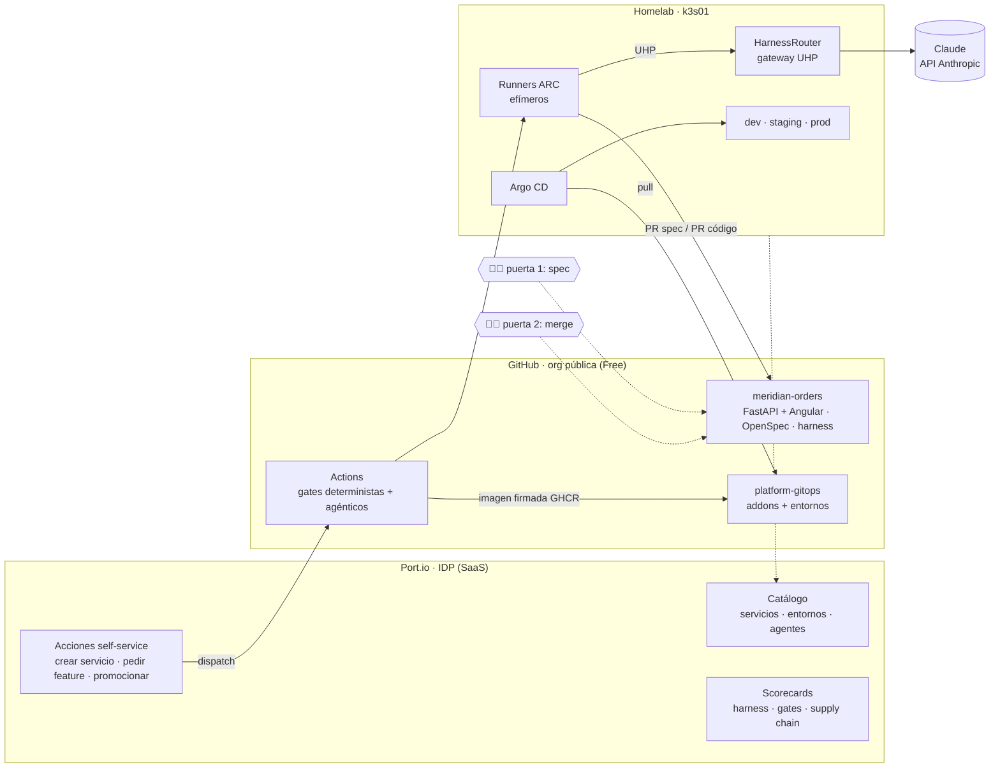
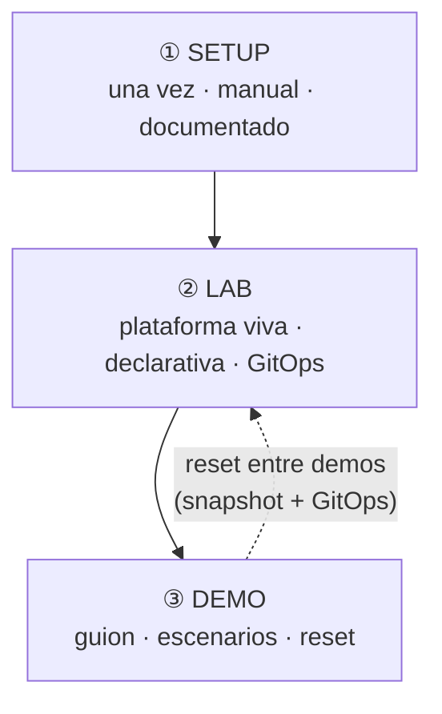

# agentic-platform-lab

> **El modelo ya no es el diferenciador. Lo es la plataforma y la ingeniería que lo rodean.**

Laboratorio real (no *mock*) de **Platform Engineering + AIDLC + Harness Engineering** montado en un
homelab, con dos objetivos:

1. **Aprender y experimentar** con desarrollo agéntico gobernado: AIDLC, *Spec-Driven Development*,
   Harness Engineering, Internal Developer Platform y Enterprise Agent Platform.
2. **Enseñarlo a clientes** de forma creíble: todo lo que se ve en la demo funciona, se puede
   abrir y se puede auditar.



## Cómo está organizado

El laboratorio se separa en **tres capas** que no se mezclan:

| Capa | Qué es | Quién la toca | Dónde |
|---|---|---|---|
| **Setup** | Lo que se hace **una vez** para tener dónde montar el lab: capacidad, VM, k3s, cuentas | Pablo, a mano y paso a paso | [`docs/setup/`](docs/setup/README.md) · [`setup/`](setup/) |
| **Lab** | La plataforma en marcha: GitOps, IDP, harness, gateway de agentes, observabilidad | GitOps (Argo CD) y los agentes, vía PR | [`docs/lab/`](docs/lab/README.md) |
| **Demo** | Lo que se enseña al cliente: guion, escenarios, datos, *reset* | Pablo antes y durante la demo | [`docs/demo/`](docs/demo/README.md) |



## Mapa del repo

```
├── docs/
│   ├── index.md               ← índice de la documentación
│   ├── 00-vision.md           ← objetivos, conceptos y relato para clientes
│   ├── 01-arquitectura.md     ← arquitectura objetivo, flujos y presupuesto de recursos
│   ├── 02-roadmap.md          ← fases, pasos, estado y preguntas abiertas
│   ├── setup/                 ← ① pasos de preparación (paso-00 … paso-NN)
│   ├── lab/                   ← ② componentes de la plataforma (se rellena por fases)
│   ├── demo/                  ← ③ recursos de demo (se rellena al final)
│   └── adr/                   ← decisiones de arquitectura
├── setup/                     ← artefactos de los pasos de setup (Terraform, k3s, Mac)
├── lab.env.example            ← variables del entorno (los valores reales van en lab.env, ignorado)
└── .gitignore
```

## Repos del laboratorio

| Repo | Contenido | Estado |
|---|---|---|
| `agentic-platform-lab` | Este repo: documentación, setup, Port como código, harness corporativo | 🟡 en construcción |
| `meridian-orders` | Monorepo de la aplicación de ejemplo: backend Python (FastAPI) + front Angular, OpenSpec, harness consumido | 🟢 `0.1.0` en dev · staging · prod |
| `platform-gitops` | Estado deseado del clúster: addons de plataforma y entornos `dev/staging/prod` | 🟢 en marcha · puerta `gitops-ok` |

## Estado

Ver [`docs/02-roadmap.md`](docs/02-roadmap.md). **Fases 1 y 2 cerradas** (27-oct): Meridian Orders se construye,
firma y promociona por GitOps a dev, staging y prod ([CI/CD](docs/lab/ci-cd.md)). Siguiente: **F3 · Port**.
Aplazados: Kyverno y cuotas por namespace.

## Reglas de este repo

- **Es público.** Nada de secretos, IP ni dominios del homelab en el repo: van en `lab.env`
  (ignorado por git) y en el repo privado `homelab-terraform`.
- **Todo documentado** en Markdown con diagramas Mermaid. Cada decisión relevante tiene su ADR.
- **Paso a paso:** no se empieza un paso hasta que el anterior está confirmado.

---
*Proyecto personal de aprendizaje. Inspirado en el showcase de Harness Engineering, pero
independiente: no contiene material de ningún cliente ni empleador.*
