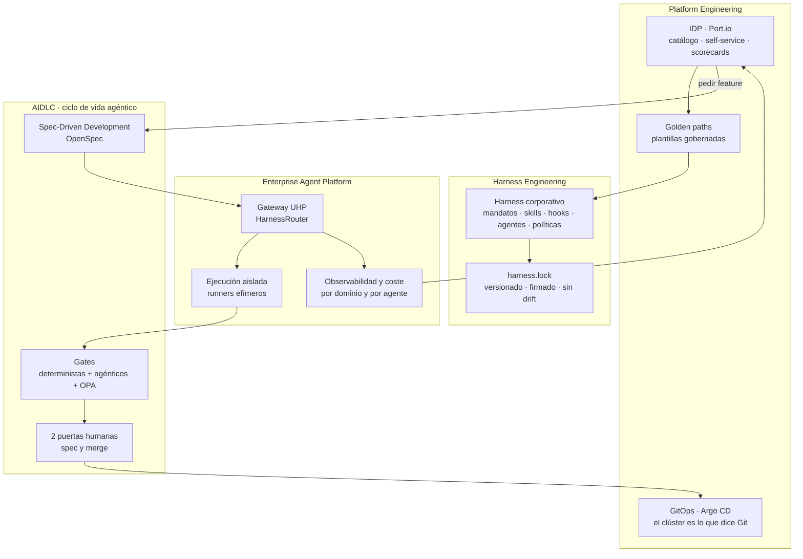
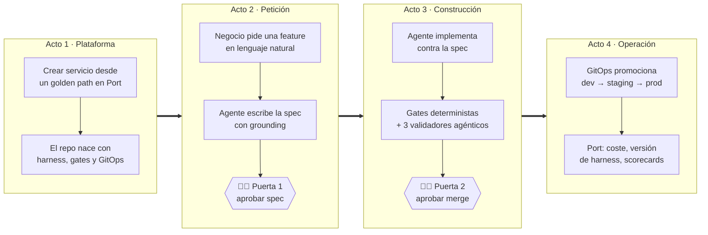

# 00 · Visión

## 1. Para qué existe este laboratorio

| Objetivo | Qué significa en la práctica | Cómo sabremos que lo hemos logrado |
|---|---|---|
| **Aprender** | Montar con las manos cada pieza (IDP, GitOps, harness, gateway de agentes) y entender sus costuras | Cada componente tiene doc, ADR y se puede reconstruir desde cero |
| **Vender** | Enseñar a un cliente, en 30-45 min, un ciclo completo *petición → spec → código → producción* gobernado | El guion de demo funciona de principio a fin sin trucos y se puede resetear en minutos |

La tesis que el laboratorio tiene que demostrar es una:

> Los agentes no escalan en una empresa por ser más listos, sino porque una **plataforma** les da
> contexto, herramientas, límites y trazabilidad. Esa plataforma es la misma que ya necesitaban los
> equipos humanos: un **IDP con golden paths, GitOps y gobierno por defecto**.

## 2. Los conceptos y cómo encajan

| Concepto | Definición de trabajo en este lab | Pieza que lo materializa |
|---|---|---|
| **Platform Engineering** | Producto interno que reduce la carga cognitiva de los equipos ofreciendo caminos pavimentados | Port.io + plantillas + `platform-gitops` |
| **IDP** (*Internal Developer Platform/Portal*) | Punto único para descubrir, crear y operar software; aquí, también agentes | Port.io (catálogo, acciones, scorecards) |
| **Enterprise Agent Platform** | La capa que ofrece agentes como servicio gobernado: identidad, ejecución, herramientas, coste | HarnessRouter (UHP) + runners ARC + observabilidad |
| **Harness Engineering** | Tratar todo lo que rodea al modelo (contexto, herramientas, guardarraíles, evaluación) como **artefacto de ingeniería versionado** | Harness corporativo + `harness.lock` + drift gate |
| **AIDLC** | SDLC donde agentes participan en cada fase, con puertas humanas en las decisiones que importan | Workflows `aidlc-*` + gates |
| **Spec-Driven Development** | La spec se aprueba antes de que exista el código; el código se valida contra la spec | OpenSpec (`openspec/specs`, `openspec/changes`) |
| **UHP** (*Unified Harness Protocol*) | Contrato HTTP abierto (estilo Responses API) para pedir tareas a cualquier harness: Claude Code, Codex… | HarnessRouter CE como servidor UHP |
| **GitOps** | El estado deseado vive en Git; un operador lo reconcilia. Nadie (ni humanos ni agentes) toca el clúster a mano | Argo CD + `platform-gitops` |

## 3. El relato para el cliente

La demo cuenta una historia en cuatro actos, cada uno apoyado en una pieza del lab:

Mensajes clave que cada acto debe dejar claros:

1. **Plataforma:** los equipos no reinventan andamiaje; el gobierno viene de serie.
2. **Petición:** el agente no improvisa: se basa en el corpus corporativo y la spec la aprueba una persona.
3. **Construcción:** la confianza no viene del modelo, sino de *gates* deterministas y validadores independientes.
4. **Operación:** todo es trazable: qué agente, con qué versión del harness, cuánto costó, qué se desplegó.

## 4. Lo que el lab **no** pretende ser

- No es producción: un solo nodo, sin HA, sin SLA.
- No compite con el showcase corporativo: es un entorno personal para aprender y para tener una
  demo que funcione de verdad.
- No depende de licencias de pago: GitHub Free (repos públicos), Port Free, HarnessRouter CE,
  k3s y Argo CD. El único coste variable es el consumo de la API de Claude.

## 5. Stack de referencia

| Capa | Elección | Por qué |
|---|---|---|
| Aplicación de ejemplo | **Meridian Orders**: FastAPI (Python) + Angular | Representativo de los clientes: backend Python, front empresarial |
| SCM y CI | GitHub (org Free, repos públicos) + Actions | Gates bloqueantes reales gratis en repos públicos |
| Registro | GHCR (público) | Integrado con Actions y con la firma de cosign |
| Runtime | k3s de un nodo en una VM de Proxmox | Kubernetes real con huella mínima |
| GitOps | Argo CD *(propuesto, pendiente de confirmar)* | UI muy visual para demos; integración nativa con Port |
| IDP | Port.io (plan Free) | Es el IDP que usa el relato corporativo; SaaS sin mantenimiento |
| Gateway de agentes | HarnessRouter CE (UHP) | Desacopla al cliente del harness concreto: hoy Claude Code, mañana otro |
| Motor de agentes | Claude (API de Anthropic) *(pendiente de confirmar)* | — |
| Observabilidad | OTel → obs-stack existente en docker01 | Reutiliza lo que ya funciona en el homelab |
