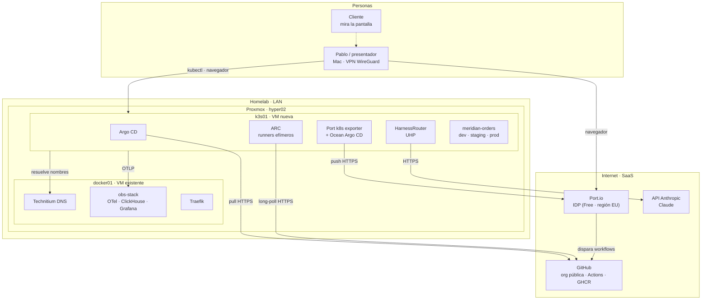
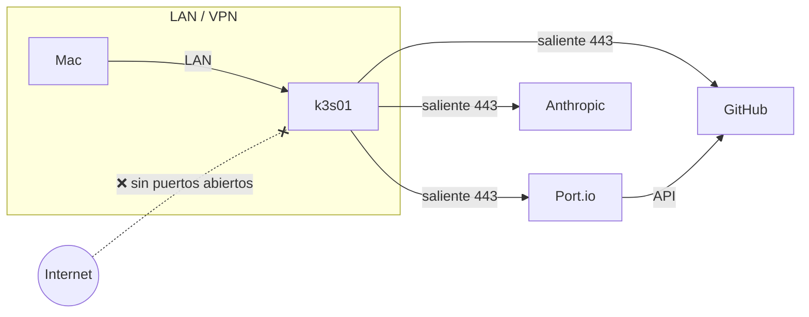
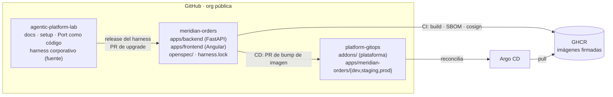
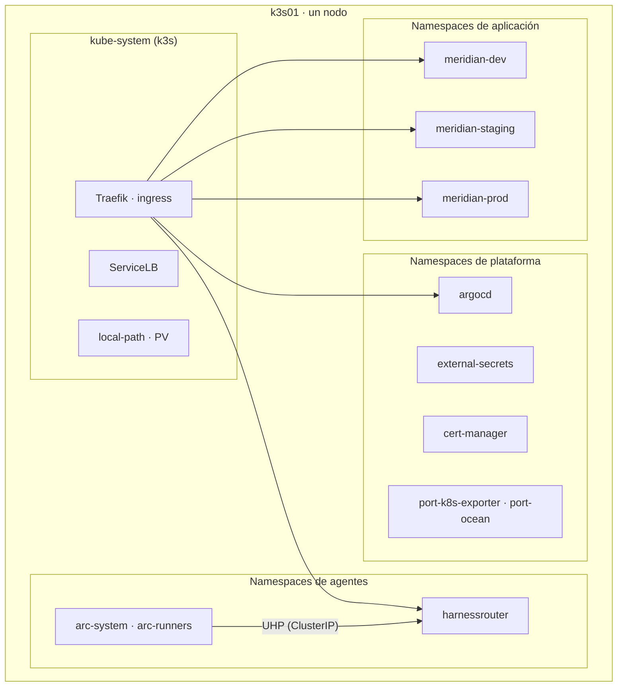
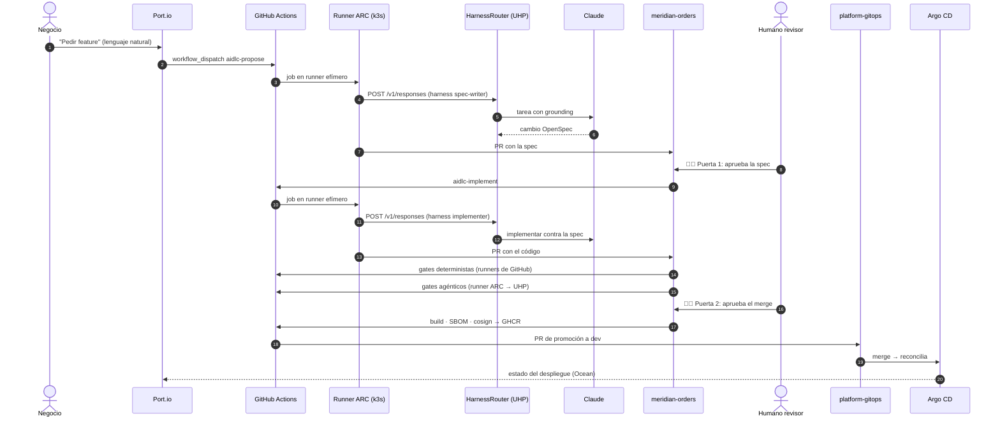
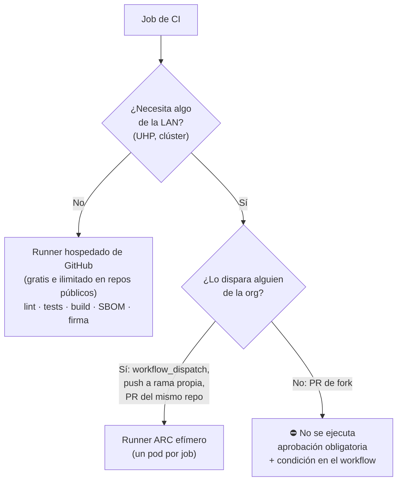
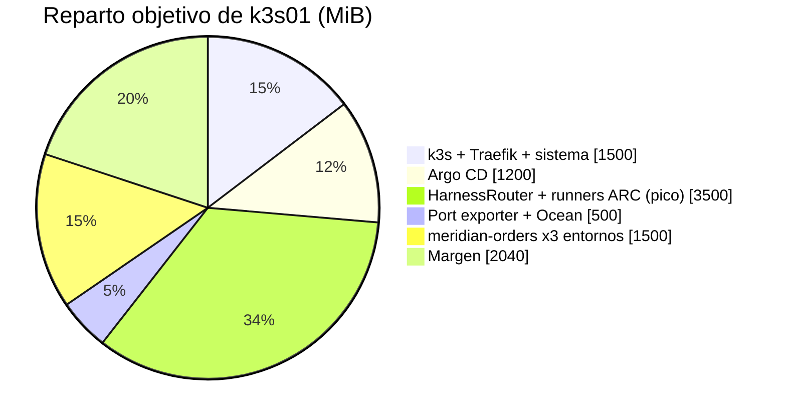

# 01 · Arquitectura objetivo

> Este documento describe **a dónde vamos**. Lo que está construido en cada momento lo marca el
> [roadmap](02-roadmap.md). Las piezas marcadas *(propuesto)* están pendientes de decisión.

## 1. Vista de contexto



**Principio de red: todo sale, nada entra.** Ninguna pieza del homelab necesita estar expuesta a
Internet: Argo CD *tira* de GitHub, los runners ARC hacen *long-poll* a GitHub, el exporter de Port
*empuja* a Port y HarnessRouter *llama* a Anthropic. Port solo habla con GitHub, nunca con el
clúster. La demo se conduce desde el Mac por VPN.



## 2. Repos y responsabilidades



| Repo | Escribe en él | Nunca escribe en él |
|---|---|---|
| `agentic-platform-lab` | Pablo (PR) | Agentes de producto |
| `meridian-orders` | Desarrolladores y agentes AIDLC (siempre por PR) | Argo CD |
| `platform-gitops` | Workflow de CD (PR de promoción) y Pablo | Agentes AIDLC directamente |

> **Por qué el GitOps va aparte:** separa *qué se construye* de *qué se despliega*. Promocionar a
> producción es un PR revisable en otro repo, con otros permisos, y el agente que escribe código no
> tiene forma de tocar lo que corre en el clúster.

## 3. Dentro del clúster



Los entornos son **namespaces** del mismo clúster. Es suficiente para enseñar promoción GitOps y
aislamiento por políticas, y es lo que cabe en un nodo.

## 4. Flujo AIDLC de extremo a extremo



## 5. Dónde corre cada tipo de job

Los repos son públicos y los **runners self-hosted en repos públicos son un riesgo** conocido
(cualquier PR de un fork podría ejecutar código en tu LAN). La regla es:



## 6. Presupuesto de recursos

El host tiene 62,7 GiB de RAM y 24 hilos. docker01 fija su RAM entera en memoria física (VFIO +
virtiofs), así que cada GiB que se le quita es un GiB real para k3s01.

| VM | Antes | Después | Comentario |
|---|---|---|---|
| docker01 | 32 GiB · 12 vCPU | **24 GiB** · 12 vCPU | A validar en el [paso 00](setup/paso-00-capacidad.md) |
| k3s01 | — | **10 GiB · 6 vCPU · 80 GB** | Nuevo |
| Resto (nas01, HA, PBS…) | sin cambios | sin cambios | — |



> Langfuse no entra en este presupuesto. Si lo queremos, irá a docker01 junto al obs-stack o
> esperará a una ampliación de RAM (ver preguntas abiertas en el roadmap).

## 7. Nombres y DNS

Todos los servicios del lab cuelgan de un subdominio propio con *wildcard* hacia k3s01:

```
*.${LAB_SUBDOMAIN}.${LAB_DOMAIN}  →  ${K3S_IP}      (Traefik de k3s)
argocd.${LAB_SUBDOMAIN}.${LAB_DOMAIN}
uhp.${LAB_SUBDOMAIN}.${LAB_DOMAIN}
orders-dev.${LAB_SUBDOMAIN}.${LAB_DOMAIN}  …
```

Los valores reales están en `lab.env` (no versionado). Ver [`lab.env.example`](../lab.env.example).
