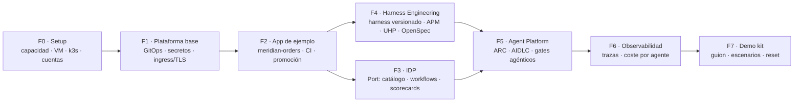
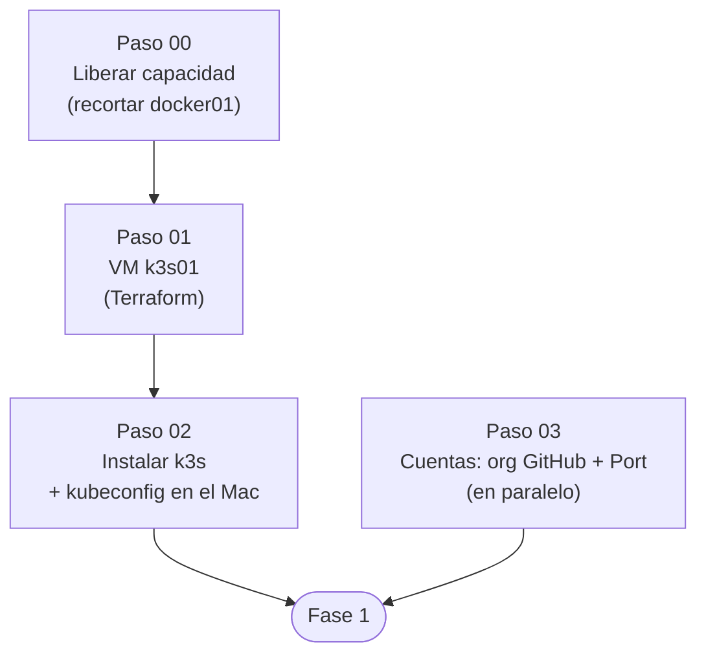
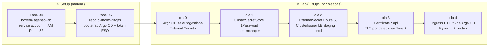

# 02 · Roadmap

> Se avanza **paso a paso**: un paso no empieza hasta que el anterior está confirmado.
> Leyenda: ✅ hecho · 🟡 en curso · ⚪ pendiente · ❓ requiere decisión

## 1. Fases

| Fase | Capa | Objetivo | Estado |
|---|---|---|---|
| F0 | Setup | Tener k3s01 funcionando y las cuentas listas | 🟡 |
| F1 | Lab | El clúster se gestiona solo desde `platform-gitops` | ✅ (salvo Kyverno y cuotas ⏸️) |
| F2 | Lab | Meridian Orders (FastAPI + Angular) se construye, firma y promociona por GitOps | ✅ 27-oct |
| F3 | Lab | Port refleja repos, despliegues y entornos; *self-service* con Workflows operativo | ✅ 28-oct |
| F4 | Lab | El harness corporativo es un producto versionado y firmado, agnóstico del modelo: lo consumen los repos (APM) y el gateway UHP | 🟡 diseñada 28-oct |
| F5 | Lab | Un agente lleva una feature de la petición al PR, a través de UHP, con puertas humanas | ⚪ |
| F6 | Lab | Cada ejecución de agente es trazable y tiene coste visible en Grafana y en Port | 🟡 F6.2 ✅, F6.1 pendiente de una CVE ajena |
| F7 | Demo | Guion de 30-45 min reproducible y *reset* en menos de 10 min | ✅ 13-nov |

## 2. Fase 0 · Setup (detalle)

| Paso | Qué | Doc | Estado |
|---|---|---|---|
| 00 | Medir y recortar docker01 a 24 GiB | [paso-00-capacidad](setup/paso-00-capacidad.md) | ✅ 24 GiB + hugepages 1 GiB + NUMA · ⚠️ falta revisar la reserva de hugepages del host |
| 01a | Plantilla Debian 13 cloud-init (9013) con usuario `pfj` y clave de 1Password | `homelab-terraform/templates/debian13` | ✅ |
| 01 | Crear la VM `k3s01` con Terraform y su DNS | [paso-01-vm-k3s01](setup/paso-01-vm-k3s01.md) | ✅ |
| 02 | Instalar k3s, kubeconfig en el Mac, prueba de humo | [paso-02-k3s](setup/paso-02-k3s.md) | 🟡 k3s `v1.36.5+k3s1` instalado, pods y almacenamiento OK · falta `curl` al ingress y snapshot |
| 03 | Configurar la org GitHub, publicar este repo, crear la org en Port | [paso-03-cuentas](setup/paso-03-cuentas.md) | 🟡 repo publicado y Port listo · falta confirmar ajustes de la org (3.1) y ruleset (3.3) |

## 3. Fases siguientes (borrador, se detallarán al llegar)

### F1 · Plataforma base (decidida el 24-oct)

Argo CD ([ADR 0007](adr/0007-argocd-gitops.md)) · ESO + 1Password ([ADR 0008](adr/0008-secretos-eso-1password.md)) ·
Let's Encrypt DNS-01 en Route 53 ([ADR 0009](adr/0009-tls-letsencrypt-dns01-route53.md)).

| Paso | Capa | Qué | Estado |
|---|---|---|---|
| 04 | Setup | Bóveda `agentic-lab`, service account de 1Password, usuario IAM para DNS-01 | ✅ ([doc](setup/paso-04-secretos-externos.md)) · limpiar tokens viejos de `agentic-lab` |
| 05 | Setup | Repo `platform-gitops`, bootstrap de Argo CD y del token de ESO | ✅ ([doc](setup/paso-05-bootstrap-gitops.md)) |
| — | Lab | Olas -1 a 1: Argo CD autogestionado, External Secrets, `ClusterSecretStore` | ✅ ([argocd](lab/argocd.md) · [secretos](lab/secretos.md)) |
| PR 1 | Lab | Olas 2-3: cert-manager, `ClusterIssuer` LE, comodín `*.apl` en staging, TLS por defecto en Traefik | ✅ #1 ([doc](lab/ingress-tls.md)) |
| PR 2 | Lab | Emisor a prod + Argo CD en `https://argocd.apl.<dominio>` | ✅ #2 |
| — | Lab | Ola 4: Kyverno y cuotas por namespace | ⏸️ **pendiente** (aplazado el 25-oct; se retoma tras F2) |

### F2 · Aplicación de ejemplo (decidida el 25-oct)

Trunk-based + release-please ([ADR 0011](adr/0011-trunk-based-release-please.md)) · promoción por PR en
`platform-gitops` ([ADR 0012](adr/0012-promocion-por-pr-gitops.md)) · PostgreSQL con CloudNativePG
([ADR 0013](adr/0013-postgresql-cloudnativepg.md)) · GitHub App `elpalmeral-platform-bot`
([ADR 0014](adr/0014-github-app-platform-bot.md)). Diseño completo: [lab/meridian-orders](lab/meridian-orders.md).

| Paso | Capa | Qué | Estado |
|---|---|---|---|
| 06 | Setup | GitHub App, repo `meridian-orders` vacío, variable y secreto de org | ✅ ([doc](setup/paso-06-github-app.md)) |
| F2.1 | Lab | Código: FastAPI + Angular 22, OpenSpec de `orders`, Dockerfiles, tests | ✅ PR #1 |
| F2.2 | Lab | CI de PR por rutas, títulos Conventional Commits, release-please | ✅ PR #2 |
| F2.3 | Lab | Publicación: GHCR, SBOM, procedencia, Grype, cosign (reordenado: va antes del despliegue) | ✅ |
| F2.4a | Lab | Despliegue en dev: CloudNativePG + base + overlay dev + ApplicationSet | ✅ `platform-gitops` #3 |
| F2.4b | Lab | CD: PR automáticos de promoción (dev, staging), prod con aprobación y puerta `gitops-ok` ([ADR 0015](adr/0015-puerta-gitops-ok.md), [doc](lab/ci-cd.md)) | ✅ `0.1.0` en los tres entornos |

> La puntuación de riesgo de pedidos **no** entra en F2: se reserva como primera feature AIDLC (F5).

### F3 · IDP con Port (decidida el 27-oct)

Linaje mixto: inventario por integraciones y eventos por los pipelines ([ADR 0016](adr/0016-linaje-mixto-port.md)) ·
modelo como código con Terraform, `plan` en PR y `apply` en `main`, estado en S3 por OIDC
([ADR 0017](adr/0017-port-como-codigo-terraform.md)). Diseño completo: [lab/port](lab/port.md).
Objetivo: el **acto 1** de la [demo](demo/README.md), con un solo servicio real.

| Paso | Capa | Qué | Estado |
|---|---|---|---|
| 07 | Setup | Bucket S3 del estado, rol OIDC, entorno `port` en GitHub, GitHub Ocean sin recursos por defecto | ✅ ([doc](setup/paso-07-port.md)) |
| F3.1 | Lab | Adoptar plantillas ([ADR 0018](adr/0018-adoptar-plantillas-port.md)): importar `environment`/`deployment`/`workload`, crear `build`/`release` · workflow `plan`/`apply` | ✅ PR #1 |
| F3.2 | Lab | *Mapping* de GitHub Ocean como código (repos, `service`, PR, releases, workflows) | ✅ PR #2 |
| F3.3 | Lab | `port-k8s-exporter` como addon de `platform-gitops` → lo que corre ([ADR 0019](adr/0019-exportador-kubernetes-gitops.md)) | ✅ |
| F3.4 | Lab | Linaje con acción de plataforma; despliegue confirmado por Argo CD ([ADR 0020](adr/0020-linaje-accion-plataforma-y-argo.md)): a) aprobado · b) `publish.yml` · c) Argo → webhook | ✅ |
| F3.5 | Lab | Scorecards (cadena de suministro, corre lo aprobado, promoción con puertas) y ficha del acto 1 como código | ✅ |
| F3.6 | Lab | **Promocionar** como Workflow de Port ([ADR 0021](adr/0021-workflows-port-en-lugar-de-acciones.md)): release del catálogo · prod/staging · puerta en GitHub | ✅ PR #8 |

**Backlog:** ADR y reglas de plataforma como entidades del catálogo (decidido el 27-oct: más adelante).

### F4 · Harness Engineering (decidida el 28-oct)

Repo propio `platform-harness` en formatos abiertos ([ADR 0022](adr/0022-harness-repo-propio-formatos-abiertos.md)) ·
distribución con APM y check `harness-ok` ([ADR 0023](adr/0023-apm-distribucion-harness-ok.md)) ·
HarnessRouter en F4 ([ADR 0024](adr/0024-harnessrouter-en-f4-proveedores.md)) · **dos motores**: abierto (UHP con OpenRouter y Bonsai local) y Claude Code con la suscripción, solo en el Mac ([ADR 0025](adr/0025-dos-motores-un-harness.md)).
Diseño completo: [lab/harness](lab/harness.md).

| Paso | Capa | Qué | Estado |
|---|---|---|---|
| 08 | Setup | Repo `platform-harness`, Claude Code con la suscripción, clave de OpenRouter con límite, acceso a Bonsai ([doc](setup/paso-08-harness.md)) | ✅ 11-nov |
| F4.1 | Lab | Contenido `harness-v0.1.0` (APM: instrucciones, skills, agentes, hooks; MCP de Port; corpus; OPA; `uhp/roles.yaml`; CI obligatorio [ADR 0026](adr/0026-ci-obligatorio-platform-harness.md)) | ✅ 13-nov |
| F4.2 | Lab | Release firmada `harness-v0.1.0` (`apm pack` + cosign keyless + GitHub Release, [ADR 0027](adr/0027-release-firmada-platform-harness.md)) | ✅ 13-nov |
| F4.3 | Lab | `meridian-orders` consume el harness (pin por SHA, `harness-v0.1.1`) · `harness-ok` obligatorio ([ADR 0028](adr/0028-excepcion-adopcion-inicial-harness.md)) | ✅ 13-nov |
| F4.4 | Lab | PR automático de *upgrade* del bot, por sondeo ([ADR 0029](adr/0029-pr-automatico-upgrade-harness.md)) | ✅ 13-nov |
| F4.5 | Lab | Motor B de principio a fin en el Mac: `/feature` real (`filtrar-pedidos-por-email`), con un ciclo PROPOSE→IMPLEMENT→validadores→PROPOSE de nuevo tras un hallazgo real de `security-gate` | ✅ 13-nov |
| F4.6 | Lab | HarnessRouter CE en k3s (`StatefulSet`, imagen por digest, [ADR 0030](adr/0030-harnessrouter-ce-despliegue-k3s.md)); sin proveedores todavía | ✅ 13-nov |
| F4.7 | Lab | `harness-sync` a UHP · prueba de humo con OpenRouter y con Bonsai, comparada con el motor B | ✅ 13-nov |
| F4.8 | Lab | Port: versión del harness por servicio y scorecard `harness_governance` (blueprint `harness_status`) | ✅ 13-nov |

**F4.7, detalle** ([ADR 0033](adr/0033-f4-7-harness-sync-prueba-humo.md)): conectadas OpenRouter
(`provider: "openai"` + `base_url`, la forma citada textualmente en la documentación real — no la
nativa `"openrouter"`, sin ejemplo verificado) y Bonsai (base `fast-agent` dedicada, para no
mezclar con los roles reales en `opencode`). Los 5 roles publicados de verdad
(`POST /v1/harnesses`, `uhp/roles.yaml` con `model: gpt-5.4-mini` — `deepseek/deepseek-v3.2` no
existe en el catálogo cerrado real de HarnessRouter, descubierto con un `422` real). Prueba de
humo: OpenRouter respondió coherente con el mandato por **0,0068 $**; Bonsai respondió igual de
coherente, gratis, en ~19 s (un primer dato a favor de Q8, no definitivo: un solo turno, sin
bucle agéntico). `harness-sync` es un script local (`platform-harness/scripts/harness-sync.sh`),
no una GitHub Action: `uhp.apl.elpalmeral.es` no resuelve desde un *runner* de GitHub (el lab es
solo LAN/VPN) y ARC solo está instalado en `meridian-orders` (ADR 0031, de un solo repo a
propósito).

### F5 · Enterprise Agent Platform
- (HarnessRouter CE pasa a F4, [ADR 0024](adr/0024-harnessrouter-en-f4-proveedores.md).)
- ✅ 13-nov · ARC (*Actions Runner Controller*) con runners efímeros para el motor A
  ([ADR 0031](adr/0031-arc-runners-k3s01.md)): `gha-runner-scale-set` 0.15.1 en k3s01, GitHub App
  dedicada de un solo repo (`meridian-orders`), verificado con un *job* real (`arc-smoke-test.yml`,
  *pod* efímero creado, ejecutado y limpiado solo).
- ✅ 13-nov · Workflow de Port «Pedir feature» con selector de **servicio** (entidad del blueprint
  `service`, sin filtro de *dataset*: entra sola cada servicio nuevo del catálogo) y de motor:
  abierto → `dispatch_workflow` de `aidlc-propose.yml` en ARC vía UHP; Claude → `create_issue` con
  etiqueta `aidlc:claude` para `/feature` en el Mac ([ADR 0025](adr/0025-dos-motores-un-harness.md)).
  El repo de destino en ambas ramas se toma del servicio elegido, no de un valor fijo. Verificado
  con tres ejecuciones reales (`trigger_run` vía MCP): motor Claude creó los *issues* reales #38 y
  #39 (cerrados tras confirmar, el segundo probando ya el selector de servicio); motor abierto
  disparó `aidlc-propose.yml` en un runner ARC real y Port reflejó `result: FAILED` con el motivo
  real (`reportWorkflowStatus`) — el mensaje esperado antes de F4.7 (faltaba la clave de API de
  HarnessRouter). **Actualizado 13-nov tras cerrar F4.7**: `aidlc-propose.yml` ya encuentra de
  verdad `meridian/spec-writer` publicado (ejecución real confirmada); sigue sin hacer la llamada
  real a `/v1/responses` ni abrir el PR con el resultado — eso es trabajo posterior, no de F4.7.
  Cada servicio nuevo necesita sus propios `aidlc-propose.yml`/`aidlc-implement.yml` y la etiqueta
  `aidlc:claude`; el workflow no lo comprueba por sí solo.
- ⏭️ Los validadores agénticos trabajan antes del PR; en el CI solo puertas deterministas (agentes en el CI: [playbook](demo/README.md#agentes-en-el-flujo-qué-se-podría-añadir)).
- ✅ 13-nov · Agentes como entidades del catálogo de Port: blueprint `aidlc_agent`, 5 entidades
  (spec-writer, implementer, 3 validadores), foto de `uhp/roles.yaml` — sin sincronización
  automática todavía con los `id` reales que asignó HarnessRouter al publicarlos (F4.7).

### F6 · Observabilidad y coste (ADR 0032)
- ✅ 13-nov · **Sin Langfuse**: se reutiliza el obs-stack real de docker01 (ClickHouse + OTel
  Collector + Grafana + Prometheus), ya probado con ai-stack. Langfuse exige su propia
  infraestructura (Postgres/Redis/ClickHouse/S3) y ya se había descartado una vez por ese motivo.
- 🟡 13-nov · **F6.1** — backend instrumentado con trazas OTel hacia el colector de docker01
  (`http://192.168.0.6:4317`), con un `server_request_hook` que quita la query string
  (`customer_email`, C3) de las trazas — mismo principio que ya protege el log de acceso y los
  errores de SQLAlchemy. Spec aprobada en OpenSpec (`instrumentar-otel-backend`, amplía
  «Operabilidad» de `orders`), código fusionado y la imagen del backend construida y firmada.
  **Pendiente de desplegarse a `meridian-dev`**: la promoción está bloqueada por una CVE crítica
  nueva en la imagen base del frontend (`zlib`, no relacionada), ajena a este cambio — pendiente de
  reintentar cuando la imagen base se reconstruya en origen.
- ✅ 13-nov · **F6.2 cerrado** — blueprint `openrouter_usage` en Port + *workflow* programado
  `openrouter-usage.yml` (lee `GET /v1/key`, solo lectura, no gasta el presupuesto). Dos fallos
  reales encontrados al ejecutarlo de verdad (no al diseñarlo): el JSON de la entidad salía en
  varias líneas y `$GITHUB_OUTPUT` exige un valor por línea (arreglado con `jq -c`); y
  `PORT_CLIENT_ID`/`PORT_CLIENT_SECRET` son secretos del *environment* `port` de GitHub, no del
  repo — sin `environment: port` en el job, `port-entity` no veía nada, sin fallar el *job*
  (comprobado que ese *environment* no tiene reglas de protección, seguro para el *cron* diario).
  **Verificado de verdad vía MCP de Port**: entidad `harnessrouter-k3s01` con `usage: 0.0135`,
  `limit: 10`, `limit_remaining: 9.9865`.
- ⏭️ El puente HarnessRouter → OTel sigue sin construirse: F4.7 (cerrado 13-nov) ya deja
  ejecuciones reales que trazar (`GET /v1/traces/{session}/all`), pero escribir ese *poll* → *push*
  OTLP no se hizo en esta sesión; queda en el *backlog*, no bloqueado.
- ⏭️ *Dashboard* de Grafana dedicado para `meridian-orders`: cambio de `docker01`/
  `homelab-containers`, fuera de alcance de este repo por ahora.

### F7 · Demo kit (ADR 0034)
- ✅ 13-nov · [`docs/demo/guion.md`](demo/guion.md): tres actos minuto a minuto, con lo que es real
  hoy — el acto 2 en directo usa el motor B (único con un ciclo completo probado, F4.5); el motor
  abierto se muestra conectado y con coste real (F4.7), sin fingir un PR autónomo que no existe.
- ✅ 13-nov · [`docs/demo/prompts.md`](demo/prompts.md): peticiones ya ejecutadas de verdad, con
  su resultado real (no hipotético).
- ✅ 13-nov · [`docs/demo/checklist-previo.md`](demo/checklist-previo.md): comprobaciones contra
  el estado real (PR de *release* abierto, `publish.yml` en verde para los dos *apps*, remanente
  de OpenRouter, Bonsai libre).
- ✅ 13-nov · **Corrección real al diseño de octubre**: el *reset* ya NO vuelve al *snapshot*
  `k3s-baseline` de Proxmox — ese *snapshot* es de antes de instalar Argo CD/HarnessRouter/ARC;
  rebobinarlo borraría la plataforma entera. `docs/demo/reset.md` +
  [`scripts/demo-reset.sh`](../scripts/demo-reset.sh) (de solo lectura: lista lo que ensucia una
  demo — *issues*, ramas, cambios de OpenSpec sin archivar, *harnesses* de prueba — y da el
  comando exacto; no borra nada por su cuenta). Al ejecutarlo de verdad encontró un cambio de F6.1
  (`instrumentar-otel-backend`) sin archivar aunque su PR ya estaba fusionado — corregido.
- ✅ 13-nov · [`docs/demo/faq-cliente.md`](demo/faq-cliente.md): preguntas habituales con un hecho
  real detrás de cada respuesta, no una afirmación de folleto.

### Golden path · crear un servicio nuevo (D1, ADR 0035, en marcha)

Petición explícita (14-nov): repo listo para AIDLC/harness + despliegue en k3s01 + autoservicio en
Port, hoy con una sola opción de frontend/backend/*runtime*. Investigación real (tres
exploraciones en paralelo) antes de diseñar nada; decisiones con el usuario antes de escribir
código (plan formal, `EnterPlanMode`): namespace independiente por servicio (sin el prefijo
`meridian-`, que resultó específico de "Orders"), GitHub App dedicada `elpalmeral-scaffolder`
(`Administration: write` de organización, primera credencial del lab con ese alcance) para crear
repos, Cookiecutter (la herramienta) para plantillar — no la *action* `cookiecutter-gha` de Port,
que exige un PAT personal (incompatible con ADR 0027).

- ✅ 14-nov · **Hito 1**: [ADR 0035](adr/0035-golden-path-crear-servicio.md).
- ✅ 14-nov · **Hito 2**: generalizados `platform-gitops/scripts/validate.sh`,
  `scripts/port-lineage.sh` y el *mapping* de `addons/port-k8s-exporter.yaml` a cualquier servicio
  bajo `apps/<servicio>/` (antes, los tres estaban cableados a `meridian-orders`). Verificado de
  verdad contra el cluster real: tras fusionar y forzar la sincronización de Argo CD (`root` no
  había recogido el commit sin refresh forzado — incidencia ya conocida), la entidad `workload`
  real de `meridian-orders` en Port sigue exacta (mismo `identifier`/`título` que antes del
  cambio). Única excepción documentada en el propio *mapping*: el namespace real de
  `meridian-orders` quedó como `meridian-<entorno>` (corto, de antes de esta decisión) — no se
  migra un namespace en vivo (perdería la base de datos) solo para generalizar un *mapping*;
  servicios nuevos usan `<servicio>-<entorno>` sin ese prefijo.
- ✅ 14-nov · **Hito 3**: [`elpalmeral-org/service-template`](https://github.com/elpalmeral-org/service-template)
  (Cookiecutter, derivado de `meridian-orders` sin el dominio de pedidos: esqueleto que arranca y
  pasa `/healthz`/`/readyz`/`/metrics`, sin ninguna entidad de negocio). Hallazgo real durante la
  construcción: el delimitador de Jinja por defecto (`{{ }}`) choca con `${{ }}` de GitHub Actions,
  la interpolación de Angular y los nodos hexagonales de Mermaid — las tres cosas conviven en este
  repo. Se cambió el delimitador a `<<= =>>` (`_jinja2_env_vars` en `cookiecutter.json`), verificado
  con un render real local y otro real contra GitHub: `ruff format/check`, `mypy`, `pytest`
  (12 tests, 90 % cobertura), `eslint`, `prettier`, `vitest`, `ng build` — todos en verde, sin
  ningún `meridian`/`orders` residual salvo el paquete Rego compartido `data.meridian.pr_gates`.
  Un *hook* `post_gen_project.sh` genera `uv.lock`/`package-lock.json` reales (nunca por *sed*, que
  corrompería los *hashes*).
- 🟡 14-nov · **Hito 4** (pausa para confirmar): Pablo creó la GitHub App `elpalmeral-scaffolder`
  y el *item* en 1Password con su `private_key` real. **Hallazgo real pendiente de resolver**: la
  App todavía no está **instalada** en `elpalmeral-org` (no aparece en
  `GET /orgs/elpalmeral-org/installations`) — crear la App y instalarla son dos pasos distintos.
  Para crear repos necesita instalación con alcance **"todos los repositorios"** (no puede
  preseleccionar uno que aún no existe), y para el primer *push* del esqueleto necesita además
  **`Contents: write`** — ADR 0035 solo pedía `Administration: write`, insuficiente para el flujo
  real que construye `crear-servicio.yml` (crear repo + empujar contenido + *ruleset*).
- ✅ 14-nov · **Hito 5**: [`crear-servicio.yml`](https://github.com/elpalmeral-org/agentic-platform-lab/blob/main/.github/workflows/crear-servicio.yml)
  en `agentic-platform-lab`, con la plantilla nueva `golden-path/platform-gitops-template/`
  (`apps/__SERVICE_SLUG__/`, `addons/__SERVICE_SLUG__.yaml`). Misma pieza para Port (hito 6) y
  para una persona (`workflow_dispatch`). **Corrección real encontrada y arreglada en el propio
  `validate.sh`** (hito 2): trataba "cero entornos activos" como error — pero un servicio recién
  creado nace así a propósito (los tres comentados en su `ApplicationSet`, sin promoción todavía);
  además un `grep` sin coincidencias rompía el script bajo `set -e` antes de llegar a ese chequeo.
  Verificado con un servicio de prueba real (cero entornos activos, `kustomize build` con imágenes
  de prueba) y con `meridian-orders` (sin regresión); PR #27 con `gitops-ok` en verde, fusionado.
  Pendiente para hito 7: instalar la App (ver hito 4) y los secretos de organización
  `SCAFFOLDER_CLIENT_ID`/`SCAFFOLDER_PRIVATE_KEY`.
- ⏭️ Hito 6: *workflow* «Crear servicio» en Port (Terraform).
- ⏭️ Hito 7 (**pausa para confirmar**): primera ejecución real — crea un repo real, abre un PR
  real en `platform-gitops`.

## 4. Preguntas abiertas

Se plantearán **cuando haga falta decidirlas**, no antes.

| # | Pregunta | Se decide en | Propuesta inicial |
|---|---|---|---|
| Q1 | ¿Argo CD o Flux? | F1 | ✅ **Argo CD** (ADR 0007) |
| Q2 | ¿Secretos con ESO + 1Password o con Sealed Secrets? | F1 | ✅ **ESO + 1Password** (ADR 0008) |
| Q3 | ¿TLS con Let's Encrypt (DNS-01) o CA interna? | F1 | ✅ **Let's Encrypt DNS-01 en Route 53** (ADR 0009) |
| Q4 | ¿El motor de agentes sigue siendo solo Claude por API? | F5 | Sí, con un *workspace* dedicado y límite de gasto |
| Q5 | ¿Usamos los agentes de IA de Port con tu propia clave LLM? | F3/F5 | A evaluar con el límite de uso del plan Free |
| Q6 | ¿Langfuse sí o no? ¿Dónde? | F6 | En docker01 si cabe; si no, solo obs-stack |
| Q7 | ¿Ampliar RAM del P500 con el presupuesto de 2026? | Tras F2 | Según el consumo real medido |

## 5. Registro de avance

| Fecha | Hito |
|---|---|
| 2026-10-23 | Arranque: visión, arquitectura, ADR 0001-0006 y pasos 00-03 documentados |
| 2026-10-24 | Paso 00: docker01 a 24 GiB con hugepages de 1 GiB y NUMA (a mano); `homelab-terraform` alineado sin drift |
| 2026-10-24 | Paso 01a: plantilla Debian 13 cloud-init (9013) · Paso 01: VM k3s01 creada con Terraform |
| 2026-10-24 | Paso 02: k3s `v1.36.5+k3s1` en marcha; línea base del nodo 75-93m CPU y 752 MiB (8 %) |
| 2026-10-24 | Paso 03: repo publicado en la org; org de Port creada y credenciales en 1Password · F1 decidida (ADR 0007-0009) |
| 2026-10-24 | Paso 04: bóveda `agentic-lab`, service account de solo lectura y usuario IAM de Route 53 verificados (✅ ✅ ⛔) · `platform-gitops` preparado (Argo CD 10.10.5, ESO 2.13.0) |
| 2026-10-24 | Paso 05: Argo CD autogestionado, ESO y `ClusterSecretStore` sanos (incidencia: token con `\n` por `op read` sin `-n`) · PR 1 de TLS preparado · ADR 0010 |
| 2026-10-25 | PR 1 de TLS fusionado (comodín staging OK) · PR 2 preparado · Kyverno/cuotas aplazados · F2 decidida (ADR 0011-0014) |
| 2026-10-26 | F2.1-F2.3: código, CI de PR, release-please y publicación firmada en GHCR (lección: CVE críticas de Alpine en el front) |
| 2026-10-27 | F2.4a: Meridian Orders en `orders-dev` solo por GitOps (CNPG sano, migración aplicada, API `0.1.0 · dev`) · ADR 0015 |
| 2026-10-28 | F3.5: tres scorecards en Terraform (todo Gold salvo dev en Silver, por diseño) y ficha del servicio diseñada en la UI e importada (`port_page` beta) |
| 2026-10-28 | F3.4c: Argo CD confirma los despliegues en Port (webhook saliente, URL solo en 1Password). Incidencias: título de webhook > 30 caracteres; anotaciones de suscripción con valor vacío no llegaban desde el ApplicationSet |
| 2026-10-27 | F3.1: modelo de Port aplicado desde CI por OIDC (incidencia: el repo usa *sujetos inmutables* en el token OIDC) · F3.2: GitHub Ocean con *mapping* como código (37 PR, 106 ejecuciones) · F3.4a: linaje de lo aprobado; los 6 `workload` con `in_sync=true` y firma verificada por la plataforma · F3.3: exportador de Kubernetes en `k3s01` (RBAC mínimo; 6 `workload` con la imagen en ejecución) |
| 2026-10-27 | F3 decidida: demo en tres actos (B → D → cierre), linaje mixto, Port en Terraform (ADR 0016-0017) · paso 07 preparado |
| 2026-10-27 | F2.4b: CD en marcha. Dev automático (bot #5 y #6 con auto-merge), staging `0.1.0` (#7 + alta #8) y prod `0.1.0` con aprobación del entorno (#9 + alta #10). Incidencias: carrera tag/firma en la release y error OIDC transitorio en `cosign sign` (corregidas). **Fase 2 cerrada** |
