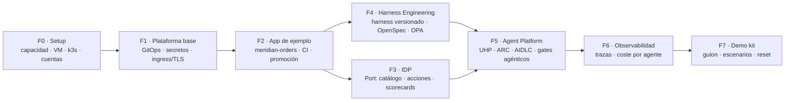
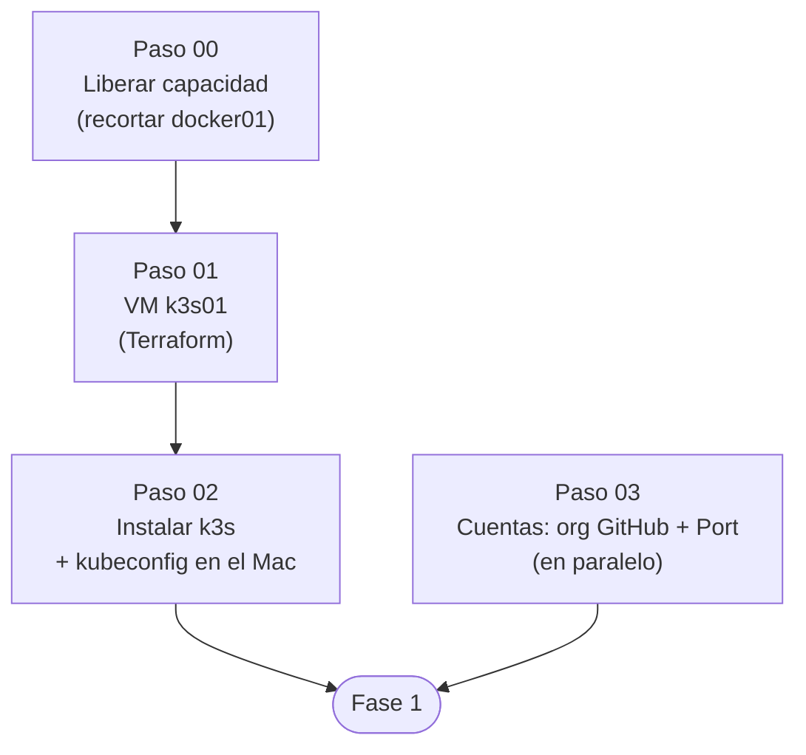
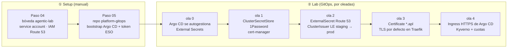

# 02 · Roadmap

> Se avanza **paso a paso**: un paso no empieza hasta que el anterior está confirmado.
> Leyenda: ✅ hecho · 🟡 en curso · ⚪ pendiente · ❓ requiere decisión

## 1. Fases

| Fase | Capa | Objetivo | Estado |
|---|---|---|---|
| F0 | Setup | Tener k3s01 funcionando y las cuentas listas | 🟡 |
| F1 | Lab | El clúster se gestiona solo desde `platform-gitops` | ⚪ |
| F2 | Lab | Meridian Orders (FastAPI + Angular) se construye, firma y promociona por GitOps | ⚪ |
| F3 | Lab | Port refleja repos, despliegues y entornos; acciones *self-service* operativas | ⚪ |
| F4 | Lab | El harness corporativo es un artefacto versionado que el repo de la app consume | ⚪ |
| F5 | Lab | Un agente lleva una feature de la petición al PR, a través de UHP, con puertas humanas | ⚪ |
| F6 | Lab | Cada ejecución de agente es trazable y tiene coste visible en Grafana y en Port | ⚪ |
| F7 | Demo | Guion de 30-45 min reproducible y *reset* en menos de 10 min | ⚪ |

## 2. Fase 0 · Setup (detalle)

| Paso | Qué | Doc | Estado |
|---|---|---|---|
| 00 | Medir y recortar docker01 a 24 GiB | [paso-00-capacidad](setup/paso-00-capacidad.md) | ✅ 24 GiB + hugepages 1 GiB + NUMA · ⚠️ falta revisar la reserva de hugepages del host |
| 01a | Plantilla Debian 13 cloud-init (9013) con usuario `pfj` y clave de 1Password | `homelab-terraform/templates/debian13` | ✅ |
| 01 | Crear la VM `k3s01` con Terraform y su DNS | [paso-01-vm-k3s01](setup/paso-01-vm-k3s01.md) | ✅ |
| 02 | Instalar k3s, kubeconfig en el Mac, prueba de humo | [paso-02-k3s](setup/paso-02-k3s.md) | 🟡 k3s `v1.36.5+k3s1` instalado, pods y almacenamiento OK · falta `curl` al ingress y snapshot |
| 03 | Configurar la org GitHub, publicar este repo, crear la org en Port | [paso-03-cuentas](setup/paso-03-cuentas.md) | 🟡 repo publicado y Port listo · falta confirmar ajustes de la org (3.1) y ruleset (3.3) |

## 3. Fases siguientes (borrador, se detallarán al llegar)

### F1 · Plataforma base (decidida el 24-oct)

Argo CD ([ADR 0007](adr/0007-argocd-gitops.md)) · ESO + 1Password ([ADR 0008](adr/0008-secretos-eso-1password.md)) ·
Let's Encrypt DNS-01 en Route 53 ([ADR 0009](adr/0009-tls-letsencrypt-dns01-route53.md)).

| Paso | Capa | Qué | Estado |
|---|---|---|---|
| 04 | Setup | Bóveda `agentic-lab`, service account de 1Password, usuario IAM para DNS-01 | ✅ ([doc](setup/paso-04-secretos-externos.md)) · limpiar tokens viejos de `agentic-lab` |
| 05 | Setup | Repo `platform-gitops`, bootstrap de Argo CD y del token de ESO | ✅ ([doc](setup/paso-05-bootstrap-gitops.md)) |
| — | Lab | Olas -1 a 1: Argo CD autogestionado, External Secrets, `ClusterSecretStore` | ✅ ([argocd](lab/argocd.md) · [secretos](lab/secretos.md)) |
| PR 1 | Lab | Olas 2-3: cert-manager, `ClusterIssuer` LE, comodín `*.apl` en staging, TLS por defecto en Traefik | 🟡 **siguiente** ([doc](lab/ingress-tls.md)) |
| PR 2 | Lab | Emisor a prod + Argo CD en `https://argocd.apl.<dominio>` | ⚪ |
| — | Lab | Ola 4: Kyverno y cuotas por namespace | ⚪ |

### F2 · Aplicación de ejemplo
- Monorepo `meridian-orders`: `apps/backend` (FastAPI, uv, ruff, mypy, pytest) y `apps/frontend` (Angular, ESLint, Vitest/Jest).
- CI en runners de GitHub: lint, tests, build, SBOM (Syft), escaneo (Grype), firma (cosign *keyless*).
- CD por PR de *bump* en `platform-gitops`; promoción dev → staging → prod con entornos de GitHub y aprobación.

### F3 · IDP con Port
- Integración GitHub (app de Port), exporter de Kubernetes y Ocean para Argo CD.
- *Blueprints* como código en este repo: `service`, `environment`, `deployment`, `harness`, `agent`, `agent_run`.
- Acciones: crear servicio desde plantilla, pedir feature (AIDLC), promocionar.
- Scorecards: versión del harness al día, gates en verde, imagen firmada, SBOM presente.

### F4 · Harness Engineering
- Harness corporativo: `AGENTS.md`/`CLAUDE.md`, skills, hooks deterministas, agentes validadores, corpus de grounding, políticas OPA.
- Versionado y firma; `harness.lock` en la app y *drift gate*.
- OpenSpec como contrato de SDD.

### F5 · Enterprise Agent Platform
- HarnessRouter CE en k3s (manifiestos propios: no hay chart oficial).
- ARC (*Actions Runner Controller*) con runners efímeros.
- Workflows `aidlc-propose` y `aidlc-implement`; 3 validadores agénticos en cada PR.
- Agentes como entidades del catálogo de Port.

### F6 · Observabilidad
- OTel desde HarnessRouter, runners y app hacia el obs-stack de docker01.
- Coste y tokens por dominio, agente y versión de harness; reflejo en Port.

### F7 · Demo kit
- Guion, prompts, escenarios (feature feliz, spec rechazada, gate que bloquea, rollback).
- *Reset*: snapshot de k3s01 + Argo CD + limpieza de PR/ramas.

## 4. Preguntas abiertas

Se plantearán **cuando haga falta decidirlas**, no antes.

| # | Pregunta | Se decide en | Propuesta inicial |
|---|---|---|---|
| Q1 | ¿Argo CD o Flux? | F1 | ✅ **Argo CD** (ADR 0007) |
| Q2 | ¿Secretos con ESO + 1Password o con Sealed Secrets? | F1 | ✅ **ESO + 1Password** (ADR 0008) |
| Q3 | ¿TLS con Let's Encrypt (DNS-01) o CA interna? | F1 | ✅ **Let's Encrypt DNS-01 en Route 53** (ADR 0009) |
| Q4 | ¿El motor de agentes sigue siendo solo Claude por API? | F5 | Sí, con un *workspace* dedicado y límite de gasto |
| Q5 | ¿Usamos los agentes de IA de Port con tu propia clave LLM? | F3/F5 | A evaluar con el límite de uso del plan Free |
| Q6 | ¿Langfuse sí o no? ¿Dónde? | F6 | En docker01 si cabe; si no, solo obs-stack |
| Q7 | ¿Ampliar RAM del P500 con el presupuesto de 2026? | Tras F2 | Según el consumo real medido |

## 5. Registro de avance

| Fecha | Hito |
|---|---|
| 2026-10-23 | Arranque: visión, arquitectura, ADR 0001-0006 y pasos 00-03 documentados |
| 2026-10-24 | Paso 00: docker01 a 24 GiB con hugepages de 1 GiB y NUMA (a mano); `homelab-terraform` alineado sin drift |
| 2026-10-24 | Paso 01a: plantilla Debian 13 cloud-init (9013) · Paso 01: VM k3s01 creada con Terraform |
| 2026-10-24 | Paso 02: k3s `v1.36.5+k3s1` en marcha; línea base del nodo 75-93m CPU y 752 MiB (8 %) |
| 2026-10-24 | Paso 03: repo publicado en la org; org de Port creada y credenciales en 1Password · F1 decidida (ADR 0007-0009) |
| 2026-10-24 | Paso 04: bóveda `agentic-lab`, service account de solo lectura y usuario IAM de Route 53 verificados (✅ ✅ ⛔) · `platform-gitops` preparado (Argo CD 10.10.5, ESO 2.13.0) |
| 2026-10-24 | Paso 05: Argo CD autogestionado, ESO y `ClusterSecretStore` sanos (incidencia: token con `\n` por `op read` sin `-n`) · PR 1 de TLS preparado · ADR 0010 |
