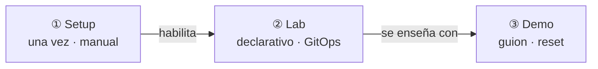

# ADR 0001 · Repo nuevo y separación setup · lab · demo

- **Estado:** Aceptada · 2026-10-23

## Contexto

Existe un diseño previo, `platform-harness-lab` (Backstage + docker01/Portainer), que no llegó a
desplegarse. El nuevo enfoque cambia piezas centrales: Port en lugar de Backstage, k3s y GitOps en
lugar de Portainer y front Angular. Además, el lab se va a enseñar a clientes, así que conviene que
el repo cuente una historia limpia.

## Decisión

1. Repo **nuevo** `agentic-platform-lab`. El anterior queda como referencia; se pueden portar
   piezas concretas (harness, cliente UHP, políticas OPA) cuando llegue su fase, revisándolas.
2. La documentación y los artefactos se separan en **tres capas**:

## Consecuencias

- ✅ El cliente ve un repo coherente, sin restos de otra arquitectura.
- ✅ Se sabe siempre qué es preparación (manual) y qué es plataforma (reproducible).
- ⚠️ Hay trabajo ya hecho que se rehará; se mitiga portando lo reutilizable fase a fase.
