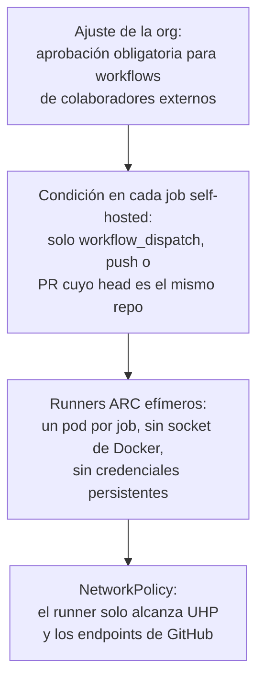

# ADR 0002 · Repos públicos en una org GitHub Free

- **Estado:** Aceptada · 2026-10-23

## Contexto

En GitHub Free, los repos **privados** no tienen *rulesets*, protección de ramas, ni entornos con
revisores obligatorios. Sin eso, los gates solo pueden avisar y la demo de gobierno pierde fuerza.
En repos **públicos** todo eso es gratis, igual que los minutos de Actions en runners hospedados.

## Decisión

Todos los repos del lab son **públicos** en la org GitHub Free. El contenido es ficticio (Meridian
Orders) y propio.

## Consecuencias

- ✅ Gates que **bloquean de verdad**, entornos con aprobación y GHCR público, sin pagar.
- ✅ El lab sirve como portfolio: se puede enseñar el repo sin pantalla compartida.
- ⚠️ **Higiene de datos:** nada del homelab en los repos (IP, dominios internos, nombres de
  máquinas en ejemplos ejecutables). Se usan variables (`lab.env`, ignorado) y el repo privado
  `homelab-terraform` para la infraestructura concreta.
- ⚠️ **Runners self-hosted en repos públicos:** un PR desde un fork podría ejecutar código en la
  LAN. Mitigaciones obligatorias:

- ⚠️ Nada de material de cliente o de empleador en los repos.
