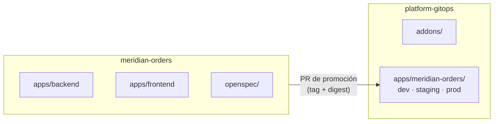

# ADR 0004 · Monorepo de aplicación y repo GitOps aparte

- **Estado:** Aceptada · 2026-10-23

## Contexto

La app de ejemplo tiene backend Python y front Angular. Hay que decidir cómo se reparten código y
estado de despliegue entre repos.

## Decisión

- **`meridian-orders`**: monorepo con `apps/backend` (FastAPI) y `apps/frontend` (Angular), la spec
  (OpenSpec) y el harness consumido (`harness.lock`). Una feature que toca back y front es **un solo
  cambio OpenSpec y un solo PR**, que es lo que mejor se entiende en una demo AIDLC.
- **`platform-gitops`**: estado deseado del clúster (addons de plataforma y entornos de la app).

## Consecuencias

- ✅ Separación clara entre *qué se construye* y *qué se despliega*; permisos distintos.
- ✅ La promoción es un PR auditable; el agente que escribe código no toca el clúster.
- ⚠️ El CI del monorepo debe filtrar por rutas (no reconstruir el front si solo cambia el back).
- ⚠️ En Port, back y front se modelan como **dos componentes** del mismo sistema, aunque compartan repo.
