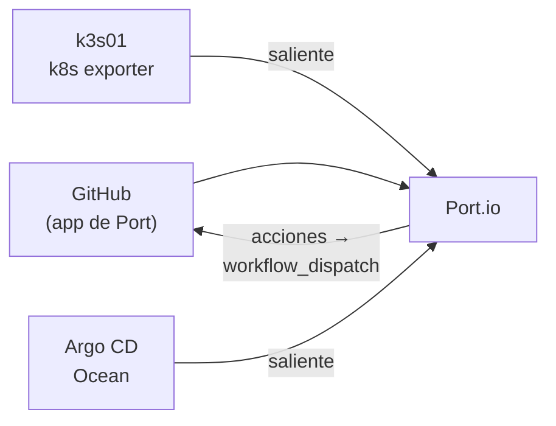

# ADR 0005 · Port.io (Free) como IDP

- **Estado:** Aceptada · 2026-10-23

## Contexto

El diseño anterior usaba Backstage (autoalojado, ~2 GiB de RAM, mantenimiento de un monorepo
Node). El relato comercial de Harness Engineering usa Port como IDP.

Plan Free de Port (consultado el 2026-10-23, conviene revalidar): hasta 15 asientos, 10K
entidades, ~400-500 ejecuciones de automatización, agentes de IA con tu propio LLM y uso limitado,
sin SLA y soporte de comunidad.

## Decisión

Port.io SaaS en plan Free como IDP. Su modelo (*blueprints*, acciones, scorecards) se gestiona
**como código** desde este repo.

## Consecuencias

- ✅ Cero RAM en el homelab y cero mantenimiento del portal.
- ✅ Coherente con el discurso que se lleva a clientes.
- ✅ Todo el tráfico sale del homelab; no hay que exponer nada.
- ⚠️ Límite de ~400-500 *runs*: hay que contar acciones y automatizaciones por demo.
- ⚠️ Dependencia de un SaaS: si Port cambia el plan Free, el lab se resiente. Mitigación: modelo
  como código, reaplicable en otra cuenta.
