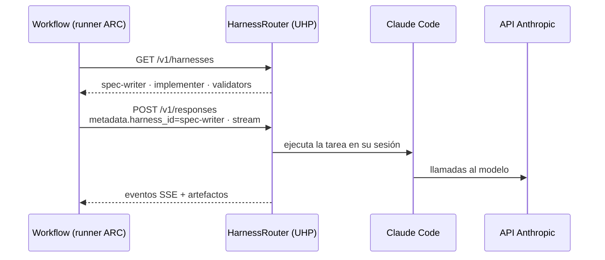

# ADR 0006 · UHP con HarnessRouter CE como gateway de agentes

- **Estado:** Aceptada · 2026-10-23

## Contexto

Queremos que los workflows AIDLC no dependan de un harness concreto (Claude Code hoy, Codex u otro
mañana). El [Unified Harness Protocol](https://unifiedharnessprotocol.org/) define un contrato HTTP
abierto (Apache-2.0, versión de spec 2026-10-19, en borrador) compatible con la Responses API:
`GET /v1/harnesses`, `POST /v1/responses`, sesiones, *streaming* por SSE, ficheros y errores
estructurados. [HarnessRouter](https://github.com/HarnessRouter/harnessrouter) CE es una
implementación autoalojada (Console + Gateway + Runner en un contenedor).

## Decisión

HarnessRouter CE desplegado en k3s01 como **único punto de entrada** de los agentes. Los workflows
seleccionan el harness por `metadata.harness_id` (p. ej. `spec-writer`, `implementer`,
`security-gate`), y cada harness personalizado fija modelo, instrucciones, herramientas MCP y skills.

## Consecuencias

- ✅ Cambiar de harness es configuración, no reescribir workflows: argumento fuerte contra el *lock-in*.
- ✅ Las claves de proveedor viven solo en HarnessRouter, no en los runners.
- ⚠️ No hay chart de Helm ni guía de Kubernetes: escribiremos los manifiestos (y es material de demo).
- ⚠️ Spec en borrador: fijar imagen por *digest* y revisar cambios de versión.
- ⚠️ La configuración de harnesses se hace en la Console: habrá que buscar cómo versionarla
  (exportación/API) para no perder el principio de *todo como código*.
