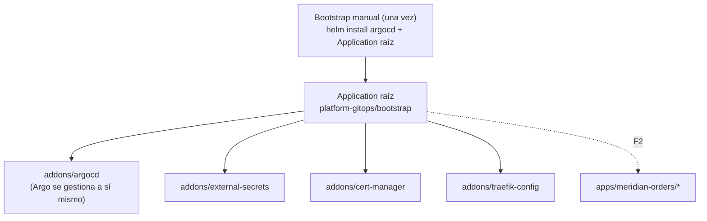

# ADR 0007 · Argo CD como motor GitOps

- **Estado:** Aceptada · 2026-10-24

## Contexto

El clúster tiene que gestionarse solo desde `platform-gitops`: ni humanos ni agentes aplican
manifiestos a mano. Opciones: Argo CD o Flux.

| | Argo CD | Flux |
|---|---|---|
| UI | Sí, muy visual (árbol de recursos, diff, historial) | No (terceros) |
| Integración con Port | Ocean de Argo CD (nativa) | Exporter genérico |
| RAM aproximada | ~1 GiB | ~300 MiB |
| Familiaridad en clientes | Muy alta | Alta |

## Decisión

**Argo CD**, con el patrón *app-of-apps*: una única `Application` raíz instalada a mano (bootstrap)
que despliega todo lo demás, **incluido el propio Argo CD**.

## Consecuencias

- ✅ La demo enseña el estado del clúster en directo y la sincronización tras cada merge.
- ✅ Port refleja aplicaciones y despliegues vía Ocean (F3).
- ⚠️ ~1 GiB de RAM: entra en el presupuesto de k3s01 (sección 6 de la arquitectura).
- ⚠️ El bootstrap es el único paso imperativo; queda documentado y es reproducible.
