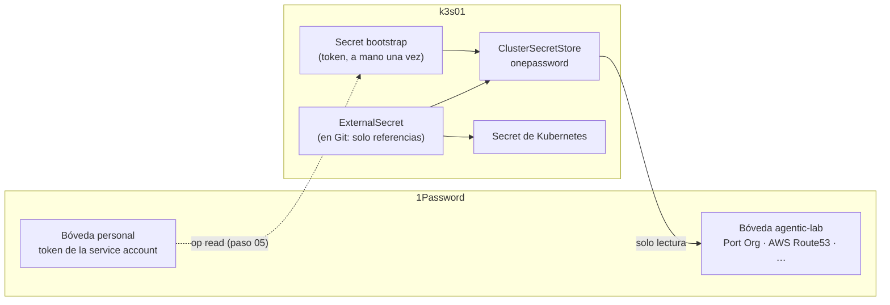

# ADR 0008 · Secretos con External Secrets Operator y 1Password

- **Estado:** Aceptada · 2026-10-24

## Contexto

El lab necesita secretos (credenciales de Port, de AWS para DNS-01, una GitHub App, la clave de
Anthropic…) y los repos son **públicos**: ningún secreto, ni siquiera cifrado, debería vivir en
Git si se puede evitar. 1Password ya es el gestor de secretos de Pablo.

## Decisión

- **External Secrets Operator (ESO)** con el proveedor de 1Password por **service account**
  (sin servidor Connect).
- Una bóveda dedicada **`agentic-lab`** con solo lo que el clúster necesita. La service account
  tiene **solo lectura** sobre esa bóveda y nada más.
- El **único secreto creado a mano** en el clúster es el token de esa service account (bootstrap).

## Consecuencias

- ✅ En Git solo hay **referencias** (`op://agentic-lab/Port Org/…`), nunca valores.
- ✅ Rotar un secreto es cambiarlo en 1Password; ESO lo resincroniza.
- ✅ Buen material de demo: "los agentes nunca ven un secreto en claro".
- ⚠️ Las service accounts no acceden a la bóveda personal: hay que mover a `agentic-lab` los
  elementos que use el clúster (por ejemplo, `Port Org`).
- ⚠️ Dependencia de la disponibilidad de 1Password y de sus límites de peticiones: intervalos de
  refresco largos (1 h).
- ⚠️ Si el plan de 1Password no permitiera service accounts, la alternativa es SOPS + age.
