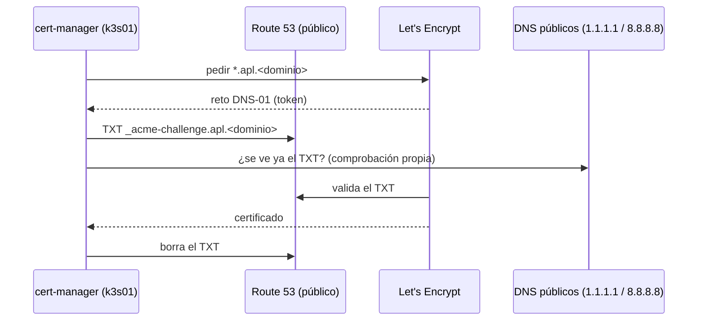

# ADR 0009 · TLS con Let's Encrypt por DNS-01 en Route 53

- **Estado:** Aceptada · 2026-10-24

## Contexto

Los servicios del lab (`*.apl.<dominio>`) solo son accesibles desde la LAN/VPN, pero en una demo
a cliente un aviso de certificado resta credibilidad. El dominio público está en **AWS Route 53**;
dentro de casa, Technitium sirve la misma zona (DNS de horizonte dividido).

## Decisión

- **cert-manager** con un `ClusterIssuer` ACME de Let's Encrypt y reto **DNS-01 en Route 53**.
- Un **certificado comodín** `*.apl.<dominio>` que Traefik usa por defecto para todos los ingress.
- Usuario IAM dedicado con permisos mínimos: solo registros `TXT` de
  `_acme-challenge.apl.<dominio>` en esa zona. Sus claves viven en 1Password (`agentic-lab`) y
  llegan al clúster por ESO.

## Consecuencias

- ✅ Certificados válidos en cualquier navegador sin abrir ni un puerto.
- ⚠️ **Horizonte dividido:** el CoreDNS del clúster resuelve vía Technitium, que es autoritativo
  para la zona en casa y **nunca verá** el TXT de Route 53. cert-manager debe comprobar la
  propagación contra DNS públicos: `--dns01-recursive-nameservers-only` y
  `--dns01-recursive-nameservers=1.1.1.1:53,8.8.8.8:53`.
- ⚠️ Los certificados públicos quedan en los registros de Certificate Transparency: se sabrá que
  existe `*.apl.<dominio>` (no qué servicios hay detrás, gracias al comodín).
- ⚠️ Límites de Let's Encrypt: se empieza con el entorno *staging* y se pasa a producción al
  validar.
