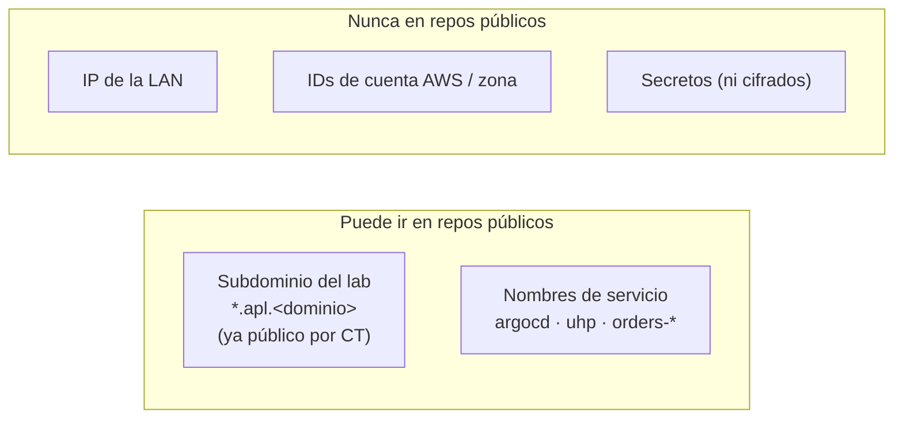

# ADR 0010 · Nombres del lab en `platform-gitops` y comprobación DNS-01 por DoH

- **Estado:** Aceptada · 2026-10-24
- **Matiza:** [ADR 0002](0002-repos-publicos-org-free.md) (higiene de datos) y [ADR 0009](0009-tls-letsencrypt-dns01-route53.md) (servidores de comprobación)

## Contexto

1. La ADR 0002 dice que los repos públicos no contienen dominios del homelab. Pero
   `platform-gitops` describe el clúster **tal cual es**: los `Certificate`, `ClusterIssuer` e
   `Ingress` necesitan el nombre real (`*.apl.<dominio>`). Plantillas y variables, como en el repo
   del lab, romperían el principio GitOps de que el repo es el estado deseado literal.
2. El certificado comodín se publicará igualmente en los registros de **Certificate
   Transparency**: el nombre `*.apl.<dominio>` será público en cuanto se emita.
3. La ADR 0009 proponía comprobar la propagación del TXT contra `1.1.1.1:53` y `8.8.8.8:53`. Si el
   router redirige el puerto 53 hacia Technitium (práctica habitual en redes domésticas), esa
   comprobación vería la zona interna y nunca el TXT.

## Decisión

- `platform-gitops` **sí contiene** el subdominio del lab (`apl.<dominio>`) en claro. Sigue
  prohibido: IP, nombres de máquinas, IDs de cuenta y zona, y cualquier secreto.
- cert-manager comprueba la propagación por **DNS-over-HTTPS**
  (`https://1.1.1.1/dns-query`, `https://dns.google/dns-query`): no le afecta ninguna redirección
  del puerto 53.

## Consecuencias

- ✅ `platform-gitops` es legible y literal: lo que se ve en el repo es lo que hay en el clúster.
- ✅ La comprobación DNS-01 no depende de la configuración DNS del router.
- ⚠️ Se sabe públicamente que existe `*.apl.<dominio>`; los servicios siguen sin ser accesibles desde
  Internet (no hay registros públicos que apunten a la LAN ni puertos abiertos).
