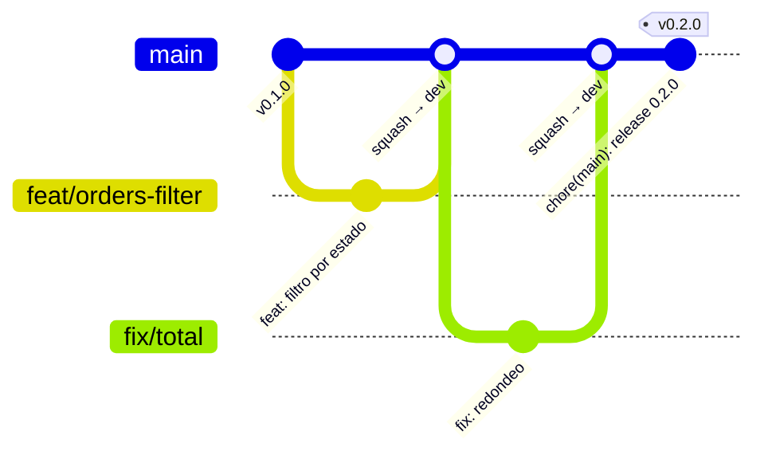

# ADR 0011 · Trunk-based y release-please en `meridian-orders`

- **Estado:** Aceptada · 2026-10-25

## Contexto

El Lifecycle Lab usó gitflow + GitVersion. En este lab los cambios los harán, cada vez más,
**agentes que abren PR pequeños**: cuanta menos ceremonia de ramas, más fácil es seguir y auditar
lo que hacen.

## Decisión

- **Trunk-based:** ramas cortas (`feat/…`, `fix/…`, `aidlc/…`) contra `main`, *squash merge*.
- **Conventional Commits** en el título del PR (lo valida un check).
- **release-please** mantiene un PR de *release* abierto con el CHANGELOG y la próxima versión
  SemVer; fusionarlo crea el tag `vX.Y.Z` y la *release* de GitHub.
- **Una única versión** para el producto (back y front se versionan juntos).

| Evento en `meridian-orders` | Imagen | Entorno |
|---|---|---|
| Merge en `main` | `sha-<commit>` | **dev** (automático) |
| Merge del PR de release (`vX.Y.Z`) | `X.Y.Z` (misma imagen, re-etiquetada) | **staging** (PR) |
| Promoción manual | mismo digest | **prod** (PR + aprobación) |

## Consecuencias

- ✅ Flujo natural para agentes: un PR = un cambio = un commit en `main`.
- ✅ Versiones y CHANGELOG sin intervención humana; la decisión humana es **cuándo** se libera.
- ⚠️ `main` siempre desplegable: los gates del PR son la única red de seguridad.
