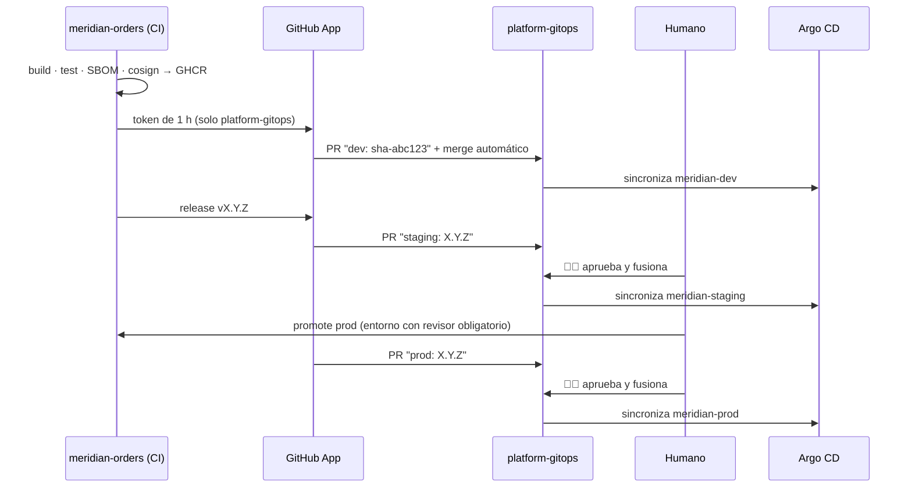

# ADR 0012 · Promoción entre entornos por PR en `platform-gitops`

- **Estado:** Aceptada · 2026-10-25

## Contexto

Hay que llevar una imagen de dev a staging y a prod. Opciones valoradas: PR en el repo GitOps,
Kargo (promoción con UI de etapas, ~500 MiB) y Argo CD Image Updater (actualización automática).

## Decisión

El CI de `meridian-orders` **no despliega**: abre PR en `platform-gitops` que cambian el *digest*
de la imagen en el *overlay* del entorno. Argo CD hace el resto.

## Consecuencias

- ✅ Cero componentes nuevos; cada promoción es un PR con autor, revisor y diff.
- ✅ *Build once*: staging y prod usan **el mismo digest** que se probó en dev.
- ✅ Rollback = revertir el PR.
- ⚠️ Menos vistoso que Kargo en una demo; se puede añadir más adelante sin cambiar este modelo.
