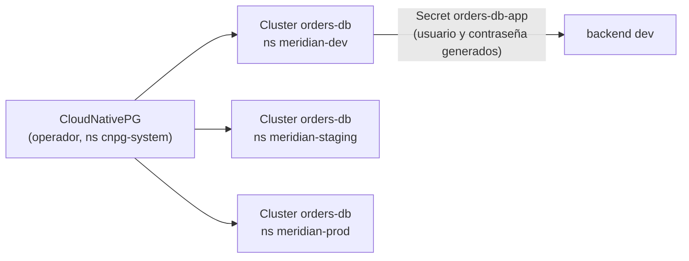

# ADR 0013 · PostgreSQL con CloudNativePG

- **Estado:** Aceptada · 2026-10-25

## Contexto

Meridian Orders necesita una base de datos por entorno. Opciones: CloudNativePG (operador),
StatefulSet de Postgres a mano o SQLite.

## Decisión

**CloudNativePG** (chart `cnpg/cloudnative-pg` 0.29.1 · operador 1.30.1) como addon de plataforma
en `platform-gitops`, y un `Cluster` de **una instancia** por entorno, declarado junto a la app.

## Consecuencias

- ✅ La base de datos se pide de forma declarativa, como cualquier otro recurso: relato de plataforma.
- ✅ Credenciales generadas por el operador en un `Secret`: ni 1Password ni Git las ven.
- ⚠️ ~150-250 MiB por entorno; con tres entornos entra en el presupuesto de k3s01.
- ⚠️ Una instancia por entorno: sin HA (aceptable en el lab). Copias a S3/Cubbit, más adelante.
