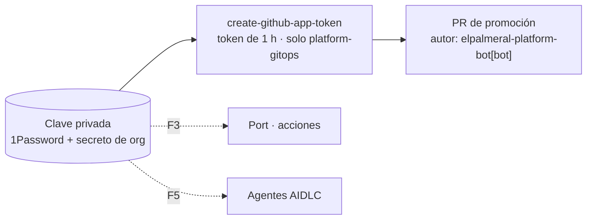

# ADR 0014 · Una GitHub App como identidad de la plataforma

- **Estado:** Aceptada · 2026-10-25

## Contexto

El CI de `meridian-orders` tiene que escribir en otro repo (`platform-gitops`). Más adelante,
Port (acciones *self-service*) y los agentes AIDLC también abrirán PR. El `GITHUB_TOKEN` de
Actions no puede escribir en otros repos.

## Decisión

Una **GitHub App de la org**, `elpalmeral-platform-bot`:

- Permisos mínimos y **por repositorio** (se instala solo en los repos que la necesitan).
- Tokens de instalación de **1 hora**, generados en cada ejecución con
  `actions/create-github-app-token`, acotados al repo de destino.
- Client ID como variable de la org (`PLATFORM_BOT_CLIENT_ID`) y clave privada como secreto de la
  org (`PLATFORM_BOT_PRIVATE_KEY`, repos públicos) y en 1Password (`agentic-lab`) para cuando la
  consuma el clúster.

## Consecuencias

- ✅ No depende de tu usuario; los PR los firma `elpalmeral-platform-bot[bot]`.
- ✅ Sin tokens de larga duración circulando.
- ⚠️ Ampliar permisos (por ejemplo, *Issues* para AIDLC) obliga a reaprobar la instalación.
- ⚠️ La clave privada es el secreto más valioso del lab: solo en 1Password y en el secreto de org.
