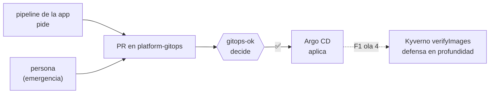

# ADR 0015 · La plataforma hace cumplir las reglas de promoción con el check `gitops-ok`

- **Estado:** Aceptada · 2026-10-27

## Contexto

Con la [ADR 0012](0012-promocion-por-pr-gitops.md) cada despliegue es un PR en `platform-gitops`.
Falta decidir **quién garantiza** que ese PR es aceptable: imágenes por digest, solo releases en
staging, prod igual a staging e imágenes firmadas por nuestro pipeline. Opciones:

| Opción | Dónde se comprueba | Problema |
|---|---|---|
| A · En el pipeline de la app | `meridian-orders` | la regla depende de la buena fe de cada equipo; un PR a mano se la salta |
| B · Check obligatorio en `platform-gitops` | CI del repo GitOps | no cubre `kubectl apply` directo al clúster |
| C · Política de admisión (Kyverno) | API de Kubernetes | aplazada en F1; no da feedback en el PR |

## Decisión

**B ahora, C después.** `scripts/validate.sh` define las reglas y `validate.yml` las ejecuta como
check obligatorio `gitops-ok` en la *ruleset* de `main`. El mismo repo aporta
`scripts/promote-meridian.sh`, que los pipelines de las apps **llaman** en lugar de reimplementar.

## Consecuencias

- ✅ Una sola puerta para personas y bots, con el motivo del rechazo en el propio PR.
- ✅ Reglas versionadas y revisables; cambiar una es un PR en un único repo.
- ✅ El job de la app espera al merge de dev: si la plataforma rechaza, el equipo lo ve en rojo.
- ⚠️ Sin admisión, el clúster acepta lo que se aplique a mano. Se mitiga con acceso restringido al
  kubeconfig hasta tener Kyverno.
- ⚠️ El check descarga esquemas del catálogo de Datree en cada ejecución (dependencia externa).
