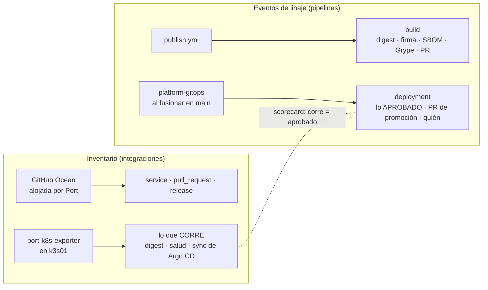

# ADR 0016 · Linaje en Port: inventario por integraciones, eventos por los pipelines

- **Estado:** Aceptada · 2026-10-27

## Contexto

El acto 1 de la demo abre **lo que corre en prod** y sigue el hilo hacia atrás: digest firmado →
PR de promoción y quién lo aprobó → release → PR de código. Port tiene que conocer cada eslabón
y **las relaciones entre ellos**. Opciones:

| Opción | Cómo | Problema |
|---|---|---|
| A · Solo integraciones | GitHub Ocean + exportador de Kubernetes; relaciones sacadas con JQ de títulos, cuerpos de PR y changelogs | el hilo depende de texto libre: un cambio de formato lo rompe en silencio |
| B · Solo eventos | los pipelines envían todo a la API de Port | se reinventa el inventario (repos, PR, *workloads*) que las integraciones ya dan |
| C · Mixto | integraciones para el **inventario**; pipelines para los **eventos de linaje** con datos exactos | dos tipos de fuente que mantener |

## Decisión

**C · Mixto.**

- **Lo aprobado** (`deployment`) lo escribe `platform-gitops` a partir de sus overlays: es la
  verdad de GitOps.
- **Lo que corre** lo informa el clúster. Que ambos coincidan es una regla del scorecard, no una
  suposición.
- Los pipelines escriben con la API REST de Port (`upsert` idempotente); sin acciones de terceros.

## Consecuencias

- ✅ El hilo del acto 1 se construye con identificadores exactos (digest, nº de PR, tag).
- ✅ La detección de *drift* sale gratis: dos fuentes independientes para la misma pregunta.
- ⚠️ Los pipelines necesitan credenciales de Port. Port solo da **una** credencial por
  organización (con permisos amplios): va en secretos de GitHub restringidos a los repos que la
  usan, y en el clúster por ESO desde 1Password.
- ⚠️ Si Port no está disponible, el paso de linaje no debe romper la entrega: será `continue-on-error`
  con aviso, nunca una puerta.
