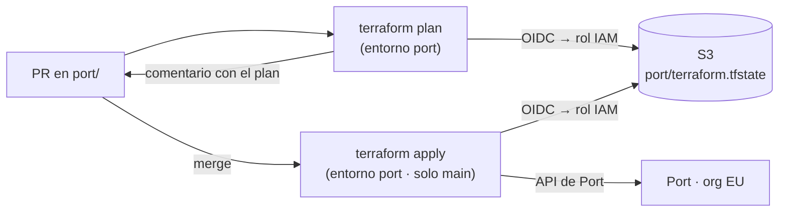

# ADR 0017 · El modelo de Port como código con Terraform, aplicado por PR

- **Estado:** Aceptada · 2026-10-27

## Contexto

Blueprints, relaciones, scorecards, páginas, acciones y el *mapping* de las integraciones de Port
se pueden definir en la UI, con la API o con el proveedor de Terraform `port-labs/port-labs`. Para
una sala con arquitectura o *design authority* importa que el IDP siga las mismas reglas que el
resto de la plataforma: versionado, revisión y aplicación automática.

## Decisión

- **Terraform** con `port-labs/port-labs` (`~> 2.33`) en `agentic-platform-lab/port/`.
- **Estado remoto en S3** (bucket dedicado, versionado, cifrado, sin acceso público), con el
  bloqueo nativo de S3 (`use_lockfile`), sin DynamoDB.
- **GitHub Actions**: `plan` en cada PR que toque `port/` (comentado en el PR) y `apply` al
  fusionar en `main`. Acceso a AWS por **OIDC**, con un rol que solo pueden asumir los jobs del
  entorno `port` de este repo, y solo para `s3://<bucket>/port/*`.
- La UI de Port se usa para **explorar**; lo que se queda se pasa a código.

## Alternativas descartadas

| Alternativa | Por qué no |
|---|---|
| JSON + script contra la API | sin estado ni *plan*: no se ve qué va a cambiar antes de aplicarlo |
| Estado local en el Mac (como `homelab-terraform`) | impide el `plan`/`apply` desde CI, que es justo lo que se quiere enseñar |
| HCP Terraform | una cuenta y un proveedor más para un estado de pocos KB |

## Consecuencias

- ✅ "El IDP también pasa por PR": se puede enseñar en la demo.
- ✅ *Reset* de la demo: `terraform apply` devuelve el modelo a lo declarado.
- ⚠️ Las entidades que crean las integraciones y los pipelines **no** las gestiona Terraform (solo el
  modelo); si no, cada sincronización sería un *drift*.
- ⚠️ La integración de GitHub se instala una vez a mano (GitHub App de Port) y se crea **sin**
  recursos por defecto: su *mapping* lo define Terraform con `port_integration`.
- ⚠️ Nombre del bucket y ARN del rol no van al repo público: variables y secretos del entorno `port`.
