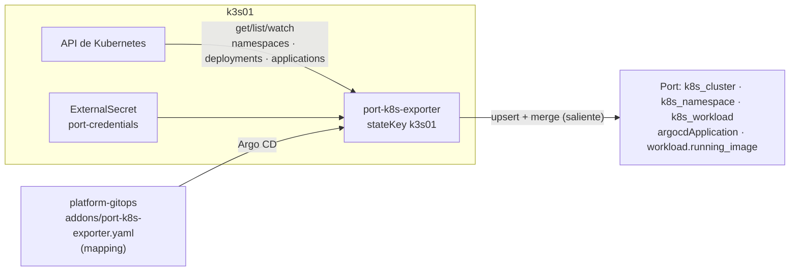

# ADR 0019 · El exportador de Kubernetes de Port como addon GitOps, con su mapping en `platform-gitops`

- **Estado:** Aceptada · 2026-10-27

## Contexto

Para el scorecard "Despliegue gobernado" Port tiene que saber **qué hay en el clúster**, no solo
lo que se aprobó. Port ofrece el `port-k8s-exporter` (chart `port-k8s-exporter`), que observa la
API de Kubernetes y escribe entidades en Port. Al revisar el chart 0.3.33:

- Su `ClusterRole` por defecto concede `get/list/watch` sobre **todos** los recursos, *secrets* incluidos.
- Si no se fija `stateKey`, genera un UUID en cada render: con Argo CD, la ConfigMap cambiaría en
  cada sincronización.
- El *mapping* se sube a Port en el primer arranque y luego manda el de Port, salvo
  `overwriteConfigurationOnRestart: true`.

## Decisión

- Addon `port-k8s-exporter` en la **ola 5** de `platform-gitops`, alcance "lo justo para el hilo"
  (decidido el 27-oct): clúster, namespaces, Deployments (`k8s_workload`), Applications de Argo CD
  y, para Meridian Orders, `workload.running_image`.
- **El mapping vive en `platform-gitops`**, junto al clúster que describe. Terraform (ADR 0017) no
  gestiona esta integración: es la frontera entre "el modelo del IDP" y "lo que reporta cada clúster".
- `stateKey: k3s01` fijo · `overwriteConfigurationOnRestart: true` (Git manda) ·
  `createDefaultResources: false` (blueprints de la plantilla, ADR 0018).
- **RBAC mínimo:** solo `namespaces`, `deployments` y `applications` (`""`, `apps`, `argoproj.io`), lectura.
- Credencial de Port por `ExternalSecret` desde 1Password (`agentic-lab/Port Org`).

## Consecuencias

- ✅ "Lo que corre" llega de una fuente independiente del pipeline: la regla `in_sync` compara dos
  orígenes distintos.
- ✅ El exportador hace *upsert* con fusión: no borra lo que escriben los pipelines en las mismas
  entidades (F3.4).
- ✅ Un ejemplo concreto de mínimo privilegio para la demo: el chart pedía leer *secrets*; aquí no.
- ⚠️ `running_image` es la imagen **del Deployment** (lo aplicado en el clúster), no el `imageID` de
  cada pod. Detecta cambios fuera de GitOps; no detecta un nodo con una imagen distinta en caché.
- ⚠️ Un clúster nuevo = otro addon con su `stateKey` y su `CLUSTER_NAME`.
