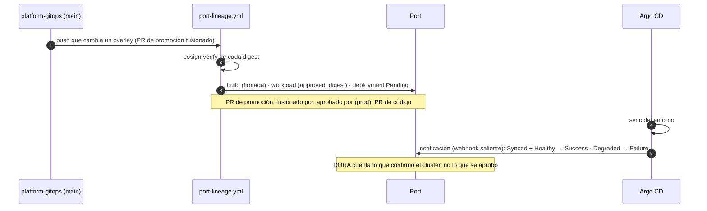

# ADR 0020 · Linaje con una acción de plataforma; el despliegue lo confirma Argo CD

- **Estado:** Aceptada · 2026-10-27 · desarrolla la [ADR 0016](0016-linaje-mixto-port.md)

## Contexto

Con la ADR 0016, los pipelines envían a Port los eventos de linaje. Quedaban dos preguntas:

1. **¿Cómo hablan con Port?** Cada equipo con su `curl`, o una pieza común.
2. **¿Cuándo es "Success" un despliegue?** Al fusionar el PR de promoción (lo aprobado) o cuando el
   clúster lo confirma (lo que funciona). Los agregados DORA de la plantilla (`deployment_frequency`,
   tasa de fallos) dependen de esa respuesta.

## Decisión

**1 · Acción compuesta de plataforma** `elpalmeral-org/platform-gitops/.github/actions/port-entity`
(fijada por SHA en quien la use): *upsert* con fusión de una o varias entidades, enmascara el token
y **nunca bloquea** una entrega (avisa y termina en verde). Las apps describen qué ha pasado; la
plataforma decide cómo se registra.

**2 · Un despliegue nace `Pending` y lo cierra Argo CD.**

| Pieza | Repo | Paso |
|---|---|---|
| Acción `port-entity` + `scripts/port-lineage.sh` + workflow `port-lineage` | `platform-gitops` | F3.4a |
| `publish.yml` enriquece `build` (SBOM, procedencia, CVE, commit, PR) y `release` → `build` | `meridian-orders` | F3.4b |
| Webhook de Port (`port_webhook`) | `agentic-platform-lab/port` | F3.4c |
| Notificaciones de Argo CD hacia ese webhook | `platform-gitops` | F3.4c |

La **firma** la verifica la plataforma (cosign) al registrar el `build`: no se fía de lo que diga el
pipeline de la app. El mismo `port-lineage` tiene un modo `state` (a mano) que reconstruye `build` y
`workload` **sin crear despliegues**, para no inventar eventos que falseen DORA.

## Consecuencias

- ✅ Un único punto de integración con Port para todos los servicios futuros.
- ✅ DORA con su significado real: frecuencia de despliegues **confirmados** y tasa de fallos.
- ✅ El acto 1 de la demo enseña, en la misma ficha, quién aprobó y que el clúster lo confirmó.
- ⚠️ Las promociones anteriores a F3.4 no tienen `deployment`: DORA empieza a contar desde aquí.
- ⚠️ Hasta F3.4c los despliegues se quedan en `Pending`.
- ⚠️ La credencial de Port pasa a ser secreto de la org, limitado a `meridian-orders` y `platform-gitops`.
