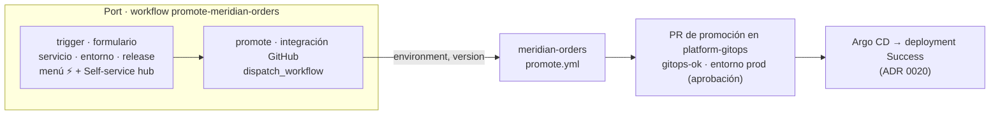

# ADR 0021 · Lo que se pide desde Port se construye como Workflow, no como acción clásica

- **Estado:** Aceptada · 2026-10-28 · desarrolla la [ADR 0017](0017-port-como-codigo-terraform.md)

## Contexto

F3.6 nació como acción *self-service* clásica (`port_action`). Funcionaba, pero no aparecía en la UI:
Port llama ya *classic* (o *legacy*) a las acciones y automatizaciones, recomienda **Workflows** y la
organización tenía activado *Hide classic actions and automations in favor of workflows*.

Un Workflow es un **grafo**: un nodo disparador (formulario, evento o calendario), nodos de acción
(webhook, integración, *upsert*, IA, agente) y nodos de flujo (condición, entrada humana). Con la
acción clásica todo eso eran piezas sueltas: acción + automatización + aprobación.

## Decisión

1. Todo lo que se pide desde Port (*self-service*) o reacciona a sus eventos se construye como
   **Workflow** (`port_workflow`, proveedor `port-labs/port-labs` ≥ 2.33), en Terraform como el resto
   del modelo.
2. **Promocionar** es el primero: `port/workflow-promote.tf` sustituye a `port/action-promote.tf`.

3. Se mantienen las decisiones de F3.6: Port **no aprueba** (la puerta es el entorno `prod` de
   GitHub, una sola fuente de verdad), la versión se elige **del catálogo** (`release`) y solo hay
   `staging` y `prod` (dev es automático).
4. El ajuste *Hide classic actions and automations* queda **activado**: en la org solo se ven
   Workflows.

## Consecuencias

- ✅ Es el modelo que Port está desarrollando: F5 (acto 2, «Pedir feature» → spec → agente) se
  construirá con nodos de **entrada humana**, **condición**, **IA/agente** e integraciones en el mismo
  grafo, sin piezas sueltas.
- ✅ El historial de cada ejecución muestra el grafo, el estado de cada nodo y el enlace a la
  ejecución de GitHub: mejor material para la demo.
- ✅ Visible en el menú ⚡ de la entidad (contexto `ENTITY`) y en el Self-service hub con un solo
  disparador.
- ⚠️ El recurso `port_workflow` es reciente: hay que fijar la versión del proveedor y revisar su
  *changelog* al subirla.
- ⚠️ Cambian las referencias: en un Workflow las entradas se leen como `.outputs.trigger.<entrada>`
  y en los filtros del formulario como `.form.<entrada>` (en la acción clásica eran `.inputs` y
  `.entity`).
- ⚠️ Se pierde el historial de ejecuciones de la acción clásica (solo hubo pruebas).
