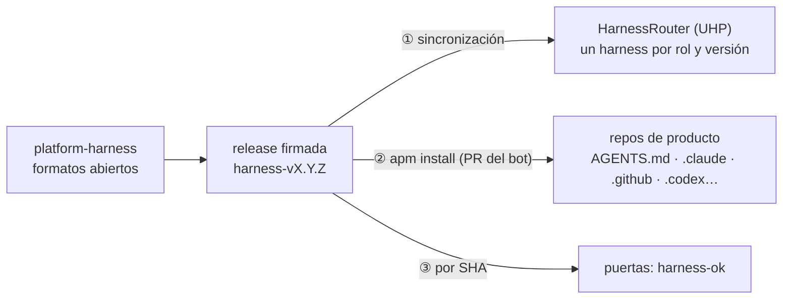

# ADR 0022 · El harness corporativo vive en su propio repo y se escribe en formatos abiertos

- **Estado:** Aceptada · 2026-10-28 · cambia la fuente del harness prevista en [01-arquitectura](../01-arquitectura.md) (antes, `agentic-platform-lab`)

## Contexto

F4 convierte el harness (todo lo que rodea al modelo: instrucciones, skills, mandatos de agente,
herramientas MCP, guardarraíles, puertas) en un **producto versionado**. Requisito de Pablo: debe
servir para **varios modelos y varias herramientas**, no solo Claude.

El harness tiene tres consumidores distintos, y cada uno lo recibe por un camino diferente:

| Plano | Consumidor | Cómo lo recibe |
|---|---|---|
| ① Agentes de la plataforma | AIDLC en CI (F5) | Un gateway UHP: el harness vive en el servidor ([ADR 0024](0024-harnessrouter-en-f4-proveedores.md)) |
| ② Personas en su IDE | Copilot, Cursor, Claude Code, Codex, OpenCode… | Ficheros en el repo de la app ([ADR 0023](0023-apm-distribucion-harness-ok.md)) |
| ③ Puertas | CI | Workflows reutilizables fijados por SHA |

Formatos abiertos maduros en octubre de 2026:

- **`AGENTS.md`**: instrucciones de proyecto. Lo leen Codex, Copilot, Cursor… y Claude Code (si no
  hay `CLAUDE.md`).
- **Agent Skills** (`SKILL.md` + carpeta).
- **Agent Plugins 1.0** (`plugin.json` + `mcp.json` + `skills/`): comité técnico con Amazon, Cursor,
  Microsoft, OpenAI y Vercel; 10 clientes compatibles; es el formato de paquete de UHP. Solo cubre
  skills y MCP, y Claude Code no está en la lista (usa `.claude-plugin/`).
- **MCP** para herramientas; **OPA/Rego** para políticas; **OpenSpec** para specs.

## Decisión

1. Repo público **`elpalmeral-org/platform-harness`**, con su propio ciclo de releases (tags
   `harness-vX.Y.Z`). No se mezcla con la documentación de `agentic-platform-lab`.
2. La fuente se escribe en formatos abiertos y es **una sola** para los tres planos: paquete APM
   (`apm.yml` + `.apm/`: instrucciones, skills, agentes, prompts, hooks), MCP, OPA y los workflows de
   las puertas. Lo específico de una herramienta (p. ej. hooks) se acepta como capa acotada y nunca
   sustituye a una puerta de CI.
3. Se porta lo aprovechable de `platform-harness-lab` (mandatos, hooks, corpus, OPA, `harnessctl`
   como plan B); Backstage y docker01 se quedan fuera. El MCP de grounding pasa a ser el de **Port**.

## Consecuencias

- ✅ Un cliente con Copilot, Cursor y Claude a la vez ve **un** harness, no tres.
- ✅ El repo es un producto más en Port, con versión, releases y consumidores.
- ⚠️ Cada herramienta soporta un subconjunto distinto (p. ej. OpenCode no tiene hooks): la matriz
  de compatibilidad se documenta y los controles duros van en CI, no en el agente.
- ⚠️ Un repo más que mantener (ruleset, GitHub App instalada, releases).
