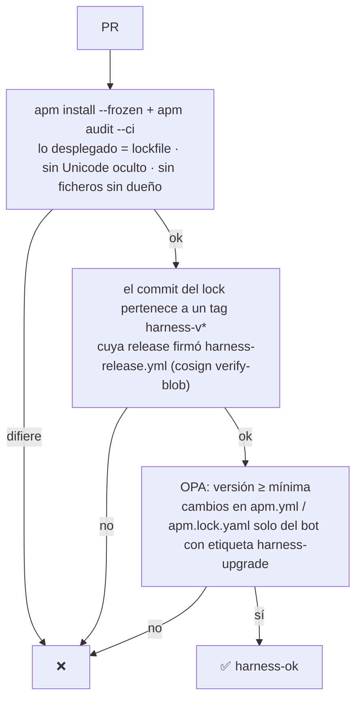

# ADR 0023 · APM distribuye el harness a los repos; `harness-ok` lo hace cumplir

- **Estado:** Aceptada · 2026-10-28 · desarrolla la [ADR 0022](0022-harness-repo-propio-formatos-abiertos.md)

## Contexto

El plano ② necesita que cada repo de producto reciba el harness en el formato de **cada**
herramienta, fijado a una versión exacta y sin modificaciones locales. Alternativas valoradas:

| Opción | A favor | En contra |
|---|---|---|
| `harnessctl` propio (render + `harness.lock` firmado) | Control total, ya escrito | Un traductor por herramienta que mantener |
| **APM** (Agent Package Manager, Microsoft) | Manifiesto + lockfile con hashes; compila a Copilot, Claude, Codex, Cursor, OpenCode, Gemini, Kiro…; `apm audit --ci`; `apm-policy.yml`; action oficial | 0.x (releases cada 1-2 semanas); no firma |
| Solo estándares, sin herramienta | Lo más simple | MCP distinto por cliente y *drift* a mano |
| Plugins nativos por herramienta | Integración perfecta | N canales; descartada |

## Decisión

**APM** (fijado a una versión exacta en CI). `platform-harness` es un paquete APM; cada repo de
producto lo declara como dependencia fijada a un tag y comitea `apm.lock.yaml` y los ficheros
generados.

```yaml
# meridian-orders/apm.yml (esquema)
name: meridian-orders
version: 0.1.0
targets: [claude, copilot, codex, opencode]
dependencies:
  apm:
    - elpalmeral-org/platform-harness#harness-v0.1.0   # trae instrucciones, skills, agentes, hooks y el MCP de Port
```

Lo propio del repo (comandos de build, estructura) va en su `.apm/instructions/`: APM compila ambas
cosas en `AGENTS.md`, `.claude/`, `.github/`, `.codex/`…

La **firma** la pone la plataforma, no APM: el workflow de release de `platform-harness` firma con
cosign *keyless* el bundle (`apm pack`) y un manifiesto que liga el tag con su commit.

**`harness-ok`**, check obligatorio en cada repo consumidor (workflow reutilizable fijado por SHA):



Subir la **versión mínima** en la política obliga a aceptar el PR de *upgrade* antes de fusionar
nada más.

## Consecuencias

- ✅ Mismo patrón que el resto de la plataforma: la app declara, la plataforma valida (como
  `gitops-ok` y `port-entity`).
- ✅ Material de demo para CISO: «subo la mínima y el repo no fusiona hasta actualizar».
- ⚠️ Dependencia de una herramienta joven: versión de APM fijada y `harnessctl` como plan B.
- ⚠️ Los ficheros generados se comitean (las herramientas los leen del repo); editarlos a mano lo
  detecta `apm audit`.
