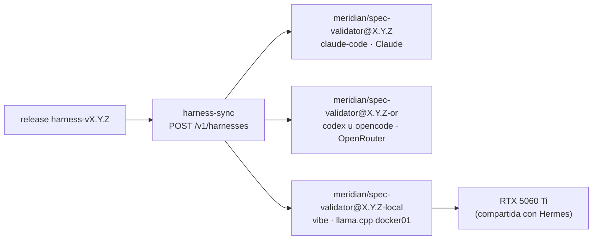

# ADR 0024 · HarnessRouter llega en F4 y aloja el harness por rol y versión; tres proveedores

- **Estado:** Aceptada · 2026-10-28 · desarrolla la [ADR 0006](0006-uhp-harnessrouter-gateway.md) y resuelve su última consecuencia (versionar la configuración) · **modificada por la [ADR 0025](0025-dos-motores-un-harness.md)**: HarnessRouter sin Anthropic (Claude llega por Claude Code con suscripción)

## Contexto

UHP (`2026-10-19`) define el harness como un objeto del servidor: `base` (Claude Code, Codex,
OpenCode, Gemini CLI, Hermes, goose… 26 en HarnessRouter), `defaultModel`, `systemPrompt`,
`skills`, `mcpServers`, `plugins` (paquetes Agent Plugins) y `disabledTools`, gestionable por API
(`POST`/`PUT /v1/harnesses`). Resuelve el agnosticismo en el plano ① (agentes de la plataforma).

No versiona: `PUT` reemplaza la configuración y no hay versiones inmutables ni firma.

## Decisión

1. **HarnessRouter CE se despliega en F4** (addon GitOps en k3s01, imagen fijada por *digest*), no
   en F5: publicar el harness en UHP es parte del harness como producto.
2. **Versionado propio:** cada release `harness-vX.Y.Z` crea en HarnessRouter un harness inmutable
   por rol, `meridian/<rol>@X.Y.Z` (`spec-writer`, `implementer`, validadores…), con su mandato como
   `systemPrompt` y el bundle Agent Plugin de la release. La pareja base + modelo de cada rol se
   declara en el repo del harness (`uhp/roles.yaml`). Nunca se edita un harness publicado: se crea el
   de la versión siguiente.
3. **Proveedores**, con las claves en 1Password → ESO:
   - **Anthropic** (Claude).
   - **OpenRouter** (una clave, muchos modelos: OpenAI, Google, DeepSeek, Qwen…).
   - **Modelo local** con endpoint compatible con OpenAI en la RTX 5060 Ti de docker01. Se reutiliza
     el `llama.cpp` que ya sirve a Hermes (Ternary Bonsai 2 27B): la GPU no admite un segundo modelo
     en sus 16 GB. Conexión *Custom · OpenAI Chat Completions*; bases probadas por HarnessRouter
     con ese formato: `docker-agent`, `fast-agent`, `vibe`.
4. F4 termina con una **prueba de humo**: el mismo mandato, de la misma versión, ejecutado en tres
   combinaciones base + modelo (una por proveedor). Los validadores en cada PR y los workflows
   `aidlc-*` siguen en F5.

## Consecuencias

- ✅ El acto 2 puede enseñar que cambiar de modelo, incluso a uno local por soberanía, es
  configuración del harness, no reescribir workflows.
- ✅ El acto 3 puede atribuir coste y resultado a `rol@versión` + base + modelo.
- ⚠️ El modelo local se comparte con Hermes (2 *slots*): no apto para carga concurrente, y un 27B
  ternario puede no sostener un bucle agéntico largo. La prueba de humo lo dirá.
- ⚠️ Salida a Internet nueva desde k3s01 (OpenRouter) y tráfico LAN k3s01 → docker01.
- ⚠️ Gasto: límite de gasto en las cuentas de Anthropic y OpenRouter antes de la primera prueba.
