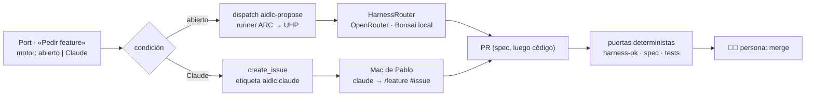

# ADR 0025 · Un harness, dos motores: abierto (UHP) y Claude Code con suscripción

- **Estado:** Aceptada · 2026-10-29 · modifica la [ADR 0024](0024-harnessrouter-en-f4-proveedores.md) (proveedores de HarnessRouter)

## Contexto

Pablo quiere dos formas de trabajar con el mismo lab:

1. Un harness **abierto**: modelos de OpenRouter y su modelo local (Bonsai en `llama.cpp`, API de
   OpenAI), servido por UHP.
2. Un harness que pueda usar **de principio a fin con su Claude Code y su suscripción personal**.

La suscripción Pro/Max vale para Claude Code en su máquina (y para su propio CI con
`claude setup-token`), pero **no** para un gateway de terceros como HarnessRouter: Anthropic no
permite que herramientas de terceros almacenen o enruten credenciales de claude.ai, y HarnessRouter
solo acepta claves de API.

## Decisión

1. **Un solo harness, dos motores.** Misma fuente (`platform-harness`), misma release, mismos
   mandatos, skills, MCP de Port y puertas. Cambia quién ejecuta los agentes y con qué credencial.

   | | Motor A · abierto | Motor B · Claude |
   |---|---|---|
   | Ejecuta | HarnessRouter (UHP) en k3s01, `meridian/<rol>@X.Y.Z` | Claude Code sin modificar, en el Mac de Pablo |
   | Modelos | OpenRouter (sin modelos de Anthropic) + Bonsai local | Claude, los de la suscripción |
   | Recibe el harness | `harness-sync`: mandato como `systemPrompt`, bundle Agent Plugin | APM, formato de Claude: `.claude/agents/` (subagentes), `/feature`, skills, hooks, MCP |
   | Credencial | Clave de OpenRouter con límite · Bonsai sin clave en la LAN | `claude login` (suscripción) |
   | Se lanza desde | Port → workflow → runner ARC (F5) → UHP | Port → *issue* → Pablo en su Mac: `/feature #<issue>` |

2. **Sin Anthropic en HarnessRouter.** Claude llega por el motor B. Una clave de API de Anthropic,
   si llega, sería un tercer camino, no un cambio de diseño.
3. **El motor B no corre en CI.** En los PR solo hay **puertas deterministas** (`harness-ok`,
   `openspec validate --strict`, tests, `gitops-ok`) y la decisión humana. Los validadores agénticos
   se ejecutan **antes** del PR: como subagentes en el motor B y dentro de la tarea UHP en el motor A.
   Meter agentes en el CI es un punto de conversación del playbook de la demo, no una pieza del lab.
4. **Port es la puerta de entrada de ambos.** El workflow «Pedir feature» (F5) lleva un selector de
   motor; un nodo de condición manda la petición por una de las dos ramas.

## Consecuencias

- ✅ La misma petición puede ir por los dos motores y compararse en igualdad: misma versión del
  harness, mismas puertas. Es el argumento contra el *lock-in* del acto 2.
- ✅ El motor B funciona en cuanto existan F4.1–F4.5: no necesita infraestructura.
- ✅ Principio para el CISO: **los agentes proponen, las puertas que bloquean son deterministas y
  deciden las personas.**
- ⚠️ El motor B depende de una persona y su portátil: no escala a un equipo sin pasar a Team,
  Enterprise o clave de API (decisión de cliente, no del lab).
- ⚠️ Coste en el acto 3: el motor A da euros reales por ejecución (0 € en local); el motor B, tokens y
  coste nocional, porque consume los límites del plan.
- ⚠️ El motor A en CI necesita runners ARC (F5): los de GitHub no llegan a la LAN.
