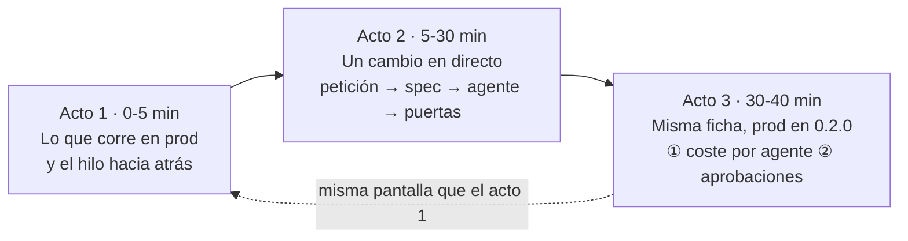
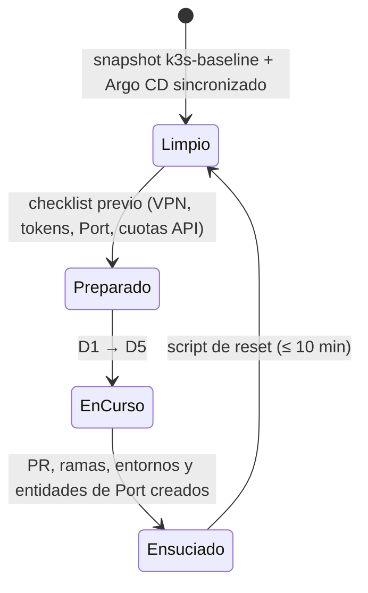

# ③ Demo · recursos para enseñar el lab

> Se construye en la fase F7, cuando el lab funcione de extremo a extremo. De momento recoge el
> **diseño** de la demo para que el resto de fases lo tengan en cuenta.

## Guion: tres actos que acaban donde empiezan (decidido el 27-oct)

Público tipo: **a partes iguales CIO/CISO y arquitectura / design authority**. Un único servicio
real (Meridian Orders); el catálogo crecerá después.

| Acto | Qué se ve | Mensaje CIO/CISO | Mensaje arquitectura | Escenarios | Fase |
|---|---|---|---|---|---|
| 1 · Lo que corre en prod | Port: ficha de Meridian Orders → prod `0.1.0` → digest firmado, SBOM, CVE → PR de promoción y aprobador → release → PR de código | "Sé qué hay en producción, quién lo aprobó y que es lo aprobado" | "Las reglas son código (`gitops-ok`) y valen igual para personas y bots" | D4 (parte) | F3 |
| 2 · Un cambio en directo | "Pedir feature" en Port, eligiendo motor (abierto por UHP o Claude Code) → spec con puerta 1 → agente → un gate bloquea → corrección → puerta 2 → dev → staging → prod | "El negocio pide, las máquinas ejecutan, las personas deciden" · sin *lock-in*: la misma petición por dos motores | spec como contrato, harness versionado, los agentes proponen antes del PR y las puertas son deterministas ([ADR 0025](../adr/0025-dos-motores-un-harness.md)) | D2 · D3 · D4 | F4-F5 |
| 3 · Cierre | Misma ficha que el acto 1, ahora `0.2.0`: **primero** coste (€, tokens, modelo, versión de harness por ejecución de agente), **después** las aprobaciones humanas del hilo (spec, código, prod) | coste y responsabilidad medibles | trazabilidad de la spec al digest | D5 · D6 opcional | F5-F6 |

D1 (crear un servicio desde Port) queda como escenario extra cuando haya más de un servicio.

## Agentes en el flujo: qué se podría añadir

En el lab los agentes trabajan **antes** del PR (escriben la spec, el código y se revisan a sí
mismos) y las puertas que bloquean son **deterministas**. Es una decisión (ADR 0025), no una
limitación: en el acto 2, cuando salga la pregunta «¿y por qué no ponéis agentes en el CI?», este es
el menú para el cliente, de menos a más riesgo.

| Dónde | Qué hace el agente | Valor | Riesgo | Control que lo hace aceptable | Qué necesita |
|---|---|---|---|---|---|
| Revisión del PR | Comenta hallazgos (seguridad, conformidad con la spec, estilo) | Revisión inmediata y constante | Ruido y falsos positivos | Solo comenta: el check no es obligatorio | Motor A en runner ARC, o Claude Code Action / Code Review con clave de empresa |
| Validador obligatorio | Emite hallazgos estructurados (JSON) | Política de «0 críticos» automática | No determinista: el mismo PR puede dar resultados distintos | El agente **informa**; una regla determinista (OPA) decide sobre su salida, con umbral y derecho a apelar | Lo anterior + un esquema de hallazgos versionado en el harness |
| Arreglo de CI en rojo | Propone un commit que corrige tests o lint | Menos tiempo atascado | Cambios no pedidos dentro del PR | Commit separado, visible, que vuelve a pasar todas las puertas; nunca en `main` | Permisos de escritura acotados a la rama del PR |
| Autor en CI | `issue → spec → código → PR` sin portátil | Escala a un equipo | Coste y alcance del agente | Runner efímero, presupuesto por ejecución, harness fijado por versión, puertas humanas 1 y 2 | Motor A + ARC, o clave de API / Team / Enterprise (la suscripción personal no vale para un equipo) |
| Tras desplegar | Resume un incidente o propone *rollback* | Menos tiempo de diagnóstico | Actuar sobre producción | Solo propone: el *rollback* sigue siendo un PR de promoción con sus puertas | Lectura de telemetría (F6) |

Mensaje: **la pregunta no es si poner agentes en el flujo, sino qué decide cada uno.** Un agente que
propone es barato de aceptar; uno que decide necesita una regla determinista que lo enmarque.

## Ciclo de una demo

## Recursos que vivirán aquí

- `guion.md` — guion minuto a minuto, con mensajes clave por acto.
- `prompts.md` — peticiones de feature probadas y sus resultados esperados.
- `checklist-previo.md` — comprobaciones 30 min antes.
- `reset.md` + script — volver al estado limpio.
- `faq-cliente.md` — preguntas habituales (seguridad, coste, lock-in, gobierno) y respuestas.
