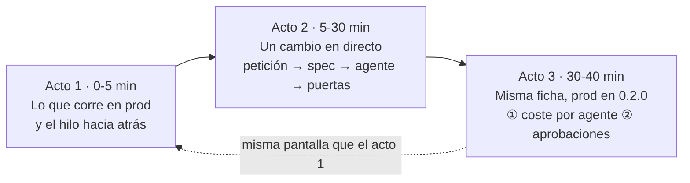
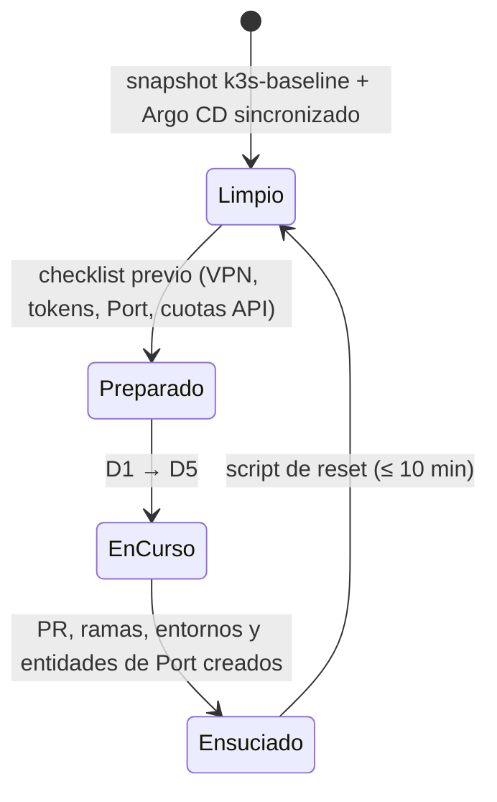

# ③ Demo · recursos para enseñar el lab

> Se construye en la fase F7, cuando el lab funcione de extremo a extremo. De momento recoge el
> **diseño** de la demo para que el resto de fases lo tengan en cuenta.

## Guion: tres actos que acaban donde empiezan (decidido el 27-oct)

Público tipo: **a partes iguales CIO/CISO y arquitectura / design authority**. Un único servicio
real (Meridian Orders); el catálogo crecerá después.

| Acto | Qué se ve | Mensaje CIO/CISO | Mensaje arquitectura | Escenarios | Fase |
|---|---|---|---|---|---|
| 1 · Lo que corre en prod | Port: ficha de Meridian Orders → prod `0.1.0` → digest firmado, SBOM, CVE → PR de promoción y aprobador → release → PR de código | "Sé qué hay en producción, quién lo aprobó y que es lo aprobado" | "Las reglas son código (`gitops-ok`) y valen igual para personas y bots" | D4 (parte) | F3 |
| 2 · Un cambio en directo | "Pedir feature" en Port → spec con puerta 1 → agente vía UHP → un gate bloquea → corrección → puerta 2 → dev → staging → prod | "El negocio pide, las máquinas ejecutan, las personas deciden" | spec como contrato, harness versionado, puertas deterministas y agénticas | D2 · D3 · D4 | F4-F5 |
| 3 · Cierre | Misma ficha que el acto 1, ahora `0.2.0`: **primero** coste (€, tokens, modelo, versión de harness por ejecución de agente), **después** las aprobaciones humanas del hilo (spec, código, prod) | coste y responsabilidad medibles | trazabilidad de la spec al digest | D5 · D6 opcional | F5-F6 |

D1 (crear un servicio desde Port) queda como escenario extra cuando haya más de un servicio.

## Ciclo de una demo

## Recursos que vivirán aquí

- `guion.md` — guion minuto a minuto, con mensajes clave por acto.
- `prompts.md` — peticiones de feature probadas y sus resultados esperados.
- `checklist-previo.md` — comprobaciones 30 min antes.
- `reset.md` + script — volver al estado limpio.
- `faq-cliente.md` — preguntas habituales (seguridad, coste, lock-in, gobierno) y respuestas.
