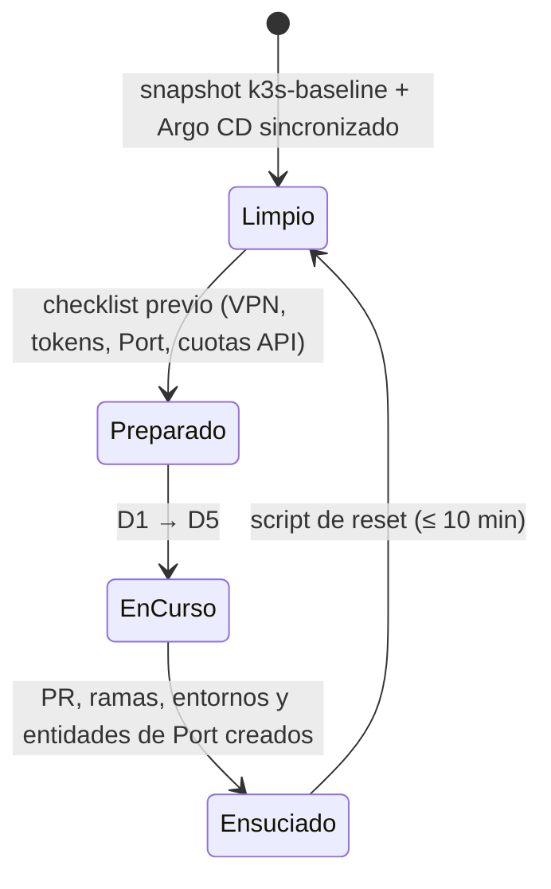

# ③ Demo · recursos para enseñar el lab

> Se construye en la fase F7, cuando el lab funcione de extremo a extremo. De momento recoge el
> **diseño** de la demo para que el resto de fases lo tengan en cuenta.

## Escenarios previstos

| # | Escenario | Qué demuestra | Duración |
|---|---|---|---|
| D1 | Crear un servicio desde Port | Golden path: el repo nace con harness, gates y GitOps | 5 min |
| D2 | Pedir una feature en lenguaje natural | AIDLC + SDD: spec con grounding y puerta humana 1 | 10 min |
| D3 | El agente implementa; un gate bloquea | La confianza viene de los gates, no del modelo | 10 min |
| D4 | Merge y promoción GitOps | Puerta humana 2, imagen firmada, Argo CD sincroniza | 5 min |
| D5 | Trazabilidad y coste | Qué agente, qué harness, cuántos tokens, qué se desplegó | 5 min |
| D6 | *(opcional)* Cambiar de harness vía UHP | El cliente no queda atado a un proveedor de agentes | 5 min |

## Ciclo de una demo

## Recursos que vivirán aquí

- `guion.md` — guion minuto a minuto, con mensajes clave por acto.
- `prompts.md` — peticiones de feature probadas y sus resultados esperados.
- `checklist-previo.md` — comprobaciones 30 min antes.
- `reset.md` + script — volver al estado limpio.
- `faq-cliente.md` — preguntas habituales (seguridad, coste, lock-in, gobierno) y respuestas.
