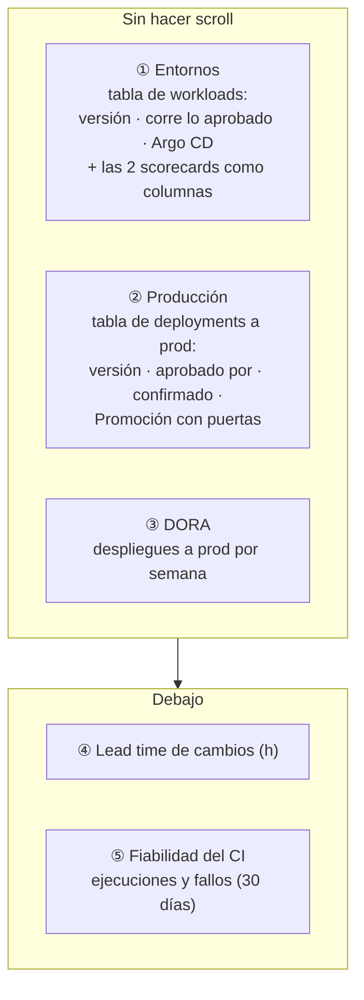

# Ficha de Meridian Orders para el acto 1 (F3.5b)

> Se monta **en la UI de Port** y, cuando convence, se importa a Terraform (`port_page`, ADR 0017).
> Contenido decidido el 28-oct. Público: CIO/CISO y arquitectura.



Las scorecards por **componente y entorno** no son un widget propio: en Port aparecen como
**columnas** de una tabla. Por eso ① enseña a la vez "qué versión hay", "corre lo aprobado" y los
dos niveles 🥇.

## Antes de empezar

- Rol de **Admin** en Port.
- Ve a **Catalog** → *Service* → **meridian-orders**. Es la página que vamos a cambiar; para todos
  los servicios a la vez, porque la página de entidad es común al blueprint.
- La pestaña **Overview** es un panel. Todo se añade con **+ Widget** (arriba a la derecha).
- Los nombres de botones pueden variar ligeramente según la versión de Port: busca el equivalente.

## ① Entornos: lo que corre, por componente

1. **+ Widget** → **Table**.
2. Título: `Entornos · lo que corre`. Blueprint: **Workload**.
3. Filtro (**Filters** o **Edit JSON**): solo los de este servicio.
   ```json
   {
     "combinator": "and",
     "rules": [
       { "operator": "relatedTo", "blueprint": "service", "value": "meridian-orders" }
     ]
   }
   ```
4. Guarda el widget y, en la tabla, abre **Manage properties** (icono de columnas). Deja visibles,
   en este orden: `Title` · `Version` · `Corre lo aprobado` · `Argo Health status` ·
   `Cadena de suministro` · `Corre lo aprobado` (la scorecard) · `URL`. Oculta el resto.
5. **Group by**: `Environment` (relación). **Sort**: `Title` ascendente.

## ② Producción: la última promoción y sus puertas

1. **+ Widget** → **Table** · título `Producción · promociones` · blueprint **Deployment**.
2. Filtro:
   ```json
   {
     "combinator": "and",
     "rules": [
       { "operator": "=", "property": "environment", "value": "Production" },
       { "operator": "relatedTo", "blueprint": "service", "value": "meridian-orders" }
     ]
   }
   ```
3. Columnas: `Versión` (tag) · `Deployment Status` · `Confirmado por Argo CD` · `Fusionado por` ·
   `Entorno aprobado por` · `PR de promoción` · `Promoción con puertas`.
4. **Sort**: `Confirmado por Argo CD` descendente. La primera fila es lo que hay en producción.

## ③ DORA: frecuencia de despliegue

1. **+ Widget** → **Number Chart**.
2. Tipo: **Display single property** · blueprint **Service** · entidad **meridian-orders** ·
   propiedad **Deployment Frequency (per week)**.
3. Unidad: **custom** → `/ semana`. Título: `Despliegues a producción`.

## ④ y ⑤ Debajo: lead time y fiabilidad del CI

Tres **Number Chart** de tipo *Display single property* sobre **meridian-orders**:


| Título | Propiedad (título en Port) | Unidad |
|---|---|---|
| `Lead time de cambios` | **Lead Time for Changes (Hours)** | custom `h` |
| `Fallos de CI · 30 días` | **Monthly Workflow Failure Rate (%)** | `%` |
| `Ejecuciones de CI · 30 días` | **Monthly Workflow Runs** | none |

La plantilla también calcula el **nivel** DORA (`Deployment Frequency`, `Lead Time for Changes
(GitHub)`: *Elite*, *High*…). Son textos, no números: no sirven para un Number Chart, pero se pueden
dejar visibles en el widget **Details**.

## Disposición

- Fila 1 (alta): ① a todo el ancho.
- Fila 2: ② (dos tercios) y ③ (un tercio).
- Fila 3: ④ y ⑤ en tres tarjetas iguales.
- El widget **Details** de la plantilla: muévelo al final o, si estorba, quítalo de Overview
  (sigue en la pestaña de propiedades).

Arrastra los widgets por su cabecera y cambia su tamaño desde la esquina inferior derecha.

## Cuando esté como quieres

Avisa: se exporta la página por la API y se importa a Terraform (`port_page`, que es *beta* y
necesita `PORT_BETA_FEATURES_ENABLED=true`). A partir de ahí, cambiar la ficha es un PR.
