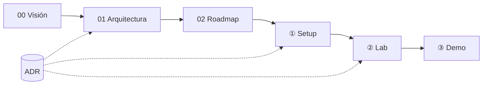

# Documentación · agentic-platform-lab

| Documento | Para qué leerlo |
|---|---|
| [00 · Visión](00-vision.md) | Objetivos, conceptos (AIDLC, Harness Engineering, IDP, Agent Platform, UHP) y relato de la demo |
| [01 · Arquitectura](01-arquitectura.md) | Arquitectura objetivo, flujos, red, repos y presupuesto de recursos |
| [02 · Roadmap](02-roadmap.md) | Fases, pasos, estado y preguntas abiertas |
| [① Setup](setup/README.md) | Pasos de preparación, uno a uno |
| [② Lab](lab/README.md) | Componentes de la plataforma (se rellena por fases) |
| [③ Demo](demo/README.md) | Recursos para enseñar el lab (se rellena al final) |
| [ADR](adr/README.md) | Decisiones de arquitectura y su porqué |

