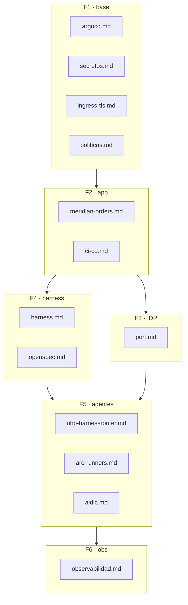

# ② Lab · componentes de la plataforma

> Esta sección describe la plataforma **en marcha**. Se rellena fase a fase; cada componente tendrá
> su página con: qué hace, cómo se despliega (siempre desde `platform-gitops`), cómo se opera y
> cómo se usa en la demo.

| Componente | Página | Fase | Estado |
|---|---|---|---|
| Argo CD y *app-of-apps* | [`argocd.md`](argocd.md) | F1 | ✅ |
| Secretos (ESO + 1Password) | [`secretos.md`](secretos.md) | F1 | ✅ |
| Ingress y TLS (cert-manager + LE DNS-01) | [`ingress-tls.md`](ingress-tls.md) | F1 | ✅ |
| Políticas de admisión (Kyverno) y cuotas | `politicas.md` | F1 | ⏸️ pendiente (tras F2) |
| Meridian Orders | [`meridian-orders.md`](meridian-orders.md) | F2 | ✅ dev · staging · prod |
| CI/CD y promoción | [`ci-cd.md`](ci-cd.md) | F2 | ✅ |
| Port.io | [`port.md`](port.md) | F3 | 🟡 diseñado |
| Harness corporativo | `harness.md` | F4 | ⚪ |
| OpenSpec / SDD | `openspec.md` | F4 | ⚪ |
| HarnessRouter (UHP) | `uhp-harnessrouter.md` | F5 | ⚪ |
| Runners ARC | `arc-runners.md` | F5 | ⚪ |
| Flujo AIDLC | `aidlc.md` | F5 | ⚪ |
| Observabilidad y coste | `observabilidad.md` | F6 | ⚪ |
