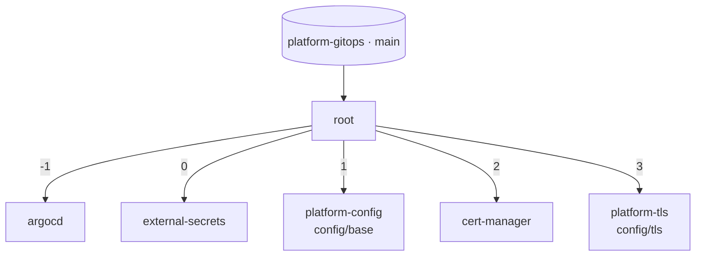

# Argo CD · GitOps app-of-apps

> Componente de la **fase 1** · [ADR 0007](../adr/0007-argocd-gitops.md) · en marcha desde el 24-oct-2026
> (paso 05). Repo: [`platform-gitops`](https://github.com/elpalmeral-org/platform-gitops).

## Qué hace

Reconcilia el clúster con `platform-gitops/main`. Una `Application` raíz (`root`) despliega una
`Application` por addon, en **oleadas**: cada una espera a que la anterior esté `Healthy`.
Argo CD se gestiona **a sí mismo** (`addons/argocd.yaml`), así que actualizarlo también es un PR.



| Dato | Valor |
|---|---|
| Chart / versión | `argo/argo-cd` 10.10.5 · Argo CD v3.5.5 |
| Valores | `bootstrap/argocd-values.yaml` (bootstrap y autogestión comparten fichero) |
| Desactivado | Dex, notificaciones (se activarán si hacen falta) |
| Acceso | *port-forward* `8080:80` hasta el PR 2 de TLS → `https://argocd.apl.<dominio>` |
| Credenciales | `admin` · 1Password `Private/argocd-k3s01-admin` |

## Operación

```bash
kubectl -n argocd get applications                     # estado de todo
argocd login localhost:8080 --username admin --insecure   # con el port-forward activo
argocd app diff <app>                                  # qué cambiaría
```

- **Cambiar algo:** PR en `platform-gitops` → merge → Argo CD sincroniza (≤ 3 min, o *Refresh* en la UI).
- **Nunca** `kubectl apply` a mano sobre recursos gestionados: `selfHeal` lo revierte (y es parte de la demo).

## En la demo

1. Abrir la UI y enseñar el árbol de `root` → addons.
2. Borrar a mano un recurso gestionado (por ejemplo el namespace `eso-smoke`) y ver cómo Argo CD lo recrea.
3. Enseñar un PR fusionado y su sincronización.
