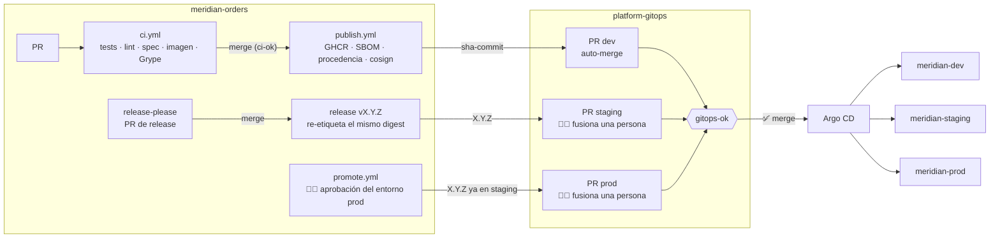
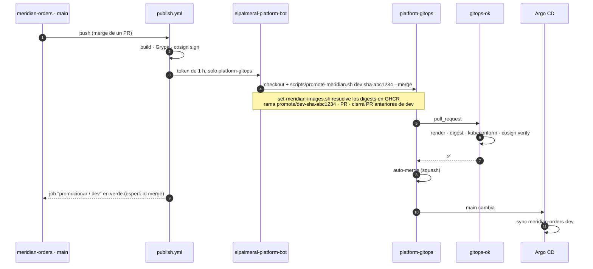
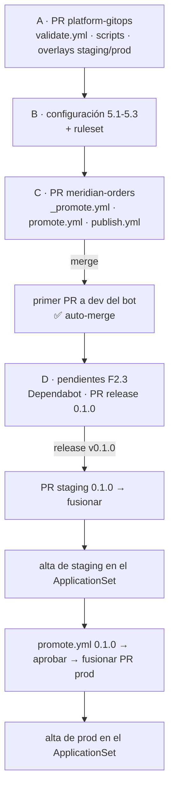
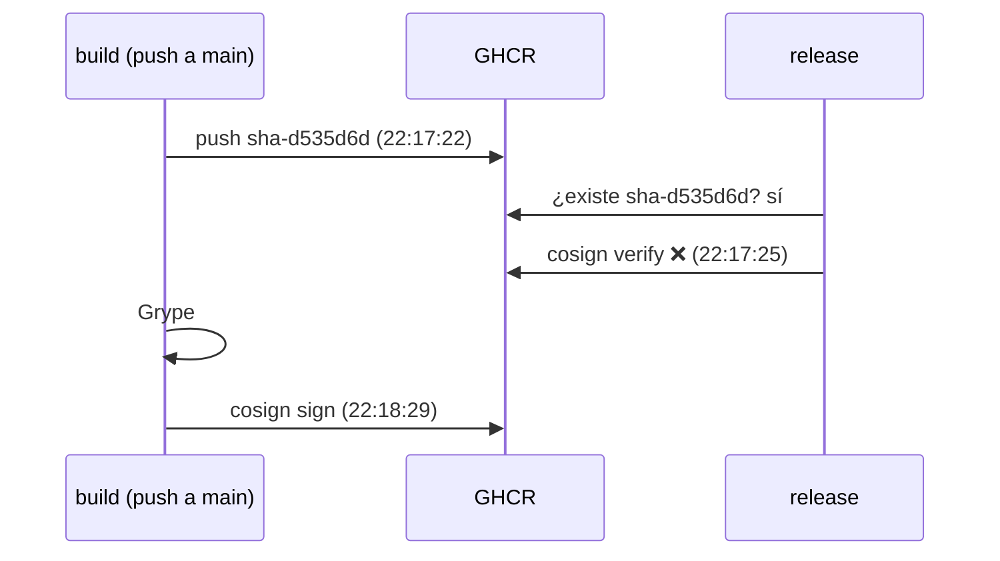

# CI/CD y promoción entre entornos (F2.4b)

> Decisiones: [0011](../adr/0011-trunk-based-release-please.md) trunk + release-please ·
> [0012](../adr/0012-promocion-por-pr-gitops.md) promoción por PR ·
> [0014](../adr/0014-github-app-platform-bot.md) GitHub App ·
> [0015](../adr/0015-puerta-gitops-ok.md) puerta `gitops-ok`.

**Idea para contar:** el pipeline de la aplicación **no despliega nada**. Construye, firma y *pide*
un despliegue abriendo un PR en `platform-gitops`. La plataforma decide si lo acepta (check
`gitops-ok`) y Argo CD lo aplica. Cada despliegue es un PR con autor, diff, checks y, cuando toca,
una persona que lo aprueba.

## 1. El recorrido completo



| Entorno | Qué llega | Quién lo dispara | Puerta humana | URL |
|---|---|---|---|---|
| dev | `sha-<commit>` de cada merge en `main` | `publish.yml` (push) | ninguna: auto-merge si `gitops-ok` ✅ | `orders-dev.apl.<dominio>` |
| staging | `X.Y.Z` de cada release | `publish.yml` (release) | fusionar el PR | `orders-staging.apl.<dominio>` |
| prod | `X.Y.Z` **que ya está en staging** | `promote.yml` a mano (entorno `prod`) | aprobar el entorno `prod` **y** fusionar el PR | `orders.apl.<dominio>` |

## 2. Una promoción a dev, paso a paso



Si `gitops-ok` falla, el PR se queda abierto y el job de la app se pone **en rojo**: el equipo lo
ve en su propio repo, sin tener que mirar la plataforma.

## 3. Quién hace qué

| Pieza | Repo | Responsable | Qué hace |
|---|---|---|---|
| `publish.yml` | meridian-orders | equipo de la app | construir, firmar y *pedir* dev y staging |
| `promote.yml` | meridian-orders | equipo de la app | *pedir* prod (con aprobación del entorno) |
| `_promote.yml` | meridian-orders | equipo de la app | reutilizable: token del bot + llamar al script de la plataforma |
| `scripts/promote-meridian.sh` | platform-gitops | plataforma | **cómo** se promociona: tags admitidos, prod = staging, PR, el último gana |
| `scripts/validate.sh` + `validate.yml` | platform-gitops | plataforma | **qué** se acepta: el check `gitops-ok` |

> La lógica vive en el repo de la plataforma a propósito. Si mañana hay diez aplicaciones, todas
> llaman al mismo script y pasan por la misma puerta; mejorar la regla es un PR en un solo sitio.

## 4. Las reglas de `gitops-ok`

| # | Regla | Qué evita |
|---|---|---|
| 1 | Los scripts pasan `shellcheck` | romper la propia promoción |
| 2 | Entorno **activo** en el ApplicationSet ⇒ imágenes fijadas **por digest** | desplegar `latest` o un tag que alguien movió |
| 3 | staging y prod solo `X.Y.Z` | que un commit sin release llegue a staging |
| 4 | Manifiestos válidos (`kubeconform` + CRD de Datree) | que Argo CD descubra el error al sincronizar |
| 5 | Si el PR cambia prod, prod = staging | saltarse staging |
| 6 | Firma cosign de `publish.yml@refs/heads/main` | desplegar una imagen que no salió de nuestro pipeline |

Se puede lanzar en local: `scripts/validate.sh` (sin `cosign` instalado avisa y omite la regla 6).

## 5. Configuración (una vez)

Desde el Mac, con `gh` autenticado como propietario de la org.

### 5.1 · La App también en `platform-gitops`

En la org → **Settings → GitHub Apps → elpalmeral-platform-bot → Configure → Repository access**:
añade `platform-gitops` (además de `meridian-orders`). Los permisos (`Contents` y `Pull requests`
en *Read and write*) ya los tiene del paso 06.

### 5.2 · `platform-gitops`: auto-merge y regla de `main`

```bash
# Solo squash, borrar la rama al fusionar y permitir auto-merge
gh api -X PATCH repos/elpalmeral-org/platform-gitops \
  -F allow_auto_merge=true -F delete_branch_on_merge=true \
  -F allow_squash_merge=true -F allow_merge_commit=false -F allow_rebase_merge=false \
  --jq '{allow_auto_merge, delete_branch_on_merge}'
```

La *ruleset* se crea **después** de fusionar el PR que añade `validate.yml` (antes no existe el
check `gitops-ok` y bloquearía todo):

```bash
gh api -X POST repos/elpalmeral-org/platform-gitops/rulesets --input - <<'EOF' --jq '{id, name, enforcement}'
{
  "name": "main",
  "target": "branch",
  "enforcement": "active",
  "conditions": { "ref_name": { "include": ["~DEFAULT_BRANCH"], "exclude": [] } },
  "rules": [
    { "type": "deletion" },
    { "type": "non_fast_forward" },
    { "type": "pull_request", "parameters": {
        "required_approving_review_count": 0,
        "dismiss_stale_reviews_on_push": false,
        "require_code_owner_review": false,
        "require_last_push_approval": false,
        "required_review_thread_resolution": false } },
    { "type": "required_status_checks", "parameters": {
        "strict_required_status_checks_policy": false,
        "required_status_checks": [ { "context": "gitops-ok", "integration_id": 15368 } ] } }
  ]
}
EOF
```

- `15368` es la integración *GitHub Actions*: solo cuenta el check que publica Actions.
- `strict: false`: los PR del bot no tienen que ponerse al día con `main` antes de fusionarse.
- 0 aprobaciones: en un lab de una persona la puerta humana es **fusionar**; en un cliente,
  aquí van `CODEOWNERS` y 1-2 aprobaciones para staging y prod.

### 5.3 · `meridian-orders`: entornos y variable

```bash
R=repos/elpalmeral-org/meridian-orders
gh api -X PUT $R/environments/dev --silent
gh api -X PUT $R/environments/staging --silent

# prod: tú como revisor obligatorio y solo desde main
me=$(gh api user --jq .id)
gh api -X PUT $R/environments/prod --input - --jq '.protection_rules[].type' <<EOF
{ "reviewers": [ { "type": "User", "id": $me } ],
  "prevent_self_review": false,
  "deployment_branch_policy": { "protected_branches": false, "custom_branch_policies": true } }
EOF
gh api -X POST $R/environments/prod/deployment-branch-policies -f name=main -f type=branch --jq .name

# Dominio de las apps para el enlace de cada despliegue (no se escribe en el repo público)
gh variable set LAB_APPS_DOMAIN --repo elpalmeral-org/meridian-orders --body "apl.$LAB_DOMAIN"
```

`LAB_DOMAIN` sale de `lab.env` (`set -a; source lab.env; set +a`).

## 6. Puesta en marcha (hecha el 27-oct)



**Dar de alta un entorno** es un PR de plataforma de una línea (descomentar su `- env:` en
`addons/meridian-orders.yaml`). `gitops-ok` lo rechaza si el overlay aún no tiene imágenes, así
que siempre va **después** de su primera promoción.

### Resultado

| Paso | Evidencia |
|---|---|
| A · puerta en `platform-gitops` | PR #4 · `gitops-ok` verde, cosign verifica las imágenes de dev desde el Mac |
| C · CD en la app | PR #12 → el bot abre y fusiona solo `platform-gitops` #5 (`sha-d5f7f99`) |
| otro merge en `main` | PR #13 → bot #6 (`sha-3624ab0`) en menos de un minuto |
| staging | `promote` → `staging`, `0.1.0` → bot #7 (fusión manual) → alta #8 → `{"version":"0.1.0","environment":"staging"}` |
| prod | `promote` → aprobar entorno `prod` → bot #9 (mismos digests que staging) → alta #10 → `{"version":"0.1.0","environment":"prod"}` |

## 7. Operación

| Quiero… | Cómo |
|---|---|
| ver qué hay en cada entorno | `newTag` en `apps/meridian-orders/overlays/<env>/kustomization.yaml`, o **Deployments** en GitHub |
| volver atrás | revertir el PR de promoción en `platform-gitops` (`gh pr revert` o botón *Revert*) |
| re-promocionar una release a staging | Actions → **promote** → entorno `staging`, versión `X.Y.Z` |
| promocionar a mano (emergencia) | `scripts/promote-meridian.sh <env> <tag>` en local: abre el mismo PR y pasa la misma puerta |
| bloquear despliegues | dejar el PR sin fusionar; en dev, desactivar el auto-merge del repo |

## 8. Lección: la imagen existe antes de estar firmada

La primera release (`v0.1.0`, 26-oct) falló en *etiquetar release* con `exit code 10` de
`cosign verify` (*no matching signatures*). El build de ese commit estaba en cola detrás del
anterior (concurrencia de `publish`), y cuando por fin subió `sha-<commit>` a GHCR el job de
release lo encontró y verificó **antes** de que se firmara: entre el *push* y la firma van ~1,5 min
de Grype.



Corrección: el job de release espera a que la imagen exista **y** esté firmada. La puerta
funcionó como debía: nada sin firma llegó a re-etiquetarse.

## 9. Lección: errores transitorios del OIDC de GitHub

Una firma falló con `fetching ambient OIDC credentials: invalid character 'u' looking for beginning
of value`: el servicio de tokens de GitHub respondió con texto (`upstream connect error…`) en vez de
JSON. El frontend se firmó bien en la misma ejecución. Se resolvió relanzando el job fallido y
`publish.yml` reintenta ahora `cosign sign` hasta tres veces.

## 10. Límites conocidos (y cuándo se cierran)

- **La firma se verifica en el CI, no en la admisión.** Quien tenga acceso al clúster podría
  aplicar una imagen sin firmar. Lo cierra Kyverno `verifyImages` (⏸️ ola 4 de F1).
- **“Desplegado” en GitHub significa “fusionado en GitOps”**, no “sano en el clúster”. Argo CD
  sincroniza después. Lo cierra F3 (Port lee el estado de Argo) o notificaciones de Argo CD (F6).
- **Argo CD tarda hasta ~3 min en ver un merge** (sondeo de `timeout.reconciliation`). El clúster
  solo es accesible desde la LAN, así que no hay webhook de GitHub. En la demo:
  `kubectl -n argocd annotate app root argocd.argoproj.io/refresh=hard --overwrite`.
- **Un PR de dev por merge.** Con mucho tráfico se acumularían; el script cierra los anteriores
  ("el último gana") para que solo quede uno vivo por entorno.
