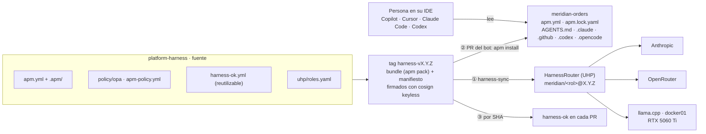
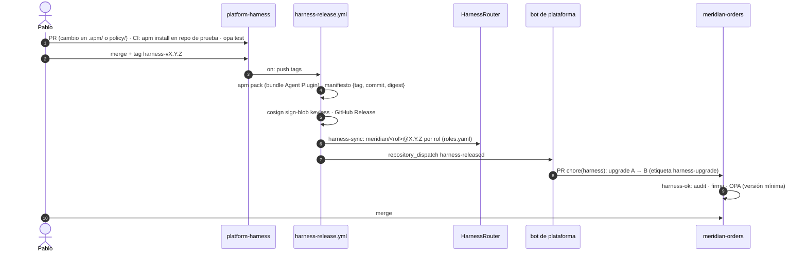

# F4 · El harness corporativo como producto

> Decidido el 28-oct: [ADR 0022](../adr/0022-harness-repo-propio-formatos-abiertos.md) (repo propio,
> formatos abiertos) · [ADR 0023](../adr/0023-apm-distribucion-harness-ok.md) (APM y `harness-ok`) ·
> [ADR 0024](../adr/0024-harnessrouter-en-f4-proveedores.md) (HarnessRouter en F4, tres proveedores).
> Requisito: **agnóstico del modelo y de la herramienta**.

## 1. Qué es el harness aquí

Todo lo que rodea al modelo y decide cómo trabaja, tratado como software: tiene versión, se firma,
se publica y se actualiza en el parque con PR.

| Pieza | Formato | Dónde se escribe en `platform-harness` |
|---|---|---|
| Estándares corporativos (siempre activos) | instrucciones APM → `AGENTS.md`, `.claude/rules`, `.github/instructions`… | `.apm/instructions/` |
| Capacidades bajo demanda | Agent Skills (`SKILL.md`) | `.apm/skills/` |
| Mandatos de agente (spec-writer, implementer, 3 validadores) | `.agent.md` (APM) y `systemPrompt` (UHP) | `.apm/agents/` |
| Comandos (`/feature`, `/harness-doctor`) | prompts APM | `.apm/prompts/` |
| Guardarraíles en el agente (secretos, grounding) | hooks APM (donde la herramienta los soporte) | `.apm/hooks/` |
| Herramientas | MCP (Port) | `apm.yml` → `dependencies.mcp` |
| Corpus de grounding | Markdown | `corpus/` (y skill que lo consulta) |
| Política de merge | OPA/Rego + tests | `policy/opa/` |
| Política del propio APM | `apm-policy.yml` (fuentes y primitivas permitidas) | raíz |
| Puertas | workflows reutilizables | `.github/workflows/harness-ok.yml` |
| Roles en UHP | rol → base + modelo + proveedor | `uhp/roles.yaml` |

## 2. Tres planos, una fuente

| Plano | Agnóstico porque… | Límite conocido |
|---|---|---|
| ① UHP | la base y el modelo son configuración por rol | hooks y permisos no están en UHP; `disabledTools` solo es bloqueo duro si la base lo soporta |
| ② APM | una fuente compila al formato de cada herramienta | cada herramienta soporta un subconjunto (p. ej. OpenCode sin hooks): ver matriz de APM |
| ③ Puertas | son deterministas | — |

> **Idea para la demo:** lo que de verdad protege (puertas) no depende del agente; lo que depende
> del agente (hooks, permisos) es una capa adicional, nunca la única.

## 3. Ciclo de vida

## 4. Plan de F4

| Paso | Qué | Estado |
|---|---|---|
| 08 (setup) | Repo `platform-harness` (ruleset, GitHub App instalada), claves en 1Password (Anthropic, OpenRouter, llama.cpp), límites de gasto, nombre para HarnessRouter | ⚪ |
| F4.1 | Contenido `harness-v0.1.0`: `apm.yml` + `.apm/` (portado de `platform-harness-lab`), MCP de Port, corpus, OPA · CI de validación | ⚪ |
| F4.2 | Release firmada: `apm pack`, manifiesto, cosign, GitHub Release | ⚪ |
| F4.3 | `meridian-orders` consume: `apm.yml`, `apm.lock.yaml`, ficheros generados · `harness-ok` obligatorio | ⚪ |
| F4.4 | PR automático de *upgrade* con el bot · versión mínima en OPA | ⚪ |
| F4.5 | OpenSpec en `meridian-orders`: specs base del comportamiento actual · `openspec validate --strict` | ⚪ |
| F4.6 | HarnessRouter CE en k3s (addon GitOps, ESO, TLS) con los tres proveedores | ⚪ |
| F4.7 | `harness-sync` (release → `meridian/<rol>@X.Y.Z`) · prueba de humo: un mandato en tres combinaciones base + modelo | ⚪ |
| F4.8 | Port: release del harness y versión por servicio · regla «harness al día y sin *drift*» | ⚪ |

## 5. Riesgos abiertos

- **APM 0.x:** se fija la versión; `harnessctl` (lab anterior) es el plan B.
- **Modelo local compartido:** el `llama.cpp` de docker01 sirve también a Hermes (2 *slots*, 64K). La
  prueba de humo dirá si un 27B ternario aguanta un bucle agéntico; si no, el plano local se queda
  para validadores cortos.
- **HarnessRouter sin releases publicadas:** imagen fijada por *digest*; manifiestos propios.
- **Gasto:** límites en Anthropic y OpenRouter antes de F4.7.
