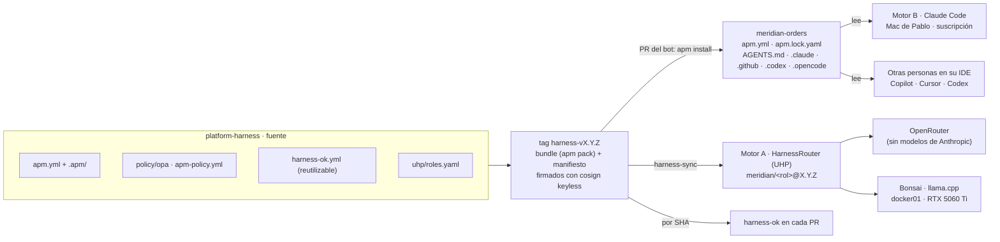
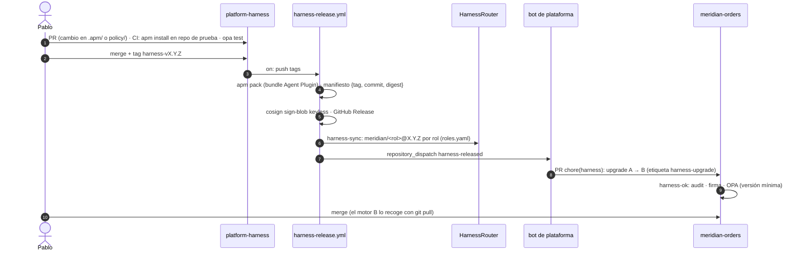

# F4 · El harness corporativo como producto

> Decidido el 28 y 29-oct: [ADR 0022](../adr/0022-harness-repo-propio-formatos-abiertos.md) (repo propio,
> formatos abiertos) · [ADR 0023](../adr/0023-apm-distribucion-harness-ok.md) (APM y `harness-ok`) ·
> [ADR 0024](../adr/0024-harnessrouter-en-f4-proveedores.md) (HarnessRouter en F4) ·
> [ADR 0025](../adr/0025-dos-motores-un-harness.md) (un harness, dos motores).
> Requisito: **agnóstico del modelo y de la herramienta**, y usable de principio a fin con Claude
> Code y la suscripción personal de Pablo.

## 1. Qué es el harness aquí

Todo lo que rodea al modelo y decide cómo trabaja, tratado como software: tiene versión, se firma,
se publica y se actualiza en el parque con PR.

| Pieza | Formato | Dónde se escribe en `platform-harness` |
|---|---|---|
| Estándares corporativos (siempre activos) | instrucciones APM → `AGENTS.md`, `.claude/rules`, `.github/instructions`… | `.apm/instructions/` |
| Capacidades bajo demanda | Agent Skills (`SKILL.md`) | `.apm/skills/` |
| Mandatos de agente (spec-writer, implementer, 3 validadores) | `.agent.md` (APM → subagentes de Claude) y `systemPrompt` (UHP) | `.apm/agents/` |
| Comandos (`/feature`, `/harness-doctor`) | prompts APM | `.apm/prompts/` |
| Guardarraíles en el agente (secretos, grounding) | hooks APM (donde la herramienta los soporte) | `.apm/hooks/` |
| Herramientas | MCP (Port) | `apm.yml` → `dependencies.mcp` |
| Corpus de grounding | Markdown | `corpus/` (y skill que lo consulta) |
| Política de merge | OPA/Rego + tests | `policy/opa/` |
| Política del propio APM | `apm-policy.yml` (fuentes y primitivas permitidas) | raíz |
| Puertas | workflows reutilizables | `.github/workflows/harness-ok.yml` |
| Roles del motor A | rol → base + modelo + proveedor | `uhp/roles.yaml` |

## 2. Una fuente, dos motores

| | Motor A · abierto | Motor B · Claude |
|---|---|---|
| Ejecuta | HarnessRouter (UHP) en k3s01 | Claude Code sin modificar, en el Mac |
| Modelos | OpenRouter (GPT, Gemini, DeepSeek, Qwen, GLM, Kimi…) + Bonsai local | Claude, los de la suscripción Pro/Max |
| Bases | OpenRouter: `opencode`, `hermes`, `vibe`, `pi`, `fast-agent` · Bonsai: `vibe`, `fast-agent`, `docker-agent` | `claude` |
| Recibe el harness | `harness-sync`: mandato como `systemPrompt`, bundle Agent Plugin, MCP | APM, formato de Claude: `.claude/agents/`, `/feature`, skills, hooks, MCP |
| Credencial | Clave de OpenRouter con límite · Bonsai sin clave (LAN) | `claude login` |
| Se lanza | Port → workflow → runner ARC (F5) → UHP | Port → *issue* `aidlc:claude` → `/feature #<issue>` en el Mac |
| Coste visible | € reales por ejecución (0 € en local) | tokens y coste nocional (consume el plan) |
| Límite conocido | hooks y permisos no están en UHP; `disabledTools` solo es duro si la base lo soporta | depende de una persona y su portátil |

**Principio para los dos:** los agentes **proponen** (spec, código, revisión) antes del PR; las
puertas que **bloquean** son deterministas (`harness-ok`, `openspec validate --strict`, tests,
`gitops-ok`); **deciden** las personas. No hay agentes en las puertas de CI: eso queda como punto de
conversación en el [playbook de la demo](../demo/README.md#agentes-en-el-flujo-qué-se-podría-añadir).

> **Idea para la demo:** la misma petición, por los dos motores, con la misma versión del harness y
> las mismas puertas. Lo que cambia es el modelo, el coste y quién lo ejecuta.

## 3. Ciclo de vida de una release

## 4. Plan de F4

| Paso | Qué | Motor | Estado |
|---|---|---|---|
| 08 (setup) | [Repo `platform-harness`](../setup/paso-08-harness.md) (rulesets de `main` y de tags), Claude Code con la suscripción, clave de OpenRouter con límite, acceso a Bonsai, credenciales y nombre de HarnessRouter, capacidad de k3s01 | A · B | 🟡 |
| F4.1 | Contenido `harness-v0.1.0`: `apm.yml` + `.apm/` (portado de `platform-harness-lab`), MCP de Port, corpus, OPA · CI de validación | A · B | ⚪ |
| F4.2 | Release firmada: `apm pack`, manifiesto, cosign, GitHub Release | A · B | ⚪ |
| F4.3 | `meridian-orders` consume: `apm.yml`, `apm.lock.yaml`, ficheros generados · `harness-ok` obligatorio | A · B | ⚪ |
| F4.4 | PR automático de *upgrade* con el bot · versión mínima en OPA | A · B | ⚪ |
| F4.5 | OpenSpec en `meridian-orders`: specs base del comportamiento actual · `openspec validate --strict` · **prueba del motor B**: `/feature` de principio a fin en el Mac | B | ⚪ |
| F4.6 | HarnessRouter CE en k3s (addon GitOps, ESO, TLS) con OpenRouter y Bonsai | A | ⚪ |
| F4.7 | `harness-sync` (release → `meridian/<rol>@X.Y.Z`) · prueba de humo: un mandato con OpenRouter y con Bonsai, comparado con el motor B | A | ⚪ |
| F4.8 | Port: release del harness y versión por servicio · regla «harness al día y sin *drift*» | A · B | ⚪ |

En F5: ARC para el motor A en CI y el workflow de Port «Pedir feature» con selector de motor.

## 5. Riesgos abiertos

- **APM 0.x:** se fija la versión; `harnessctl` (lab anterior) es el plan B.
- **Modelo local compartido:** el `llama.cpp` de docker01 sirve también a Hermes (2 *slots*, 64K). La
  prueba de humo dirá si un 27B ternario aguanta un bucle agéntico (Q8); si no, Bonsai se queda para
  validadores cortos.
- **HarnessRouter sin releases en GitHub:** versión de Docker Hub fijada por *digest*; manifiestos propios.
- **Gasto:** límite en la clave de OpenRouter antes de F4.7. El motor B consume los límites del plan.
- **Motor B personal:** no escala a un equipo sin Team, Enterprise o clave de API; es una decisión de
  cada cliente.
