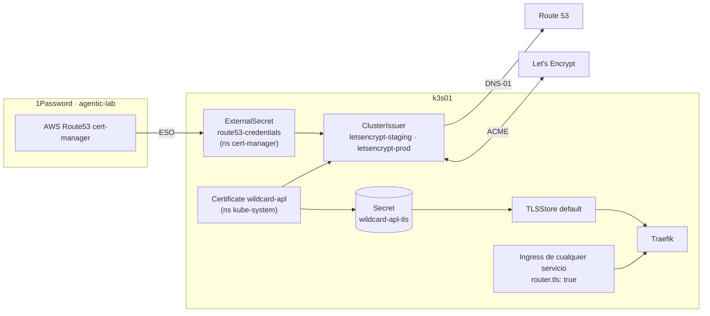
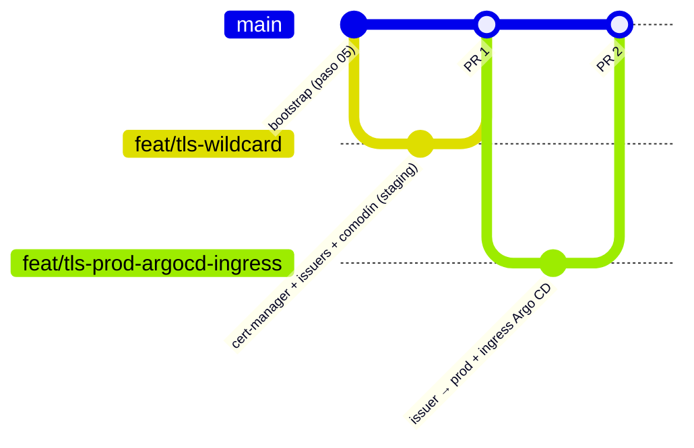

# Ingress y TLS · cert-manager + Let's Encrypt (DNS-01) + Traefik

> Componente de la **fase 1**. Decisiones: [ADR 0009](../adr/0009-tls-letsencrypt-dns01-route53.md)
> y [ADR 0010](../adr/0010-nombres-publicos-gitops-y-doh.md). Todo vive en
> [`platform-gitops`](https://github.com/elpalmeral-org/platform-gitops) y entra **por PR**.

## Qué hace

Un único certificado comodín `*.apl.<dominio>`, emitido por Let's Encrypt y renovado solo, que
Traefik sirve **por defecto** a cualquier ruta HTTPS. Un servicio nuevo solo necesita un `Ingress`
con dos anotaciones: nada de un `Certificate` por servicio.



## Cómo se despliega: dos PR

Se hace en dos PR a propósito: el primero prueba toda la cadena con el entorno *staging* de Let's
Encrypt, que tiene límites generosos; el segundo pasa a producción y publica Argo CD por HTTPS.
Además, es una buena demo: **cambiar el emisor de todo el clúster es un PR de una línea**.



### PR 1 · `feat/tls-wildcard` (preparado)

Ficheros (ya en `~/git/homelab/platform-gitops`):

| Fichero | Qué |
|---|---|
| `addons/cert-manager.yaml` | Ola 2 · cert-manager v1.21.2, comprobación DNS-01 por DoH |
| `addons/platform-tls.yaml` | Ola 3 · aplica `config/tls/` |
| `addons/platform-config.yaml` | Ahora apunta a `config/base/` (para que no recoja `config/tls/`) |
| `config/base/…` | Lo que había en `config/` (mismo contenido, movido) |
| `config/tls/route53-credentials.yaml` | `ExternalSecret` con las claves de AWS |
| `config/tls/cluster-issuers.yaml` | `letsencrypt-staging` y `letsencrypt-prod` |
| `config/tls/wildcard-certificate.yaml` | Comodín `*.apl` con **staging** |
| `config/tls/traefik-default-tlsstore.yaml` | Certificado por defecto de Traefik |

```bash
cd ~/git/homelab/platform-gitops
git switch -c feat/tls-wildcard
git add -A
git commit -m "feat(tls): cert-manager, ClusterIssuer Let's Encrypt (DNS-01 Route 53) y comodín *.apl en staging"
git push -u origin feat/tls-wildcard
gh pr create --fill --base main
gh pr merge --squash --delete-branch      # el merge ES el despliegue
git switch main && git pull
```

Seguimiento (2-5 min; el reto DNS-01 tarda ~1-2 min en propagarse):

```bash
kubectl -n argocd get applications -w                               # cert-manager y platform-tls → Healthy
kubectl -n cert-manager get externalsecret route53-credentials       # SecretSynced
kubectl get clusterissuer                                           # READY True ambos
kubectl -n kube-system get certificate wildcard-apl                 # READY True
kubectl -n kube-system get secret wildcard-apl-tls
```

Prueba de que Traefik ya lo sirve (staging no es confiable: por eso `-k`):

```bash
curl -skv "https://cualquiera.$LAB_SUBDOMAIN.$LAB_DOMAIN" 2>&1 | grep -E 'subject:|issuer:'
# issuer: … (STAGING) …   subject: CN=*.apl.<dominio>
```

### PR 2 · `feat/tls-prod-argocd-ingress` (se prepara al confirmar el PR 1)

- `config/tls/wildcard-certificate.yaml`: `issuerRef.name: letsencrypt-prod`.
- `bootstrap/argocd-values.yaml`: `global.domain: argocd.apl.<dominio>` y
  `server.ingress` con `ingressClassName: traefik` y las anotaciones
  `traefik.ingress.kubernetes.io/router.entrypoints: websecure` y
  `traefik.ingress.kubernetes.io/router.tls: "true"`.
- Resultado: `https://argocd.apl.<dominio>` con candado verde, sin *port-forward*.

## Problemas típicos

| Síntoma | Causa probable | Qué hacer |
|---|---|---|
| `Challenge` en `pending` con *propagation check failed* | El TXT aún no se ve en los DNS públicos | Esperar 2-3 min; `kubectl -n kube-system describe challenge` |
| `Challenge` *AccessDenied* | Política IAM o nombre del registro distinto de `_acme-challenge.apl.<dominio>` | Revisar el paso 04 (prueba ✅ ✅ ⛔) |
| `ClusterIssuer` no Ready · *secret not found* | `ExternalSecret` aún sin sincronizar | `kubectl -n cert-manager describe externalsecret route53-credentials` |
| `curl` muestra `TRAEFIK DEFAULT CERT` | El `Secret` aún no existe o el `TLSStore` no se aplicó | `kubectl -n kube-system get certificate,secret,tlsstore` |

## Cómo usarlo desde un servicio

```yaml
apiVersion: networking.k8s.io/v1
kind: Ingress
metadata:
  name: mi-servicio
  annotations:
    traefik.ingress.kubernetes.io/router.entrypoints: websecure
    traefik.ingress.kubernetes.io/router.tls: "true"
spec:
  ingressClassName: traefik
  rules:
    - host: mi-servicio.apl.<dominio>
      http:
        paths:
          - path: /
            pathType: Prefix
            backend:
              service: { name: mi-servicio, port: { number: 80 } }
```
