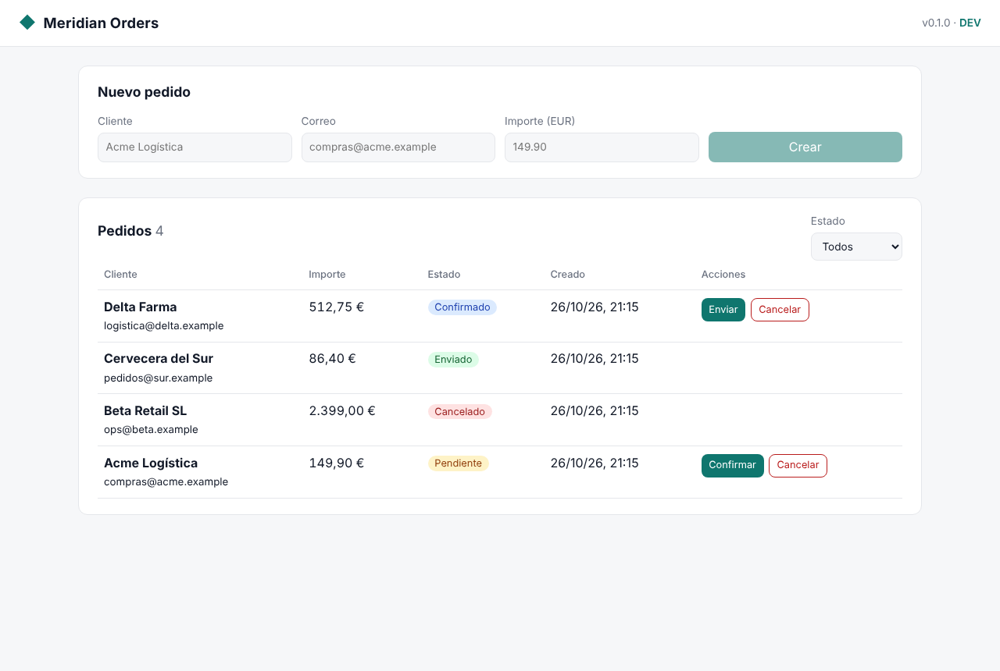
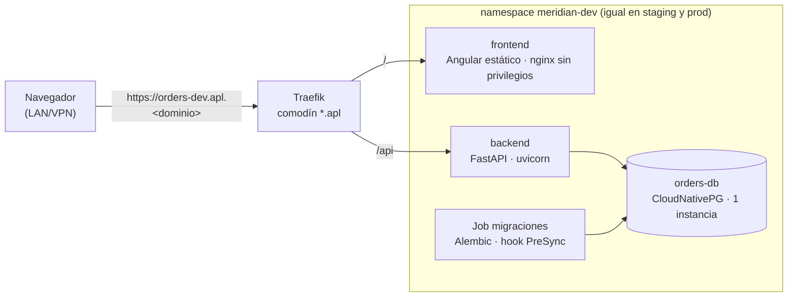
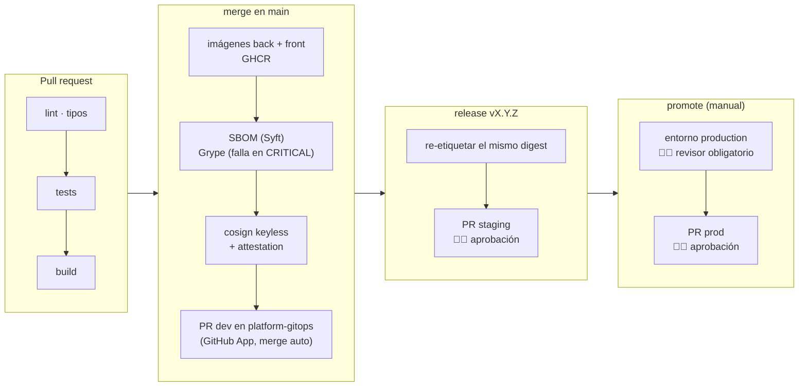
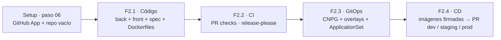

# Meridian Orders · aplicación de ejemplo (fase 2)

> Decisiones: [0011](../adr/0011-trunk-based-release-please.md) trunk-based + release-please ·
> [0012](../adr/0012-promocion-por-pr-gitops.md) promoción por PR ·
> [0013](../adr/0013-postgresql-cloudnativepg.md) CloudNativePG ·
> [0014](../adr/0014-github-app-platform-bot.md) GitHub App.
> Repo: `elpalmeral-org/meridian-orders` (público).

## 1. Qué es

Un gestor de pedidos ficticio, lo bastante realista para que un cliente se reconozca en él y lo
bastante pequeño para que un agente pueda cambiarlo en una demo.

| Funcionalidad | Fase |
|---|---|
| Listar, crear y consultar pedidos; cambiar su estado (`pending → confirmed → shipped`, `cancelled`) | F2 (base) |
| Panel Angular: tabla de pedidos, filtro por estado, alta de pedido | F2 (base) |
| `/healthz`, `/readyz`, `/metrics` (Prometheus) | F2 (base) |
| **Puntuación de riesgo del pedido** (`add-order-risk-scoring`) | **F5 · la primera feature que construye un agente vía AIDLC** |

> La puntuación de riesgo **no** se implementa ahora a propósito: la app arranca sin ella para que
> la demo AIDLC muestre a un agente añadiéndola de la spec al despliegue.



### Validación de F2.1 (26-oct-2026)

| Pieza | Comprobación | Resultado |
|---|---|---|
| Backend | `ruff format` · `ruff check` · `mypy --strict` | ✅ sin avisos |
| Backend | `pytest` (24 tests: escenarios de la spec, salud, métricas, migraciones) | ✅ 99 % de cobertura |
| Backend | `alembic upgrade/downgrade` y `alembic check` contra **PostgreSQL 16** | ✅ `ENUM` nativo, sin divergencias |
| Frontend | Prettier · ESLint (angular-eslint 22.6) · Vitest (13 tests) · `ng build` | ✅ 65 KB comprimido |
| Spec | `openspec validate --specs --strict` (1.15.0) | ✅ 5 requisitos |
| E2E manual | Panel + API + PostgreSQL, escritorio claro y móvil oscuro | ✅ sin errores de consola |
| Imágenes | `hadolint` en los dos Dockerfiles | ✅ · *build* real en el CI (F2.2) |

## 2. Arquitectura en ejecución



Mismo host para front y API (`/` y `/api`): sin CORS y sin configuración por entorno en el front.

| Entorno | URL | Imagen | Cómo llega |
|---|---|---|---|
| dev | `orders-dev.apl.<dominio>` | `sha-<commit>` | merge en `main` → PR automático |
| staging | `orders-staging.apl.<dominio>` | `X.Y.Z` | release → PR que fusiona una persona |
| prod | `orders.apl.<dominio>` | `X.Y.Z` (mismo digest que staging) | `promote` a mano → aprobar entorno → fusionar PR |

## 3. Repositorio `meridian-orders`

```
├── apps/
│   ├── backend/            FastAPI · SQLAlchemy 2.1 · Alembic · uv · ruff · mypy · pytest
│   │   └── Dockerfile      multi-stage, usuario no root
│   └── frontend/           Angular 22 (standalone) · ESLint · tests
│       └── Dockerfile      build → nginx-unprivileged
├── openspec/               specs vigentes (orders) y cambios en curso
├── .github/workflows/
│   ├── ci.yml              PR: lint · tests · build (solo lo que cambia: filtros por ruta)
│   ├── pr-title.yml        Conventional Commits en el título
│   ├── release-please.yml  PR de release · tag vX.Y.Z
│   ├── cd.yml              main/tag: imágenes → SBOM → Grype → cosign → PR a platform-gitops
│   └── promote.yml         workflow_dispatch: staging → prod (entorno "production")
└── release-please-config.json · .release-please-manifest.json
```

## 4. Pipeline



Todos los jobs corren en **runners hospedados de GitHub** (gratis en repos públicos): ninguno
necesita la LAN, porque el despliegue lo hace Argo CD tirando de `platform-gitops`.

### Detalle del CI (F2.2)

| Workflow | Cuándo | Qué hace |
|---|---|---|
| `ci` | PR y push a `main` | Filtros por ruta → backend (ruff, mypy, pytest, migraciones en **PostgreSQL 18**) · frontend (Prettier, ESLint, Vitest, build) · spec (`openspec --strict`) · imagen de cada app cambiada (hadolint, buildx, prueba de humo) → check agregado **`ci-ok`** |
| `pr-title` | PR | Título en Conventional Commits → check **`conventional-commits`** |
| `release-please` | push a `main` | PR de release `chore(release): X.Y.Z` con CHANGELOG; al fusionarlo, tag `vX.Y.Z`. Token de la GitHub App acotado a este repo (*contents* y *pull requests*) |
| Dependabot | semanal | Actions, uv, npm y Docker, agrupados y con prefijo `chore(deps)` |

Decisiones de detalle:

- **Versión dinámica en el backend** (`[tool.hatch.version]` lee `__init__.py`): así `uv.lock` no
  fija la versión y el PR de release no rompe `uv sync --locked`.
- **Primera versión `0.1.0`**: manifiesto en `0.0.0` con `bump-minor-pre-major`.
- **Un solo check obligatorio** (`ci-ok`) aunque los jobs se salten por ruta: el ruleset no se
  queda esperando checks que no se van a ejecutar.
- Validado con `actionlint`, `zizmor` (0 hallazgos) y los esquemas de Dependabot, workflows y release-please.

### Lección de F2.3: CVE en la imagen base

El primer `publish` del frontend falló en Grype: `nginx-unprivileged:1.29-alpine` traía `openssl`,
`curl` y `brotli` con CVE críticas ya corregidas en Alpine. Subir a 1.31 no bastó (la imagen base
va días por detrás de los parches). Solución: `apk upgrade` al construir y eliminar `curl`, que no
se usa. Y el análisis se adelantó al **CI de PR**, para que una imagen vulnerable no llegue a `main`.

## 5. En `platform-gitops`

```
addons/
├── cloudnative-pg.yaml            ← ola 2 · operador CNPG
└── meridian-orders.yaml           ← ApplicationSet: una Application por entorno
apps/meridian-orders/
├── base/                          ← Deployments, Services, Ingress, Cluster CNPG, Job de migración
└── overlays/
    ├── dev/       kustomization.yaml  (images: digest dev · host orders-dev)
    ├── staging/   kustomization.yaml
    └── prod/      kustomization.yaml
```

## 6. Presupuesto de recursos (por entorno)

| Pieza | Petición | Límite |
|---|---|---|
| backend | 50m · 96 MiB | 256 MiB |
| frontend | 10m · 16 MiB | 64 MiB |
| orders-db | 50m · 128 MiB | 384 MiB |
| **Total ×3 entornos** | **~0,3 CPU · ~0,7 GiB** | ~2,1 GiB |

Más el operador CNPG (~100 MiB). Entra en el margen medido tras la fase 1.

## 7. Plan de la fase 2



| Paso | Qué | Estado |
|---|---|---|
| Setup 06 | GitHub App `elpalmeral-platform-bot`, repo `meridian-orders` vacío, secretos de org | ✅ ([doc](../setup/paso-06-github-app.md)) |
| F2.1 | Código de la app, tests y Dockerfiles; validado en local | ✅ PR #1 |
| F2.2 | CI de PR (filtros por ruta), títulos Conventional Commits, release-please, Dependabot | ✅ PR #2 (8/8 checks a la primera) |
| F2.3 | **Publicación** (reordenado): imágenes en GHCR con SBOM, procedencia, Grype y firma cosign; release = mismo digest | ✅ (imágenes públicas; Grype también en el PR) |
| F2.4a | **Despliegue en dev**: CloudNativePG, base kustomize, overlay dev por digest, ApplicationSet | ✅ 27-oct · `platform-gitops` #3 |
| F2.4b | **CD**: PR automático a dev en cada merge, PR a staging en cada release, promoción a prod con aprobación · detalle en [ci-cd.md](ci-cd.md) | ✅ 27-oct · `0.1.0` en los tres entornos |
