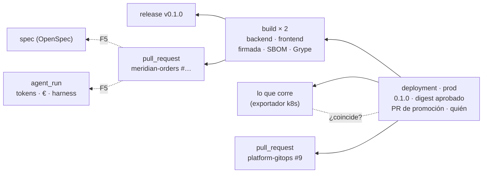
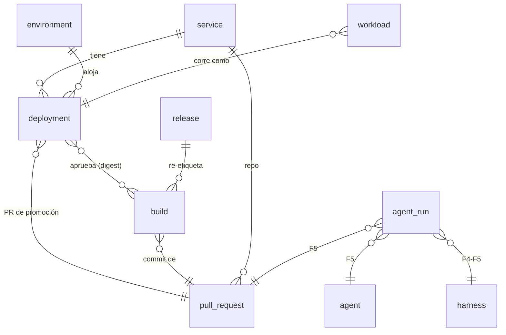
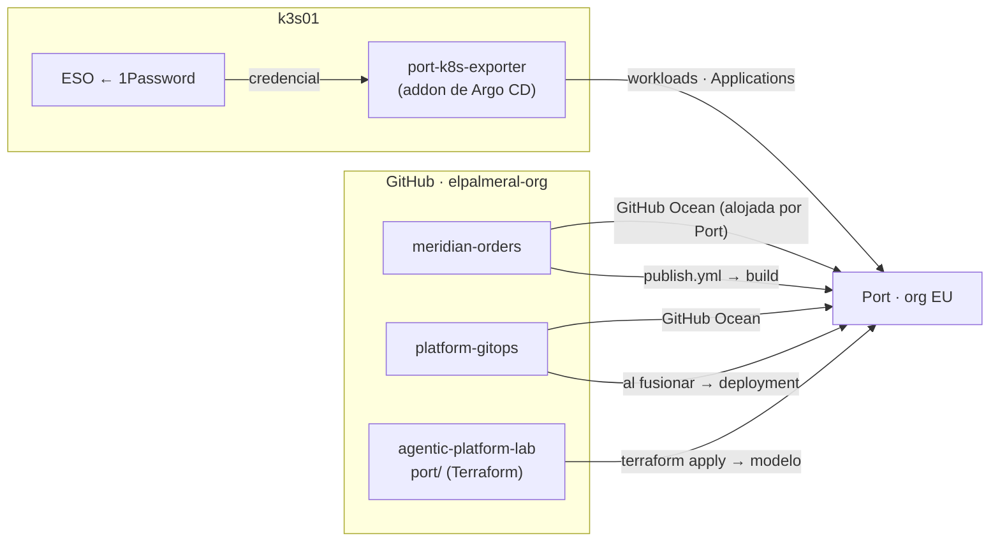

# Port · IDP del laboratorio (fase 3)

> Decisiones: [0005](../adr/0005-port-como-idp.md) Port Free como IDP ·
> [0016](../adr/0016-linaje-mixto-port.md) linaje mixto ·
> [0017](../adr/0017-port-como-codigo-terraform.md) modelo como código con Terraform.

**Para qué en la demo:** el acto 1 ([guion](../demo/README.md)) abre en Port **lo que corre en
prod** y sigue el hilo hasta el PR que lo originó. El acto 3 vuelve a esa misma pantalla para
enseñar el coste de los agentes y las aprobaciones humanas. F3 construye el acto 1 y deja los
enganches de F4-F5.

## 1. El hilo que tiene que poder seguirse

## 2. Modelo

> **27-oct · adopción de la plantilla ([ADR 0018](../adr/0018-adoptar-plantillas-port.md)).** Port ya trae
> `service`, `environment`, `deployment` y `workload` con DORA montado. `deployment` pasa a ser
> **un evento por promoción** (lo que espera DORA) y "lo que hay ahora" en cada entorno es `workload`.

| Blueprint | Origen | Identificador | Qué añadimos / qué lleva | Fuente de datos | Fase |
|---|---|---|---|---|---|
| `service` | plantilla (escaparate) | nombre del repo | — | GitHub Ocean | F3 |
| `environment` | plantilla → **Terraform** | `dev` · `staging` · `prod` | URL, ¿aprobación?, orden | Terraform (entidades fijas) | F3.1 |
| `deployment` | plantilla → **Terraform** | `<servicio>-<entorno>-<tag>` | tag, aprobado por, relación con `environment` y `build`; `environment` = Development/Staging/**Production** y `deploymentStatus` para DORA; el PR de promoción en `github_pull_request` | `platform-gitops` al fusionar (API) | F3.4 |
| `workload` | plantilla → **Terraform** | `<servicio>-<componente>-<entorno>` | versión y digests **aprobados**; *drift* contra `k8s_workload` | `platform-gitops` (API) + exportador | F3.3-F3.4 |
| `build` | **nuevo** | digest | app, tag, firmada, SBOM, procedencia, CVE críticas, commit, PR | `publish.yml` (API) | F3.4 |
| `release` | **nuevo** | `<repo>-vX.Y.Z` | fecha, changelog, `build` | `publish.yml` (release) | F3.4 |
| `githubRepository` · `githubPullRequest` · `githubWorkflowRun`… | plantilla | — | — | GitHub Ocean (*mapping* en Terraform) | F3.2 |
| `k8s_*` · `argocdApplication` · `argocdDeploymentHistory` | plantilla | — | — | `port-k8s-exporter` | F3.3 |
| `dynatrace*` · `awsAccount` · `cloudResource` · `organization` | plantilla (escaparate) | — | — | — | — |
| `harness` · `spec` · `agent` · `agent_run` | nuevos | — | versión, modelo, tokens, coste | F4-F5 | ⚪ |

**Scorecards (acto 1):**

| Scorecard | Reglas | Mensaje |
|---|---|---|
| Cadena de suministro | firmada · SBOM · procedencia · 0 CVE críticas corregibles | "sabemos qué hay dentro y quién lo construyó" |
| Despliegue gobernado | llegó por PR · prod = staging · **lo que corre = lo aprobado** | "nadie se salta el proceso, y si pasa, se ve" |

## 3. Flujo de datos

Todo **saliente** desde el homelab: Port no entra en la LAN.

## 4. Plan de la fase 3

| Paso | Qué | Estado |
|---|---|---|
| [Setup 07](../setup/paso-07-port.md) | Estado de Terraform en S3 + rol OIDC · entorno `port` en GitHub · GitHub Ocean instalada sin recursos por defecto | ✅ |
| F3.1a | Importar `environment`, `deployment` y `workload` y generar su código (`port/imports.tf`) | ✅ (el proveedor conserva las relaciones no declaradas) |
| F3.1b | Ampliarlos, crear `build` y `release`, entidades `dev`/`staging`/`prod` · workflow `port` (`plan` en PR, `apply` en `main`) | ✅ PR #1 (`apply` desde CI: 4 importados, 4 creados, 4 cambiados) |
| F3.2 | *Mapping* de GitHub Ocean como código (`port/github-ocean.tf`): organización, repos, `service`, PR, releases, workflows y ejecuciones | ✅ PR #2 · 1 servicio, 37 PR, 1 release, 106 ejecuciones |
| F3.3 | `port-k8s-exporter` como addon de `platform-gitops` → `k8s_*`, `argocdApplication` y lo que corre en `workload` ([ADR 0019](../adr/0019-exportador-kubernetes-gitops.md)) | ✅ 1 clúster, 10 namespaces, 18 Deployments, 11 Applications, 6 `workload` con `running_image` |
| F3.4a | Acción de plataforma `port-entity` + `port-lineage` en `platform-gitops`: `build` (firma verificada), `workload.approved_digest`, `deployment` Pending ([ADR 0020](../adr/0020-linaje-accion-plataforma-y-argo.md)) | ✅ `platform-gitops` #14 · 6 `workload` con `in_sync=true` y firma verificada |
| F3.4b | `publish.yml` enriquece `build` (SBOM, procedencia, CVE, commit, PR) y enlaza `release` → `build` | ✅ `meridian-orders` #15 · hilo de dev completo sin intervención |
| F3.4c | Webhook de Port (`port/webhook-argocd.tf`, URL solo en el estado y en 1Password) + notificaciones de Argo CD: `deployment` Pending → Success / Failure | ✅ dev, staging y prod en `Success` con la hora real de sincronización |
| F3.4 · relleno | Despliegues de staging y prod `0.1.0` (anteriores al linaje) completados una vez con la acción `port-entity`: PR de promoción #7/#9, aprobador, PR de código #3 e imágenes. DORA: 1 despliegue a prod | ✅ 28-oct |
| F3.5a | Scorecards en Terraform (`port/scorecards.tf`): **Cadena de suministro** y **Corre lo aprobado** por `workload`; **Promoción con puertas** por `deployment` | ✅ |
| F3.5b | Ficha de Meridian Orders para el acto 1: arriba versión por entorno con «corre lo aprobado», las dos scorecards, el último despliegue a prod y una métrica DORA; debajo DORA y fiabilidad del CI. Se diseña en la UI y se importa a Terraform (`port_page`, beta) | ✅ `port/page-service.tf` + `pages/service-entity.json` · plan sin cambios tras importar |
| F3.6 | **Promocionar** como Workflow de Port (`port/workflow-promote.tf`, [ADR 0021](../adr/0021-workflows-port-en-lugar-de-acciones.md)): formulario con servicio, entorno (prod/staging) y release del catálogo, en el menú ⚡ del servicio y en el Self-service hub; un nodo de GitHub lanza `promote.yml`; sin aprobación en Port: la puerta es el entorno `prod` de GitHub | 🟡 preparado (sustituye a la acción clásica) |

## 5. Backlog (fuera de F3 por decisión del 27-oct)

- **ADR y reglas de plataforma como entidades** (`adr`, `guardrail` con las reglas de `gitops-ok`),
  ligadas al servicio. Gancho para arquitectura en el acto 1. Requiere *frontmatter* en las ADR.
- Más servicios reales en el catálogo para que los scorecards comparen.
- Integración de Port con Claude Managed Agents frente a la ruta UHP (ADR 0006): se evalúa en F5.
