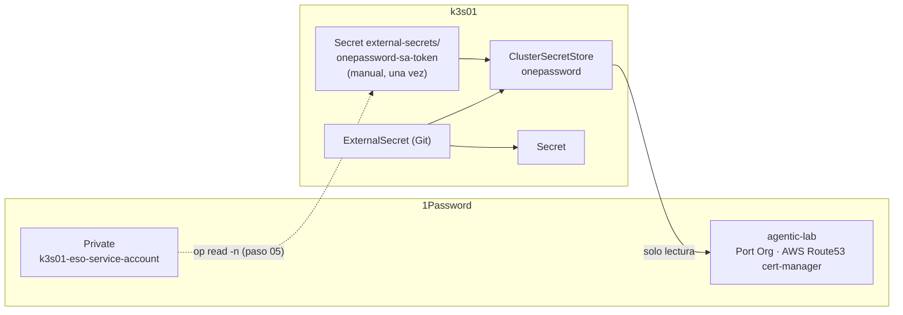

# Secretos · External Secrets + 1Password

> Componente de la **fase 1** · [ADR 0008](../adr/0008-secretos-eso-1password.md) · en marcha desde el
> 24-oct-2026 (pasos 04 y 05).

## Qué hace

Los secretos viven en 1Password (bóveda `agentic-lab`). En Git solo hay **referencias**
(`ExternalSecret` con `<elemento>/<campo>`), y External Secrets Operator crea los `Secret` de
Kubernetes. El único secreto creado a mano es el token de la service account.



| Dato | Valor |
|---|---|
| Chart / versión | `external-secrets` 2.13.0 |
| Proveedor | `onepasswordSDK` (service account, sin servidor Connect) |
| Service account | `k3s01-external-secrets` · `read_items` sobre `agentic-lab` |
| Consumidores | `eso-smoke/port-client-id` (prueba, temporal) · `cert-manager/route53-credentials` |

## Operación

```bash
kubectl get clustersecretstore onepassword                 # Valid
kubectl get externalsecret -A                              # SecretSynced
kubectl -n <ns> annotate externalsecret <nombre> force-sync=$(date +%s) --overwrite   # forzar
```

**Rotar el token de la service account:**

1. Crear una service account nueva (bloque del paso 04.3) y guardar el token en `Private`.
2. `kubectl -n external-secrets delete secret onepassword-sa-token` y recrearlo con `op read -n` (paso 05.3).
3. Revocar la anterior en 1Password.com › Developer › Service accounts.

## Lecciones aprendidas

- `op read` sin `-n` añade un salto de línea: el token queda inválido (*base64 decoding failed*).
- Cada `op service-account create` crea **otra** service account: ejecutarlo una sola vez.
- Nombres de elemento y campo sin caracteres especiales (`·`): las referencias `op://` no los admiten.
- El token nunca dentro de la bóveda que lee la propia service account.
