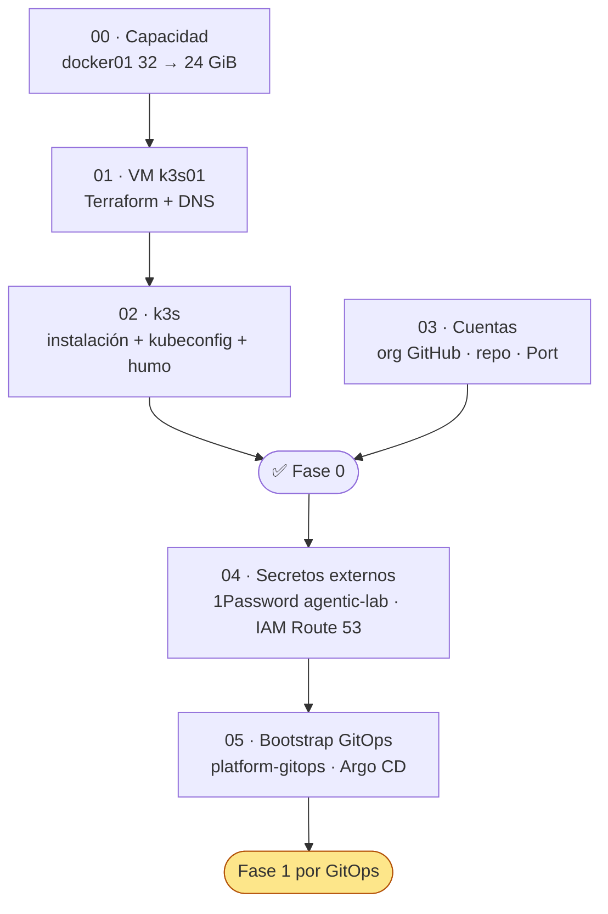

# ① Setup · preparación del entorno

> Lo que se hace **una vez** (o al reconstruir desde cero) para tener dónde montar el lab. Todo es
> manual a propósito: son operaciones sobre el homelab que conviene hacer con la vista puesta.

## Pasos



| Paso | Dónde se ejecuta | Tiempo | Riesgo | Estado |
|---|---|---|---|---|
| [00 · Capacidad](paso-00-capacidad.md) | docker01 y host Proxmox | 30 min + ventana de reinicio | 🟠 reinicia docker01 | ✅ (revisar hugepages del host) |
| [01 · VM k3s01](paso-01-vm-k3s01.md) | Mac (`homelab-terraform`) | 20 min | 🟢 | ✅ (con plantilla 9013) |
| [02 · k3s](paso-02-k3s.md) | Mac + k3s01 | 20 min | 🟢 | 🟡 falta ingress y snapshot |
| [03 · Cuentas](paso-03-cuentas.md) | Navegador + Mac | 30 min | 🟢 | 🟡 falta confirmar 3.1 y 3.3 |
| [04 · Secretos externos](paso-04-secretos-externos.md) | Mac (`op`, `aws`) | 30 min | 🟢 | ✅ |
| [05 · Bootstrap GitOps](paso-05-bootstrap-gitops.md) | Mac + k3s01 | 30 min | 🟢 | ✅ |

## Cómo está escrito cada paso

Todos siguen la misma estructura:

1. **Objetivo** y criterio de hecho.
2. **Prerrequisitos.**
3. **Pasos**, con los comandos listos para copiar.
4. **Verificación.**
5. **Marcha atrás.**
6. **📣 Qué tienes que confirmarme** antes de pasar al siguiente.

## Variables

Los comandos usan variables de `lab.env` (no versionado) para que el repo público no contenga
datos del homelab:

```bash
cp lab.env.example lab.env   # una vez; edita los valores
set -a; source lab.env; set +a
```

## Artefactos

| Fichero | Para qué |
|---|---|
| [`setup/docker01/medir-memoria.sh`](../../setup/docker01/medir-memoria.sh) | Paso 00: consumo real de docker01 |
| [`setup/proxmox/medir-host.sh`](../../setup/proxmox/medir-host.sh) | Paso 00: memoria y fragmentación del host |
| [`setup/proxmox/k3s01.tf`](../../setup/proxmox/k3s01.tf) | Paso 01: VM y DNS (se copia a `homelab-terraform`) |
| [`setup/proxmox/k3s01.tfvars.example`](../../setup/proxmox/k3s01.tfvars.example) | Paso 01: valores de la VM |
| [`setup/k3s/config.yaml.tpl`](../../setup/k3s/config.yaml.tpl) | Paso 02: configuración del servidor k3s |
| [`setup/k3s/smoke-test.yaml.tpl`](../../setup/k3s/smoke-test.yaml.tpl) | Paso 02: prueba de ingress y almacenamiento |
| [`setup/mac/Brewfile`](../../setup/mac/Brewfile) | Paso 02: herramientas en el Mac |
| [`setup/aws/route53-cert-manager-policy.json.tpl`](../../setup/aws/route53-cert-manager-policy.json.tpl) | Paso 04: política IAM mínima para DNS-01 |
