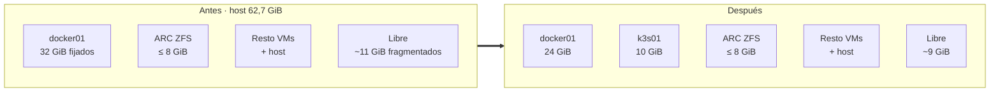
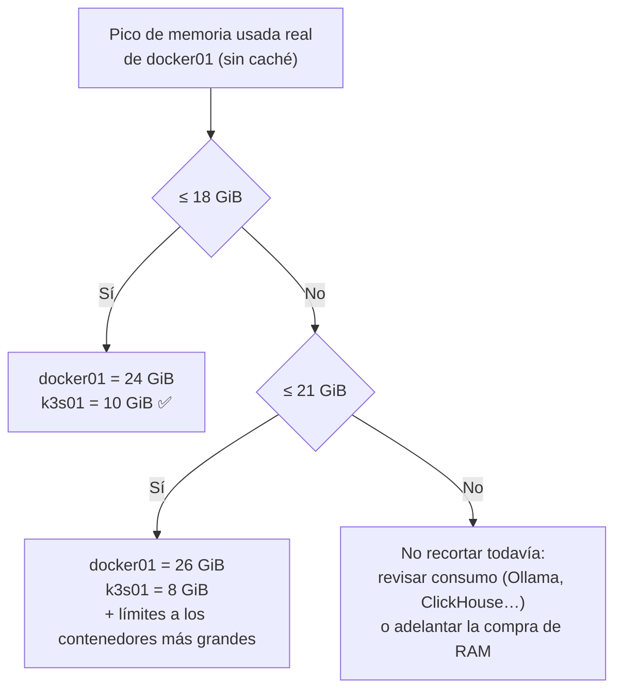

# Paso 00 · Liberar capacidad: docker01 de 32 a 24 GiB

## Objetivo

Liberar **8 GiB de RAM física** en el host para la VM k3s01 sin degradar los servicios de docker01.

**Hecho cuando:** docker01 arranca con 24 GiB, todos sus contenedores están en marcha, la presión
de memoria (PSI) sigue a ~0 y el host tiene ≥ 10 GiB más disponibles que antes.

## Por qué funciona (y por qué hay que medir)

docker01 usa GPU por VFIO y volúmenes por virtiofs. Las dos cosas obligan a QEMU a **reservar y
fijar toda su RAM** al arrancar, la use o no. Por eso recortar docker01 devuelve exactamente esa
memoria al host. Pero si docker01 de verdad usa más de lo que le dejamos, el recorte lo pagan sus
contenedores (OOM). De ahí la medición previa.



## Prerrequisitos

- Acceso `ssh pfj@docker01` (sudo sin contraseña) y `ssh pfj@hyper02` (**no es root**: `sudo` con
  contraseña). Los comandos de una línea contra hyper02 usan `ssh -t` para que `sudo` pueda
  pedirte la contraseña.
- Una **ventana de mantenimiento** de ~10 min: docker01 se apaga y arranca (DNS de la casa, Home
  Assistant si depende de él, Jellyfin, etc.).
- Recomendado: avisar en casa. 🙂

## Pasos

### 0.1 · Medir docker01

```bash
scp setup/docker01/medir-memoria.sh pfj@docker01:/tmp/
ssh pfj@docker01 'sudo bash /tmp/medir-memoria.sh' | tee /tmp/docker01-memoria.txt
```

Si tienes métricas del host en Grafana (obs-stack), mira además el **pico de 30 días** de memoria
usada (sin caché) de docker01. Una foto puntual no ve los picos (Frigate, Ollama cargando un modelo
grande, ClickHouse haciendo *merges*…).

### 0.2 · Medir el host

```bash
scp setup/proxmox/medir-host.sh pfj@hyper02:/tmp/
ssh -t pfj@hyper02 'sudo bash /tmp/medir-host.sh 102' | tee /tmp/host-memoria.txt
```

### 0.3 · Decidir el tamaño



> El margen de 6 GiB es para caché de páginas y picos: Docker con poca caché va lento aunque no
> llegue a OOM.

### 0.4 · Aplicar el recorte

Se hace con `qm` (control total del momento del reinicio) y luego se alinea Terraform para que el
código siga siendo la fuente de verdad.

```bash
# En el host Proxmox
ssh pfj@hyper02
sudo qm shutdown 102 --timeout 300          # apagado limpio del invitado
sudo qm set 102 --memory 24576

# Ayuda a que QEMU encuentre memoria contigua al arrancar
# (la auditoría detectó arranques fallidos por fragmentación)
sync
echo 3 | sudo tee /proc/sys/vm/drop_caches
echo 1 | sudo tee /proc/sys/vm/compact_memory

sudo qm start 102
```

Después, en el Mac:

```bash
cd ~/git/homelab/homelab-terraform
# terraform.tfvars:  docker01_memory_dedicated = 24576
terraform plan      # debe salir "No changes" para docker01
```

> Si el plan muestra cambios **distintos** de la memoria en docker01 (por ejemplo, la
> configuración de virtiofs que no está en Terraform), **no hagas apply**: anótalos y los
> revisamos.

> **Hugepages (riesgo R4 de la auditoría):** docker01 usa hugepages de 1 GiB con NUMA y
> `keep_hugepages` (aplicado el 24-oct, reflejado en `homelab-terraform` mediante las variables
> `docker01_memory_hugepages`, `docker01_memory_keep_hugepages` y `docker01_cpu_numa`).
> Las hugepages que reserva el host al arrancar (`hugepages=` en `/etc/kernel/cmdline`) **solo
> las puede usar una VM con hugepages**: si la reserva es mayor que los 24 GiB de docker01, el
> sobrante no está disponible para k3s01 ni para el ARC. Compruébalo en el host:
>
> ```bash
> # en hyper02 (no hace falta sudo para leer)
> grep -o 'hugepages=[0-9]*' /etc/kernel/cmdline
> grep -E 'HugePages_(Total|Free)' /proc/meminfo   # con docker01 en marcha, Free debería ser 0
> ```
>
> Si `HugePages_Free` > 0, baja `hugepages=` a 24, ejecuta `sudo proxmox-boot-tool refresh` y reinicia el
> host (`sudo reboot`) en la próxima ventana.

## Verificación

```bash
# docker01 arriba y sin contenedores caídos
ssh pfj@docker01 'free -g; cat /proc/pressure/memory; sudo docker ps --filter status=exited --format "{{.Names}}"'

# El host ha ganado memoria disponible
ssh pfj@hyper02 'free -g'
```

- [ ] docker01 ve ~24 GiB (`free -g` → *total* ≈ 23).
- [ ] No hay contenedores en `exited` que antes estuvieran en marcha.
- [ ] El DNS de la casa responde (`dig @<ip-docker01> pve.<dominio>` desde el Mac).
- [ ] PSI de memoria de docker01 a ~0 tras 24 h de uso normal.

## Marcha atrás

```bash
ssh -t pfj@hyper02 'sudo qm shutdown 102 --timeout 300 && sudo qm set 102 --memory 32768 && sudo qm start 102'
# y devolver terraform.tfvars a 32768
```

## 📣 Qué tienes que confirmarme

1. Las salidas de `/tmp/docker01-memoria.txt` y `/tmp/host-memoria.txt` (o un resumen, si
   prefieres no pegarlas enteras).
2. Si tienes el pico de 30 días en Grafana, el valor.
3. Con eso decidimos el tamaño (0.3) **antes** de aplicar 0.4.
