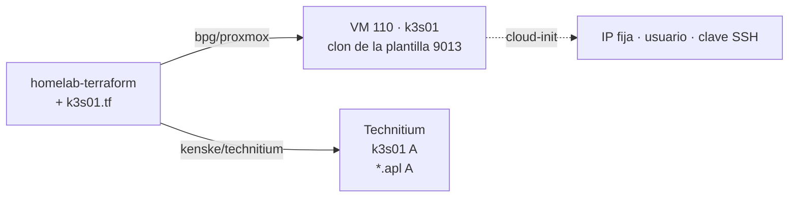

# Paso 01 · VM k3s01 con Terraform

## Objetivo

Crear la VM **k3s01** en Proxmox con el mismo Terraform que gestiona docker01, más su registro DNS y
un *wildcard* para los servicios del lab.

**Hecho cuando:** `ssh <usuario>@k3s01` funciona, la VM ve 6 vCPU / 10 GiB / 80 GB y
`algo.${LAB_SUBDOMAIN}.${LAB_DOMAIN}` resuelve a su IP.



## Prerrequisitos

- ✅ Paso 00 completado (docker01 recortado).
- ✅ **Paso 01a · Plantilla Debian 13 cloud-init (VMID 9013)** creada y probada siguiendo
  `homelab-terraform/templates/debian13/README.md` (repo privado). La plantilla 100 está
  desactualizada y no aplica cloud-init; k3s01 clona de la 9013 mediante `k3s01_template_vm_id`.

  ```mermaid
  flowchart LR
      OP["1Password<br/>pfj@homelab-vms<br/>(clave pública)"] --> SH["crear-plantilla.sh<br/>imagen oficial Debian 13<br/>+ qemu-guest-agent"]
      SH --> T9013[["plantilla 9013"]]
      T9013 -->|probar-plantilla.sh| T9999["VM 9999 de prueba<br/>ssh pfj@… ✔"]
      T9013 -->|"clone (Terraform)"| K3S["k3s01"]
  ```

- Una IP libre **fuera del rango DHCP** del MikroTik. Compruébala:

  ```bash
  ping -c2 -t1 <ip-candidata>      # no debe responder
  ssh <router> '/ip dhcp-server lease print where address=<ip-candidata>'   # sin resultados
  ```

- `lab.env` creado a partir de `lab.env.example`, con `K3S_IP` ya fijada.

## Pasos

### 1.1 · Añadir la VM a `homelab-terraform`

```bash
cp setup/proxmox/k3s01.tf ~/git/homelab/homelab-terraform/k3s01.tf
cd ~/git/homelab/homelab-terraform
```

Añade a `terraform.tfvars` el bloque de [`k3s01.tfvars.example`](../../setup/proxmox/k3s01.tfvars.example)
con tus valores reales (la IP con `/24`).

> El fichero usa las variables `default_*` que ya tienes (nodo, datastore `fastpool`, usuario y
> claves de cloud-init, DNS). La plantilla es la única excepción: usa `k3s01_template_vm_id`
> (9013) en lugar de `default_clone_vm_id` (100), porque cambiar esta última haría que Terraform
> quisiera recrear docker01 y nas01.

### 1.2 · Revisar el orden de arranque de docker01

k3s01 tiene que arrancar **después** de docker01, que sirve el DNS:

```bash
ssh -t pfj@hyper02 'sudo qm config 102 | grep -E "^(onboot|startup)"'
```

Si docker01 no tiene `startup: order=…`, ponle uno menor (por ejemplo `order=10`) desde la GUI o
con `sudo qm set 102 --startup order=10` en hyper02, y deja `k3s01_startup_order = 20`.

### 1.3 · Plan y apply

```bash
terraform init -upgrade      # por si hay versión nueva de los providers
terraform plan -out k3s01.tfplan
```

El plan debe mostrar **solo 3 recursos nuevos** (VM, registro A y wildcard) y **ningún cambio** en
docker01 ni en nas01. Si sale otra cosa, para y lo revisamos.

```bash
terraform apply k3s01.tfplan
```

### 1.4 · Primer arranque

```bash
set -a; source ~/git/homelab/agentic-platform-lab/lab.env; set +a
ssh ${K3S_SSH_USER}@${K3S_FQDN}

# Dentro de k3s01
sudo apt update && sudo apt full-upgrade -y
sudo systemctl is-active qemu-guest-agent
cat /proc/swaps                     # solo la cabecera = sin swap (la imagen cloud no trae)
sudo timedatectl set-timezone Europe/Madrid
sudo reboot
```

Si `/proc/swaps` muestra alguna línea además de la cabecera, desactívala (`sudo swapoff -a` y
comenta la línea en `/etc/fstab`). Ojo: `swapon`/`swapoff` están en `/usr/sbin`, que no está en el
`PATH` de `pfj`; con `sudo` sí se encuentran.

## Verificación

```bash
ssh ${K3S_SSH_USER}@${K3S_FQDN} 'nproc; free -g | head -2; df -h / | tail -1; cat /etc/os-release | head -2'
dig +short ${K3S_FQDN}
dig +short prueba.${LAB_SUBDOMAIN}.${LAB_DOMAIN}     # debe devolver K3S_IP
```

- [ ] 6 CPU, ~10 GiB, ~80 GB de disco.
- [ ] Ambos `dig` devuelven `K3S_IP`.
- [ ] Desde el Mac **por VPN** también resuelve (el túnel usa el DNS de casa).

## Marcha atrás

```bash
terraform destroy -target=technitium_dns_zone_record.lab_wildcard_a \
                  -target=technitium_dns_zone_record.k3s01_a \
                  -target=proxmox_virtual_environment_vm.k3s01
```

## 📣 Qué tienes que confirmarme

1. La IP y el subdominio elegidos (para dejarlos en tu `lab.env`).
2. La salida de la verificación.
3. Si el plan mostró algún cambio inesperado.
