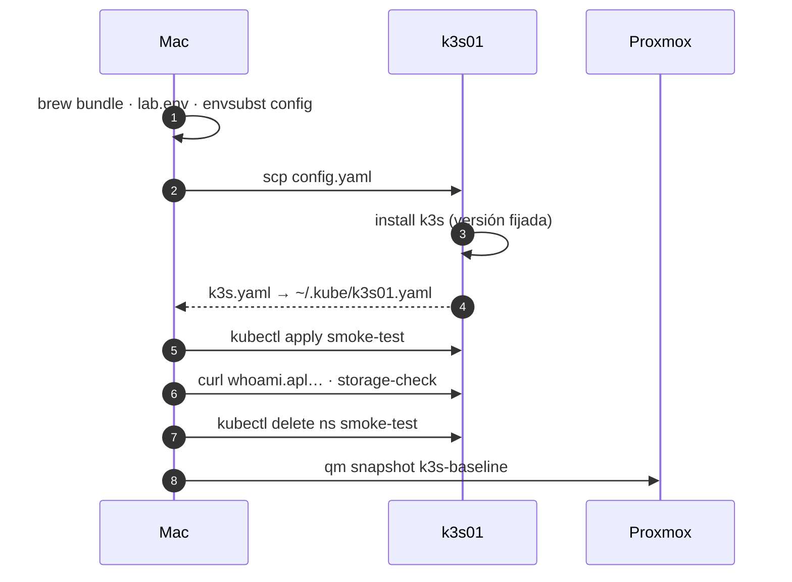

# Paso 02 · Instalar k3s y conectarlo al Mac

## Objetivo

k3s de un nodo funcionando en k3s01, gestionable con `kubectl` desde el Mac, con ingress y
almacenamiento probados y un **snapshot limpio** de la VM al que volver.

**Hecho cuando:** `kubectl --context k3s01 get nodes` da `Ready`, `curl` a
`whoami.${LAB_SUBDOMAIN}.${LAB_DOMAIN}` responde y el snapshot `k3s-baseline` existe.



## Prerrequisitos

- ✅ Paso 01 completado.
- `lab.env` cargado: `set -a; source lab.env; set +a`.

## Pasos

### 2.1 · Herramientas en el Mac

```bash
brew bundle --file=setup/mac/Brewfile
```

### 2.2 · Elegir y fijar la versión de k3s

```bash
curl -s https://update.k3s.io/v1-release/channels \
  | jq -r '.data[] | select(.id=="stable") | .latest'
```

Anota el valor en `lab.env` como `K3S_VERSION=` (por ejemplo `v1.xx.y+k3s1`) y recárgalo. Fijar la
versión hace que reinstalar dé exactamente el mismo clúster.

### 2.3 · Configuración del servidor

```bash
envsubst < setup/k3s/config.yaml.tpl > /tmp/k3s-config.yaml
cat /tmp/k3s-config.yaml                         # revisa que no queden ${...}
scp /tmp/k3s-config.yaml ${K3S_SSH_USER}@${K3S_FQDN}:/tmp/config.yaml
ssh ${K3S_SSH_USER}@${K3S_FQDN} \
  'sudo install -D -m 600 /tmp/config.yaml /etc/rancher/k3s/config.yaml && rm /tmp/config.yaml'
```

Qué fija esa configuración:

| Opción | Por qué |
|---|---|
| `tls-san` | El certificado de la API vale para el FQDN y la IP desde el Mac |
| `secrets-encryption` | Los Secrets se cifran en reposo (útil en la demo de seguridad) |
| `system-reserved` / `kube-reserved` | 1 GiB y 0,5 CPU para el SO y k3s: los pods no ahogan el nodo |
| `eviction-hard` | Kubernetes desaloja pods antes de que el kernel haga OOM |

### 2.4 · Instalar k3s

```bash
ssh ${K3S_SSH_USER}@${K3S_FQDN} \
  "curl -sfL https://get.k3s.io -o /tmp/k3s-install.sh && \
   sudo INSTALL_K3S_VERSION='${K3S_VERSION}' sh /tmp/k3s-install.sh && \
   sudo k3s kubectl get nodes"
```

> Se descarga el script a un fichero en lugar de `curl | sh` para poder revisarlo si quieres
> (`less /tmp/k3s-install.sh`) antes de ejecutarlo.

### 2.5 · kubeconfig en el Mac

```bash
mkdir -p ~/.kube
ssh ${K3S_SSH_USER}@${K3S_FQDN} 'sudo cat /etc/rancher/k3s/k3s.yaml' \
  | sed -e "s#https://127.0.0.1:6443#https://${K3S_FQDN}:6443#" \
        -e 's/: default$/: k3s01/' \
  > ~/.kube/k3s01.yaml
chmod 600 ~/.kube/k3s01.yaml

# Añádelo a tu shell (~/.zshrc) para tener el contexto siempre disponible
export KUBECONFIG="$HOME/.kube/config:$HOME/.kube/k3s01.yaml"
kubectl config use-context k3s01
```

Este fichero es **admin del clúster**: guárdalo también en 1Password y no lo copies a ningún repo.

```bash
op document create ~/.kube/k3s01.yaml --title "k3s01 · kubeconfig admin" --vault "<tu bóveda del homelab>"
```

### 2.6 · Prueba de humo

```bash
envsubst < setup/k3s/smoke-test.yaml.tpl | kubectl apply -f -
kubectl -n smoke-test wait --for=condition=Available deploy/whoami --timeout=120s
kubectl -n smoke-test wait --for=jsonpath='{.status.phase}'=Succeeded pod/storage-check --timeout=120s

curl -s http://whoami.${LAB_SUBDOMAIN}.${LAB_DOMAIN} | head -5   # Hostname: whoami-…
kubectl -n smoke-test logs storage-check                           # ok
kubectl top node

kubectl delete namespace smoke-test
```

> **zsh y las llaves:** si al pegar el `curl` tu terminal lo convierte en `$\{LAB_SUBDOMAIN\}`
> (lo hace `url-quote-magic` de oh-my-zsh), la URL llega literal y `curl -s` no muestra nada.
> Usa la variante sin llaves, que no se escapa:
>
> ```bash
> curl -s "http://whoami.$LAB_SUBDOMAIN.$LAB_DOMAIN" | head -5
> ```

**Resultados de referencia (24-oct-2026, k3s `v1.36.5+k3s1`, sin addons):**

| Métrica | Valor |
|---|---|
| CPU del nodo en reposo | 75-93m (1 %) |
| Memoria del nodo | 752 MiB (8 %) |
| Pods de sistema | coredns, local-path-provisioner, metrics-server, svclb-traefik, traefik (`Running`); `helm-install-traefik*` (`Completed`, normal) |

Sirve para calibrar el presupuesto de la [arquitectura](../01-arquitectura.md#6-presupuesto-de-recursos):
lo previsto para "k3s + Traefik + sistema" eran 1,5 GiB, así que hay ~750 MiB más de margen.

### 2.7 · Snapshot de referencia

Será el punto de partida del *reset* de demos y de cualquier experimento que salga mal.

```bash
ssh -t pfj@hyper02 "sudo qm snapshot ${K3S_VMID} k3s-baseline --description 'k3s ${K3S_VERSION} recién instalado, sin addons'"
```

## Verificación

- [ ] `kubectl get nodes -o wide` → `k3s01 Ready`, versión = `K3S_VERSION`.
- [ ] `kubectl get pods -A` → coredns, traefik, svclb-traefik, local-path-provisioner y metrics-server en `Running`.
- [ ] `curl` a `whoami.…` responde **desde el Mac por VPN**.
- [ ] `storage-check` escribió y leyó `ok`.
- [ ] Snapshot `k3s-baseline` visible en Proxmox.

## Marcha atrás

```bash
ssh ${K3S_SSH_USER}@${K3S_FQDN} 'sudo /usr/local/bin/k3s-uninstall.sh'
# o volver al snapshot:
ssh -t pfj@hyper02 "sudo qm rollback ${K3S_VMID} k3s-baseline"
```

## 📣 Qué tienes que confirmarme

1. La versión de k3s instalada.
2. La salida de `kubectl get pods -A` y de `kubectl top node` (para calibrar el presupuesto de RAM).
3. Que el `curl` funciona por VPN.
