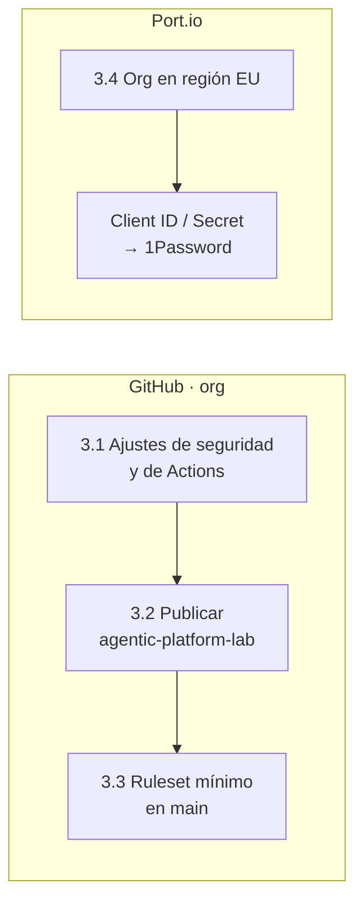

# Paso 03 · Cuentas: org GitHub, repo del lab y Port

> **Independiente** de los pasos 00-02: se puede hacer ya.

## Objetivo

Dejar la org de GitHub endurecida para repos públicos, publicar este repo y crear la organización
en Port **sin integraciones todavía** (llegan en F3, como código).

**Hecho cuando:** `agentic-platform-lab` está publicado en la org, los ajustes de Actions de la org
coinciden con la tabla de 3.1 y las credenciales de Port están en 1Password.



## 3.1 · Ajustes de la org GitHub

En `https://github.com/organizations/${GH_ORG}/settings`:

| Sección | Ajuste | Valor | Por qué |
|---|---|---|---|
| Authentication security | Require two-factor authentication | ✅ | Básico |
| Member privileges | Base permissions | **Read** | Mínimo privilegio |
| Actions › General › Policies | Actions permitidas | **Allow all actions** y **Require actions to be pinned to a full-length commit SHA** | Supply chain: nada se ejecuta por *tag* mutable |
| Actions › General | Fork pull request workflows from outside collaborators | **Require approval for all external contributors** | Repos públicos (ADR 0002) |
| Actions › General | Workflow permissions | **Read repository contents and packages** | El `GITHUB_TOKEN` empieza sin escritura |
| Actions › General | Allow GitHub Actions to create and approve pull requests | ❌ (de momento) | Lo activaremos con una GitHub App en F5 |
| Packages | Package creation | Public ✅ | Imágenes públicas en GHCR |
| Actions › Runner groups | *Default* · Allow public repositories | ❌ (de momento) | Se activa en F5, con las mitigaciones de la ADR 0002 |

> Si la opción de exigir SHA no aparece con ese nombre en tu org, dímelo: GitHub cambia a veces la
> ubicación de estos ajustes.

## 3.2 · Publicar este repo

```bash
cd ~/git/homelab/agentic-platform-lab

# Comprobación de higiene: ninguno de estos ficheros debe salir en la lista
git init -b main
git add .
git status --short | grep -E 'lab\.env$|kubeconfig|tfstate|\.tfvars$' && echo "⛔ PARA" || echo "✅ limpio"

git commit -m "docs: arranque del agentic-platform-lab (visión, arquitectura, ADR, setup 00-03)"
gh repo create ${GH_ORG}/agentic-platform-lab --public --source . --push \
  --description "Lab de Platform Engineering + AIDLC + Harness Engineering (Port, k3s, GitOps, UHP)"
```

## 3.3 · Ruleset mínimo en `main`

En el repo › Settings › Rules › Rulesets › *New branch ruleset*:

- Nombre: `main-proteccion` · Enforcement: **Active** · Target: rama por defecto.
- ✅ Restrict deletions · ✅ Block force pushes.
- (Más adelante, en F2: *Require a pull request* y *Require status checks*.)

## 3.4 · Port.io

1. Entra en <https://app.port.io> (región **EU**; la de EE. UU. es `app.us.port.io`) y crea la
   cuenta con tu correo personal.
2. Crea la organización (por ejemplo, con el mismo nombre que la org de GitHub).
3. **No completes el asistente de integraciones** (GitHub, Kubernetes…): crearía *blueprints*
   automáticos que luego querremos gestionar como código.
4. Menú de usuario › **Credentials** → copia *Client ID* y *Client Secret* a 1Password
   (`Port · <org> · client credentials`).

> Plan Free: 15 asientos, 10K entidades y unas 400-500 ejecuciones de automatización. Lo vigilaremos
> cuando lleguen las acciones *self-service*.

## Verificación

- [ ] `gh repo view ${GH_ORG}/agentic-platform-lab --json visibility -q .visibility` → `PUBLIC`.
- [ ] En GitHub, el README se ve con los diagramas Mermaid renderizados.
- [ ] Ajustes de la org = tabla 3.1.
- [ ] Credenciales de Port en 1Password; Port sin integraciones instaladas.

## 📣 Qué tienes que confirmarme

1. El nombre exacto de la org GitHub.
2. Región y nombre de la organización en Port.
3. Cualquier ajuste de la tabla 3.1 que no hayas encontrado o que hayas dejado distinto.
