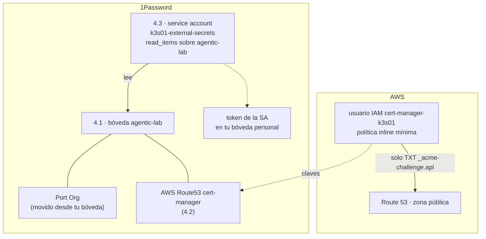

# Paso 04 · Fuentes de secretos: bóveda de 1Password y credencial de Route 53

> Preparación manual de la **fase 1**. Nada de esto toca el clúster todavía: deja listas las dos
> fuentes de las que beberá (ADR [0008](../adr/0008-secretos-eso-1password.md) y
> [0009](../adr/0009-tls-letsencrypt-dns01-route53.md)).

## Objetivo

1. Una bóveda **`agentic-lab`** en 1Password con todo lo que el clúster necesita leer.
2. Una **service account** de 1Password con solo lectura sobre esa bóveda.
3. Un usuario IAM de AWS que **solo** puede escribir el TXT `_acme-challenge.apl.<dominio>`, con sus
   claves guardadas en `agentic-lab`.

**Hecho cuando:** la service account lista solo `agentic-lab`, y las claves de AWS pueden crear y
borrar el TXT del reto pero **no** cualquier otro registro.



## Prerrequisitos

- `op` (CLI de 1Password) con sesión iniciada: `op whoami`.
- AWS CLI con un perfil con permisos de IAM y Route 53: `brew install awscli` si no lo tienes, y
  `export AWS_PROFILE=<tu-perfil>` (o `aws sso login --profile <tu-perfil>`).
- `lab.env` cargado: `cd ~/git/homelab/agentic-platform-lab && set -a; source lab.env; set +a`.

## Pasos

### 4.1 · Bóveda `agentic-lab` y mover `Port Org`

Las service accounts **no pueden leer tus bóvedas personales**, así que lo que use el clúster vive
en una bóveda aparte.

```bash
op vault create agentic-lab --description "Secretos que k3s01 lee mediante External Secrets"
op item move "Port Org" --destination-vault agentic-lab

# Nombres de los campos (no muestra valores): los necesitaremos para el ExternalSecret de Port
op item get "Port Org" --vault agentic-lab --format json | jq -r '.fields[] | "\(.label)\t\(.type)"'
```

Deja en `Port Org` **solo** lo que necesita el clúster, con estos nombres (ESO los referencia por
etiqueta):

| Campo | Tipo | Contenido |
|---|---|---|
| `ClientId` | oculto | *Client ID* de Port (menú de usuario › *Credentials*) |
| `ClientSecret` | oculto | *Client Secret* de Port |

Si el elemento tiene también usuario y contraseña de tu cuenta de Port, sácalos a otro elemento en
tu bóveda personal: lo que está en `agentic-lab` es legible por el clúster.

> Si `op item move` dice que hay varios elementos con ese nombre, añade
> `--current-vault "<bóveda actual>"`.

### 4.2 · Usuario IAM para el reto DNS-01

```bash
# Zona pública del dominio
export R53_ZONE_ID=$(aws route53 list-hosted-zones-by-name --dns-name "$LAB_DOMAIN" \
  --query "HostedZones[?Name=='${LAB_DOMAIN}.'].Id" --output text | sed 's#/hostedzone/##')
echo "$R53_ZONE_ID"            # algo como Z0123456789ABCDEFGHIJ

# Política mínima: solo TXT de _acme-challenge.<subdominio>.<dominio>
envsubst < setup/aws/route53-cert-manager-policy.json.tpl > /tmp/r53-policy.json
jq . /tmp/r53-policy.json      # revisa que no quedan ${...}

aws iam create-user --user-name cert-manager-k3s01 \
  --tags Key=project,Value=agentic-platform-lab
aws iam put-user-policy --user-name cert-manager-k3s01 \
  --policy-name "route53-acme-${LAB_SUBDOMAIN}" \
  --policy-document file:///tmp/r53-policy.json

# Claves directamente a 1Password, sin mostrarlas en pantalla
read -r AK SK < <(aws iam create-access-key --user-name cert-manager-k3s01 \
  --query 'AccessKey.[AccessKeyId,SecretAccessKey]' --output text)
op item create --vault agentic-lab --category "API Credential" \
  --title "AWS Route53 cert-manager" \
  "access_key_id[text]=$AK" "secret_access_key[password]=$SK" \
  "hosted_zone_id[text]=$R53_ZONE_ID" "region[text]=us-east-1"
unset AK SK
```

> Route 53 es un servicio global; cert-manager pide igualmente una región y `us-east-1` es la
> convención.

### 4.3 · Service account de 1Password

Ejecútalo **una sola vez**: cada ejecución crea otra service account con otro token. Con `--raw` el
token va directo a 1Password (bóveda `Private`) sin aparecer en pantalla:

```bash
SA_TOKEN="$(op service-account create "k3s01-external-secrets" --vault "agentic-lab:read_items" --raw)" \
  && op item create --vault Private --category "API Credential" \
       --title "k3s01-eso-service-account" "credential=$SA_TOKEN" >/dev/null \
  && echo "✅ creada y guardada en Private"
unset SA_TOKEN
```

> **Si te equivocas y creas varias:**
>
> 1. En **1Password.com** (la web; la app de escritorio no las gestiona): **Developer** ›
>    pestaña **Service accounts**.
> 2. Abre cada `k3s01-external-secrets` › sección **Token** › **Revoke Token** › escribe el nombre
>    para confirmar › **Revoke Token**. El acceso se corta al instante.
> 3. Borra los elementos de token viejos:
>    `op item list --format json | jq -r '.[] | select(.title|test("ESO|eso-service")) | "\(.id)\t\(.vault.name)\t\(.title)"'`
>    y después `op item delete <ID>` para cada uno.
> 4. Vuelve a ejecutar el bloque anterior **una vez**.

Ese token es el **único secreto que meteremos a mano en el clúster** (paso 05).

> Usa nombres de elemento y de campo **sin caracteres especiales** (`·`, acentos…): las
> referencias `op://bóveda/elemento/campo` que usan `op read` y External Secrets no los admiten.

> ⚠️ **No lo guardes en `agentic-lab`**: la service account podría leer su propio token y lo vería
> cualquiera con acceso compartido a esa bóveda. Si ya está ahí:
> `op item move "k3s01-eso-service-account" --current-vault agentic-lab --destination-vault Private`

> Si tu plan de 1Password no permite service accounts, el comando lo dirá. En ese caso, avísame:
> la alternativa es SOPS + age (ADR 0008).

## Verificación

```bash
# 1 · La service account solo ve agentic-lab.
#     Si el op read falla, NO se ejecuta nada: si no, op usaría tu sesión normal y la prueba engañaría.
SA_TOKEN="$(op read 'op://Private/k3s01-eso-service-account/credential')" || echo "⛔ no se pudo leer el token"
[ -n "$SA_TOKEN" ] && OP_SERVICE_ACCOUNT_TOKEN="$SA_TOKEN" op vault list                       # → solo agentic-lab
[ -n "$SA_TOKEN" ] && OP_SERVICE_ACCOUNT_TOKEN="$SA_TOKEN" op item list --vault agentic-lab --format json | jq -r '.[].title'
unset SA_TOKEN
# → Port Org, AWS Route53 cert-manager

# 2 · Las claves de AWS solo tocan el TXT del reto (espera ~10 s a que IAM propague las claves)
#     Todo dentro de ( … ): las credenciales y variables no salen de la subshell,
#     así que tu perfil de AWS queda como estaba.
(
  export AWS_PAGER=""          # sin pager: `less` ocultaría la salida y se comería las líneas siguientes
  unset AWS_PROFILE AWS_SESSION_TOKEN
  export AWS_ACCESS_KEY_ID=$(op read "op://agentic-lab/AWS Route53 cert-manager/access_key_id")
  export AWS_SECRET_ACCESS_KEY=$(op read "op://agentic-lab/AWS Route53 cert-manager/secret_access_key")
  R53_ZONE_ID=$(op read "op://agentic-lab/AWS Route53 cert-manager/hosted_zone_id")
  cb() { printf '{"Changes":[{"Action":"%s","ResourceRecordSet":{"Name":"%s","Type":"TXT","TTL":60,"ResourceRecords":[{"Value":"\\"prueba\\""}]}}]}' "$1" "$2"; }

  aws route53 change-resource-record-sets --hosted-zone-id "$R53_ZONE_ID" \
    --change-batch "$(cb UPSERT "_acme-challenge.$LAB_SUBDOMAIN.$LAB_DOMAIN")" --query ChangeInfo.Status   # ✅ "PENDING"
  sleep 30; dig +short TXT "_acme-challenge.$LAB_SUBDOMAIN.$LAB_DOMAIN" @1.1.1.1                          # → "prueba"
  aws route53 change-resource-record-sets --hosted-zone-id "$R53_ZONE_ID" \
    --change-batch "$(cb DELETE "_acme-challenge.$LAB_SUBDOMAIN.$LAB_DOMAIN")" --query ChangeInfo.Status   # ✅ "PENDING"
  aws route53 change-resource-record-sets --hosted-zone-id "$R53_ZONE_ID" \
    --change-batch "$(cb UPSERT "prueba.$LAB_DOMAIN")" --query ChangeInfo.Status                           # ⛔ AccessDenied
)
```

- [ ] La service account lista exactamente los dos elementos (si salen más, el `op read` falló y
      `op` ha usado tu sesión normal: revisa la referencia `op://…`).
- [ ] Las dos primeras órdenes de Route 53 devuelven `"PENDING"`, `dig` ve el TXT `"prueba"` y la
      tercera orden da `AccessDenied`.
- [ ] Si la **primera** ya da `AccessDenied`, revisa la política aplicada (con tu perfil de
      administrador): `aws iam get-user-policy --user-name cert-manager-k3s01 --policy-name "route53-acme-$LAB_SUBDOMAIN" --query PolicyDocument`

## Marcha atrás

```bash
aws iam list-access-keys --user-name cert-manager-k3s01 --query 'AccessKeyMetadata[].AccessKeyId' --output text \
  | xargs -n1 -I{} aws iam delete-access-key --user-name cert-manager-k3s01 --access-key-id {}
aws iam delete-user-policy --user-name cert-manager-k3s01 --policy-name "route53-acme-${LAB_SUBDOMAIN}"
aws iam delete-user --user-name cert-manager-k3s01
# En 1Password: borrar la service account (Developer › Service accounts) y la bóveda si ya no se usa
```

## 📣 Qué tienes que confirmarme

1. La salida de los **nombres de campo** de `Port Org` (4.1). No tiene valores secretos.
2. Que la verificación da exactamente los resultados esperados (✅ ✅ ⛔).
3. Si `op service-account create` funcionó con tu plan.
