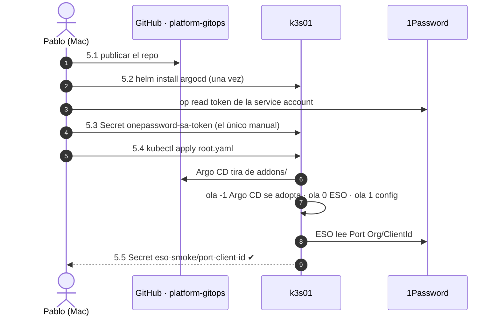
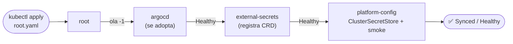

# Paso 05 · Bootstrap GitOps: `platform-gitops`, Argo CD y External Secrets

> Último paso **manual** de la fase 1. A partir de aquí, el clúster solo cambia por PR en
> [`platform-gitops`](https://github.com/elpalmeral-org/platform-gitops).

## Objetivo

Argo CD instalado y **gestionándose a sí mismo** desde `platform-gitops`, External Secrets leyendo
de la bóveda `agentic-lab` y una prueba de humo que trae un campo de `Port Org` a un `Secret`.

**Hecho cuando:** las cuatro Application (`root`, `argocd`, `external-secrets`,
`platform-config`) están `Synced` y `Healthy`, el `ClusterSecretStore` está `Ready` y existe el
`Secret` `eso-smoke/port-client-id` con la clave `client_id`.



## Prerrequisitos

- ✅ Paso 02: `kubectl config current-context` → `k3s01`.
- ✅ Paso 04: token en `op://Private/k3s01-eso-service-account/credential` y **sin** elementos de
  token en `agentic-lab`.
- `helm` y `argocd` instalados (Brewfile).

## Pasos

### 5.1 · Publicar `platform-gitops`

El contenido inicial ya está en `~/git/homelab/platform-gitops`.

```bash
cd ~/git/homelab/platform-gitops
git init -b main
git add .
git status --short | grep -Ei 'secret|token|\.env' && echo "⛔ revisa antes de subir" || echo "✅ limpio"
git commit -m "feat: bootstrap app-of-apps (Argo CD autogestionado, External Secrets, ClusterSecretStore 1Password)"
gh repo create elpalmeral-org/platform-gitops --public --source . --push \
  --description "Estado deseado del clúster k3s01 del agentic-platform-lab (Argo CD app-of-apps)"
```

Añade el mismo ruleset mínimo que en el paso 03.3 (bloquear borrado y *force push* en `main`).

### 5.2 · Instalar Argo CD (una sola vez)

```bash
helm repo add argo https://argoproj.github.io/argo-helm && helm repo update argo
helm upgrade --install argocd argo/argo-cd --version 10.10.5 \
  --namespace argocd --create-namespace \
  -f bootstrap/argocd-values.yaml --wait --timeout 10m
kubectl -n argocd get pods
```

> La versión y los valores son **los mismos** que en `addons/argocd.yaml`: cuando Argo CD se
> sincronice a sí mismo no verá diferencias y simplemente adoptará la instalación.

### 5.3 · El único secreto manual: token de la service account

```bash
kubectl create namespace external-secrets
op read -n 'op://Private/k3s01-eso-service-account/credential' \
  | kubectl -n external-secrets create secret generic onepassword-sa-token --from-file=token=/dev/stdin
kubectl -n external-secrets get secret onepassword-sa-token -o jsonpath='{.data}' | jq 'keys'   # ["token"]
```

El token va de 1Password al clúster por una tubería: no aparece en pantalla ni en el historial.

> ⚠️ **`-n` es imprescindible:** sin él, `op read` añade un salto de línea final, el `Secret` guarda
> el token con `\n` y el `ClusterSecretStore` queda en `InvalidProviderConfig`.

### 5.4 · Aplicar la Application raíz

```bash
kubectl apply -f bootstrap/root.yaml
kubectl -n argocd get applications -w      # Ctrl+C cuando las cuatro estén Synced/Healthy (2-5 min)
```



### 5.5 · Comprobar External Secrets

```bash
kubectl get clustersecretstore onepassword                     # READY True · STATUS Valid
kubectl -n eso-smoke get externalsecret port-client-id         # READY True · STATUS SecretSynced
kubectl -n eso-smoke get secret port-client-id -o jsonpath='{.data}' | jq 'keys'   # ["client_id"]
```

No imprimas el valor: basta con ver que la clave existe.

### 5.6 · Entrar en la UI de Argo CD (provisional, sin ingress)

Hasta la ola 4 (ingress HTTPS) se entra por *port-forward*:

```bash
# Contraseña inicial de admin → a 1Password, sin mostrarla
PW="$(kubectl -n argocd get secret argocd-initial-admin-secret -o jsonpath='{.data.password}' | base64 -d)" \
  && op item create --vault Private --category Login --title "argocd-k3s01-admin" \
       username=admin "password=$PW" >/dev/null && echo "✅ guardada en Private"
unset PW

kubectl -n argocd port-forward svc/argocd-server 8080:80
# → http://localhost:8080  (admin / contraseña de 1Password)
```

Cuando entres, cambia la contraseña en *User Info* (y actualízala en 1Password) y borra el secreto
inicial: `kubectl -n argocd delete secret argocd-initial-admin-secret`.

## Verificación

- [ ] `kubectl -n argocd get applications` → 4 Application `Synced` + `Healthy`.
- [ ] `ClusterSecretStore onepassword` → `Valid`.
- [ ] `Secret eso-smoke/port-client-id` con la clave `client_id`.
- [ ] En la UI, `argocd` aparece gestionándose a sí mismo.
- [ ] `kubectl top node` (para el presupuesto de RAM).

## Problemas típicos

| Síntoma | Causa probable | Qué hacer |
|---|---|---|
| `platform-config` en `Unknown`/`SyncFailed` al principio | Los CRD de ESO aún no estaban | Esperar: tiene reintentos (hasta 5 min) |
| `ClusterSecretStore` `InvalidProviderConfig` | Token con salto de línea final (`op read` sin `-n`) o service account revocada | Ver si acaba en `0a`: `kubectl -n external-secrets get secret onepassword-sa-token -o jsonpath='{.data.token}' \| base64 -d \| tail -c 2 \| xxd`. Borrar el secreto, repetir 5.3 con `op read -n` y forzar la revisión: `kubectl annotate clustersecretstore onepassword force-sync=$(date +%s) --overwrite` |
| `root` y `platform-config` en `Degraded` | Es la consecuencia del anterior: la prueba de humo no puede sincronizar | Se resuelve solo al arreglar el `ClusterSecretStore` |
| `ExternalSecret` `SecretSyncedError` · *item not found* | Nombre del elemento o del campo | Debe ser exactamente `Port Org/ClientId` en `agentic-lab` |
| `argocd` `OutOfSync` permanente | Valores distintos entre el bootstrap y `addons/argocd.yaml` | Comparar versión y `valueFiles` |

## Marcha atrás

```bash
kubectl delete -f bootstrap/root.yaml          # sin finalizer: no borra en cascada
helm uninstall argocd -n argocd
helm uninstall external-secrets -n external-secrets 2>/dev/null
kubectl delete namespace argocd external-secrets eso-smoke
# o volver al snapshot k3s-baseline del paso 02
```

## 📣 Qué tienes que confirmarme

1. Salida de `kubectl -n argocd get applications`.
2. Las tres líneas de 5.5.
3. `kubectl top node` con todo esto en marcha.
