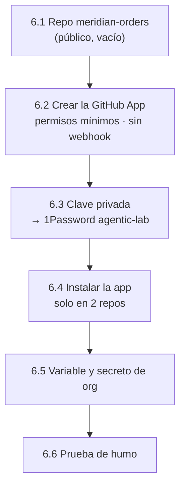

# Paso 06 · GitHub App `elpalmeral-platform-bot` y repo `meridian-orders`

> Preparación manual de la **fase 2** ([ADR 0014](../adr/0014-github-app-platform-bot.md)).

## Objetivo

Una GitHub App de la org con permisos mínimos, instalada **solo** en `platform-gitops` y
`meridian-orders`, cuya clave privada vive en 1Password y como secreto de la org.

**Hecho cuando:** un workflow de prueba en `meridian-orders` obtiene un token de la app y lista el
contenido de `platform-gitops` con él.



## Prerrequisitos

- `gh auth status` con permisos de administrador de la org (`gh auth refresh -s admin:org` si hace falta).
- `op` con sesión iniciada.

## Pasos

### 6.1 · Repo vacío

```bash
gh repo create elpalmeral-org/meridian-orders --public \
  --description "Meridian Orders: app de ejemplo (FastAPI + Angular) del agentic-platform-lab"
```

Añade el mismo ruleset mínimo de `main` que en el paso 03.3.

### 6.2 · Crear la GitHub App

En `https://github.com/organizations/elpalmeral-org/settings/apps/new`:

| Campo | Valor |
|---|---|
| GitHub App name | `elpalmeral-platform-bot` (si está cogido, añade un sufijo y anótalo) |
| Homepage URL | `https://github.com/elpalmeral-org/agentic-platform-lab` |
| Webhook › Active | ❌ desmarcado |
| Repository permissions › **Contents** | Read and write |
| Repository permissions › **Pull requests** | Read and write |
| Repository permissions › Metadata | Read-only (obligatorio) |
| Resto de permisos | No access |
| Where can this GitHub App be installed? | **Only on this account** |

Pulsa **Create GitHub App** y copia el **App ID** y el **Client ID** que aparecen arriba en dos
variables de tu terminal. Ninguno de los dos es secreto, y los usan los pasos siguientes:

```bash
APP_ID=123456                     # ← sustituye: es un número
CLIENT_ID=Iv23XXXXXXXXXXXXXXXX    # ← sustituye: empieza por Iv
[[ "$APP_ID" =~ ^[0-9]+$ && "$CLIENT_ID" == Iv* ]] && echo "✅ valores con buena pinta" || echo "⛔ revisa APP_ID / CLIENT_ID"
```

> ⚠️ No los confundas: la *action* de la prueba de humo usa el **Client ID**. Si recibe el App ID
> (o un marcador sin sustituir), falla con `'Issuer' claim ('iss') must be an Integer`.

> Permisos para fases futuras (Issues, Checks, Actions…) se añadirán cuando hagan falta: cada
> ampliación exige reaprobar la instalación, y así queda registrado.

### 6.3 · Clave privada a 1Password

En la página de la app › **Private keys** › **Generate a private key**: se descarga un `.pem`.

```bash
PEM=$(ls -t ~/Downloads/elpalmeral-platform-bot*.private-key.pem | head -1); echo "$PEM"
op item create --vault agentic-lab --category "API Credential" --title "github-app-platform-bot" \
  "app_id[text]=$APP_ID" "client_id[text]=$CLIENT_ID" "private_key[password]=$(cat "$PEM")" >/dev/null \
  && echo "✅ en 1Password"
rm "$PEM"                      # no dejes la clave en Descargas
```

Guarda el elemento en `agentic-lab` (y no en `Private`) porque más adelante la usará el clúster
(Port y los agentes) a través de External Secrets.

### 6.4 · Instalar la app solo en dos repos

Página de la app › **Install App** › `elpalmeral-org` › **Only select repositories** →
`platform-gitops` y `meridian-orders` › **Install**.

### 6.5 · Variable y secreto de la org

En GitHub Free, los secretos de org están disponibles para **repos públicos**, que son todos los
del lab.

```bash
gh variable set PLATFORM_BOT_CLIENT_ID --org elpalmeral-org --visibility all --body "$CLIENT_ID"
op read -n "op://agentic-lab/github-app-platform-bot/private_key" \
  | gh secret set PLATFORM_BOT_PRIVATE_KEY --org elpalmeral-org --visibility all
gh variable list --org elpalmeral-org; gh secret list --org elpalmeral-org
```

### 6.6 · Prueba de humo

Un workflow temporal en `meridian-orders` que pide un token de la app y lee `platform-gitops`:

```bash
mkdir -p /tmp/meridian-smoke/.github/workflows && cd /tmp/meridian-smoke
cat > .github/workflows/app-token-smoke.yml <<'EOF'
name: app-token-smoke
on: workflow_dispatch
permissions: {}
jobs:
  smoke:
    runs-on: ubuntu-latest
    steps:
      - id: app
        uses: actions/create-github-app-token@64ab729a6294000f5aa4a4bc0b73d1f32bc45510 # v3.3.0
        with:
          client-id: ${{ vars.PLATFORM_BOT_CLIENT_ID }}
          private-key: ${{ secrets.PLATFORM_BOT_PRIVATE_KEY }}
          owner: elpalmeral-org
          repositories: platform-gitops
      - run: gh api repos/elpalmeral-org/platform-gitops/contents --jq '.[].name'
        env:
          GH_TOKEN: ${{ steps.app.outputs.token }}
EOF
git init -b main && git add . && git commit -m "chore: prueba temporal del token de la GitHub App"
git remote add origin git@github.com:elpalmeral-org/meridian-orders.git && git push -u origin main   # SSH, como el resto de repos
gh workflow run app-token-smoke.yml -R elpalmeral-org/meridian-orders
sleep 20; gh run watch -R elpalmeral-org/meridian-orders "$(gh run list -R elpalmeral-org/meridian-orders -L1 --json databaseId -q '.[0].databaseId')"
```

> La *action* va fijada por SHA (v3.3.0), como exige la org desde el paso 03.1. En la v3 se usa
> `client-id` (el `app-id` está obsoleto). El workflow es temporal: en F2.1 se sustituye por el
> código real.

## Verificación

- [ ] `gh variable get PLATFORM_BOT_CLIENT_ID --org elpalmeral-org` empieza por `Iv`.
- [ ] El run termina en verde y lista `README.md`, `addons`, `bootstrap`, `config`.
- [ ] `gh api orgs/elpalmeral-org/installations --jq '.installations[].app_slug'` muestra la app.
- [ ] No queda ningún `.pem` en `~/Downloads`.

## Problemas típicos

| Síntoma | Causa | Qué hacer |
|---|---|---|
| `git push` pide usuario y contraseña | Remoto HTTPS en lugar de SSH | `git remote set-url origin git@github.com:elpalmeral-org/meridian-orders.git` |
| `'Issuer' claim ('iss') must be an Integer` | La variable tiene el App ID o un marcador, no el Client ID | `gh variable set PLATFORM_BOT_CLIENT_ID … --body "$CLIENT_ID"` |
| `A JSON web token could not be decoded` | Clave privada incompleta en el secreto | Repetir el `op read -n … \| gh secret set` |
| `Not Found` al pedir el token | App no instalada en uno de los repos | Revisar 6.4 |

## Marcha atrás

Org › Settings › GitHub Apps › la app › **Uninstall**; después, en la app, **Delete GitHub App**;
`gh secret delete PLATFORM_BOT_PRIVATE_KEY --org elpalmeral-org`;
`gh variable delete PLATFORM_BOT_CLIENT_ID --org elpalmeral-org`.

## 📣 Qué tienes que confirmarme

1. El nombre final de la app (por si llevaba sufijo), su App ID y su Client ID (no son secretos).
2. Que la prueba de humo terminó en verde.
3. Si al ejecutar el workflow apareció algún error de política de *actions* de la org.
